# Learn C# 💜

<div align="center">

[](https://opensource.org/licenses/MIT)
[](https://dotnet.microsoft.com/)
[](https://learn.microsoft.com/dotnet/csharp/)
[](https://github.com/TheLearningHubOrg/learn-c-sharp/actions/workflows/ci.yml)
[](https://github.com/TheLearningHubOrg/learn-c-sharp/releases)
[](https://xunit.net/)
[](https://github.com/dotnet/runtime)

**From your first `dotnet new` to staff-level C#: the language, the runtime underneath it, and the engineering habits that keep .NET services fast and correct.**  
Types and memory, records and pattern matching, generics and generic math, `Span<T>`, async and channels, the garbage collector, diagnostics, Native AOT and 40+ staff interview questions.

[Getting Started](#1-stage-1-toolchain-runtime--c-fundamentals) • [Types & LINQ](#2-stage-2-methods-types-collections--linq) • [Generics & Memory](#3-stage-3-oop-generics-memory--error-handling) • [Async](#4-stage-4-async-concurrency--parallelism) • [I/O & Testing](#5-stage-5-io-serialization-http-data--testing) • [Performance](#6-stage-6-performance-diagnostics-security--deployment) • [Interview Prep](#7-stage-7-staff-c-engineer-interview-handbook--cheatsheet)

<br/>

<a href="https://www.buymeacoffee.com/manthanank">
  
</a>

</div>

---

Every example in this guide is written in **C#**, and the starter project is a C# 14 / .NET 10 ASP.NET Core minimal API tested with xUnit. C# is the language the .NET runtime, its base class library and nearly all of its ecosystem are written in and documented for, so it is the only sensible choice for a guide about C# itself. Shell commands use the cross-platform `dotnet` CLI.

## 🗺️ 7-Stage Pedagogical Roadmap


| Stage | Focus Domain | Core Concepts & Engineering Outcomes |
| :--- | :--- | :--- |
| **Stage 1** | **Toolchain, Runtime & C# Fundamentals** | `dotnet new/build/run/test`, `global.json`, `.csproj` and `Directory.Build.props`, file-based apps (`dotnet run app.cs`), Roslyn to IL to tiered JIT, built-in types, `checked`, `decimal` vs `double`, value vs reference types, nullable reference types, raw string literals, indices and ranges. Outcome: build, run and read the starter API. |
| **Stage 2** | **Methods, Types, Collections & LINQ** | `ref`/`out`/`in`, `params` collections, properties with `init`, `required` and the C# 14 `field` keyword, primary constructors, `record` and `record struct`, tuples, switch expressions with property and list patterns, `List<T>`, `Dictionary<TKey,TValue>`, `FrozenDictionary`, collection expressions, delegates and closures, deferred LINQ, C# 14 extension members. Outcome: model a domain with records and query it with LINQ. |
| **Stage 3** | **OOP, Generics, Memory & Error Handling** | `abstract`/`virtual`/`sealed`, default interface methods, generic constraints including `allows ref struct`, variance (`out T`, `in T`), static abstract members and `INumber<T>`, exception filters, the Result pattern, `IDisposable`/`IAsyncDisposable`, `StructLayout`, `[InlineArray]`, `readonly struct`, `ref struct`, `Span<T>`, `Memory<T>`, `ArrayPool<T>`. Outcome: write allocation-free parsers and generic numeric code. |
| **Stage 4** | **Async, Concurrency & Parallelism** | The `async` state machine, `Task` vs `ValueTask`, `IAsyncEnumerable<T>` with `[EnumeratorCancellation]`, `AsyncLocal<T>`, ThreadPool work stealing, `Interlocked`, the C# 13 `Lock` type, bounded `Channel<T>` with backpressure. Outcome: build pipelines that neither deadlock nor starve the pool. |
| **Stage 5** | **I/O, Serialization, HTTP, Data & Testing** | Expression trees and LINQ providers, source-generated `System.Text.Json`, streams, `HttpClient` and `IHttpClientFactory`, EF Core, minimal APIs, xUnit and `WebApplicationFactory`. Outcome: ship a tested HTTP service with a data layer. |
| **Stage 6** | **Performance, Diagnostics, Security & Deployment** | GC generations, LOH and POH, Server GC and DATAS, BenchmarkDotNet with `[MemoryDiagnoser]`, `ActivitySource` and `Meter` for OpenTelemetry, `dotnet-counters`/`dotnet-trace`/`dotnet-dump`, Native AOT and trimming, container images. Outcome: measure, tune and deploy a service. |
| **Masterclasses** | **Zero-allocation pipelines and runtime internals** | End-to-end builds that combine spans, pooling, channels and structured shutdown. |
| **Stage 7** | **Staff Interview Handbook** | 40+ interview Q&As across core concepts, internals, architecture and production scenarios, plus a one-page cheatsheet. |

---

## 🆕 .NET and C# Versions, What's New & Migration

C# and .NET ship together every November. Even-numbered .NET releases are Long Term Support (LTS, three years of patches); odd-numbered ones are Standard Term Support (STS). Starting with .NET 9, STS releases get 24 months instead of 18, so .NET 8 and .NET 9 both reach end of support on the same day. This guide targets **.NET 10 (LTS) with C# 14**, the current stable release. .NET 11 with C# 15 is in release-candidate builds at the time of writing and is due in November 2026.

### V.1 Release Timeline

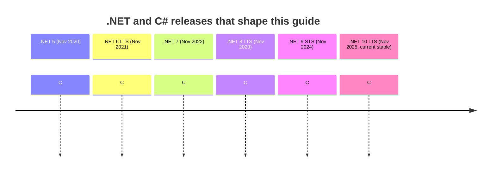

### V.2 Compatibility Matrix

| .NET | C# (default) | Released | End of support | Support type | Container tags | Notes |
| --- | --- | --- | --- | --- | --- | --- |
| .NET 10 | C# 14 | November 2025 | November 2028 | LTS | `sdk:10.0`, `aspnet:10.0`, `runtime-deps:10.0` | Target for new work. This repo's starter. |
| .NET 9 | C# 13 | November 2024 | November 10, 2026 | STS (24 months) | `sdk:9.0`, `aspnet:9.0` | Move to 10 now; support ends with .NET 8's. |
| .NET 8 | C# 12 | November 2023 | November 10, 2026 | LTS | `sdk:8.0`, `aspnet:8.0` | Most common production baseline in 2024-2026. Plan the move to 10. |
| .NET 7 | C# 11 | November 2022 | May 2024 | STS | (unsupported) | Upgrade. |
| .NET 6 | C# 10 | November 2021 | November 2024 | LTS | (unsupported) | Upgrade. |
| .NET Framework 4.8.1 | C# 7.3 | August 2022 | Tied to the Windows release | Windows component | `mcr.microsoft.com/dotnet/framework/*` | Windows only, no new features. |

The compiler picks the language version from the target framework: `net10.0` means C# 14. Setting `<LangVersion>latest</LangVersion>` on an older target framework compiles, but features that need runtime support (default interface methods, generic math, `ref` fields, `params` spans) fail or behave differently, so keep the default.

### V.3 What's New in C# 14 and .NET 10

#### Extension members

Before C# 14 you could only add extension *methods*. Extension blocks add properties, static members and operators, and group everything for one receiver type.

```csharp
// Before: methods only, the receiver repeated on every member.
public static class StringExtensionsOld
{
    public static bool IsBlank(this string text) => string.IsNullOrWhiteSpace(text);
}

// C# 14: an extension block. Instance members use the receiver name; static members need no receiver.
public static class StringExtensions
{
    extension(string text)
    {
        public bool IsBlank => string.IsNullOrWhiteSpace(text);   // extension property
        public string Truncate(int max) => text.Length <= max ? text : text[..max];
    }

    extension(string)
    {
        public static string Repeat(char c, int count) => new(c, count); // called as string.Repeat('-', 10)
    }
}
```

#### The `field` keyword

An auto-property with logic in one accessor no longer needs a hand-written backing field.

```csharp
// Before
public class CustomerOld
{
    private string _name = "";
    public string Name
    {
        get => _name;
        set => _name = value?.Trim() ?? throw new ArgumentNullException(nameof(value));
    }
}

// C# 14: `field` is the compiler-generated backing field.
public class Customer
{
    public string Name
    {
        get;
        set => field = value?.Trim() ?? throw new ArgumentNullException(nameof(value));
    } = "";
}
```

#### Null-conditional assignment

```csharp
Order? order = FindOrder(42);

// Before
if (order is not null)
{
    order.ShippedAt = DateTimeOffset.UtcNow;
}

// C# 14: the right-hand side is evaluated only when order is not null.
order?.ShippedAt = DateTimeOffset.UtcNow;

static Order? FindOrder(int id) => id > 0 ? new Order() : null;

public sealed class Order
{
    public DateTimeOffset? ShippedAt { get; set; }
}
```

#### First-class span conversions

Arrays, `Span<T>` and `ReadOnlySpan<T>` now convert implicitly in more places, including extension-method receivers and generic type inference, so span-based APIs in `MemoryExtensions` can be called directly on arrays.

```csharp
int[] numbers = [5, 3, 9, 1];

// Before: explicit AsSpan() to reach the span extension.
numbers.AsSpan().Sort();

// C# 14: the array converts to Span<int> for the extension call. Sorts in place, no allocation.
numbers.Sort();
```

#### Smaller C# 14 features

| Feature | Example | Why it matters |
| --- | --- | --- |
| `nameof` with unbound generics | `nameof(List<>)` gives `"List"` | No more dummy type arguments in logging and exceptions. |
| Modifiers on implicitly typed lambda parameters | `TryParse<int> p = (text, out result) => int.TryParse(text, out result);` | `ref`/`out`/`in` without writing the types. |
| Partial constructors and events | `public partial MyType(int x);` | Source generators can implement constructors and events. |
| User-defined compound assignment | `public void operator +=(Money other)` | Mutating `+=` on large structs without a copy. |

#### .NET 10 SDK and runtime

```bash
# File-based apps: run a single .cs file with no project file.
cat > hello.cs <<'CS'
#:package Humanizer@2.14.1
using Humanizer;
Console.WriteLine(TimeSpan.FromMinutes(90).Humanize(precision: 2));
CS
dotnet run hello.cs          # prints "1 hour, 30 minutes"
dotnet project convert hello.cs   # turn it into a normal project when it grows

# Noun-first CLI aliases (the old verb-first forms still work).
dotnet package add Polly
dotnet package list --outdated
dotnet reference add ../Shared/Shared.csproj
```

Runtime highlights: the JIT can stack-allocate small objects and arrays that provably do not escape a method, devirtualizes more interface calls on arrays, and adds AVX10.2 intrinsics. ASP.NET Core 10 adds built-in validation for minimal APIs (`builder.Services.AddValidation()`), OpenAPI 3.1 documents and server-sent events (`TypedResults.ServerSentEvents`). The cryptography library adds the post-quantum algorithms ML-KEM and ML-DSA.

### V.4 Migration Guide (.NET 8 → .NET 10)

```bash
# 1. Install the .NET 10 SDK and confirm it.
dotnet --list-sdks

# 2. Pin it for the repo (see global.json in this repo).
dotnet new globaljson --sdk-version 10.0.100 --roll-forward latestFeature --force

# 3. Change the target framework in every project (or once in Directory.Build.props).
#    <TargetFramework>net8.0</TargetFramework>  ->  <TargetFramework>net10.0</TargetFramework>
grep -rl "net8.0" --include=*.csproj --include=*.props . | xargs sed -i 's/net8\.0/net10.0/g'

# 4. Move Microsoft.* packages to their 10.0.x versions.
dotnet package list --outdated

# 5. Build with warnings as errors: new analyzers and obsoletions show up here.
dotnet build -warnaserror

# 6. Update container tags: mcr.microsoft.com/dotnet/aspnet:8.0 -> aspnet:10.0.
grep -rn "dotnet/.*:8.0" Dockerfile* .github/

# 7. Run the tests, then load-test before promoting.
dotnet test
```

Read the official breaking-change lists for .NET 9 and .NET 10 before step 5; most apps hit only a handful, and the compiler or analyzers flag most of them.

### V.5 Deprecations & Breaking Changes

| Version | Deprecated / removed | Replacement | What breaks and how to fix it |
| --- | --- | --- | --- |
| C# 14 | `field` becomes a keyword inside property accessors | `@field` or `this.field` | A class with a field literally named `field` now binds to the backing field. Rename it or escape it. |
| C# 14 | `extension` becomes a contextual keyword | Rename the type | A type named `extension` no longer compiles in some positions. |
| C# 14 | First-class span conversions change overload resolution | Call `Enumerable.Reverse(array)` explicitly | `array.Reverse()` now binds to `MemoryExtensions.Reverse(Span<T>)`, which reverses **in place** and returns `void`. Code that used the returned sequence fails to compile; code that ignored it now mutates the array. |
| .NET 9 | `BinaryFormatter` implementation removed (always throws) | `System.Text.Json`, `MessagePack`, protobuf | `PlatformNotSupportedException` at runtime. Migrate the format; never deserialize untrusted binary data. |
| C# 13 | Locking on a `System.Threading.Lock` typed as `object` | Keep the static type `Lock` | `lock ((object)myLock)` falls back to `Monitor` and the compiler warns. |
| .NET 8 | `Rfc2898DeriveBytes` constructors with default SHA-1 and low iteration counts (SYSLIB0041) | `Rfc2898DeriveBytes.Pbkdf2(...)` with SHA-256+ and a high iteration count | Obsoletion warning; with `TreatWarningsAsErrors` the build fails. |
| .NET 6 | `WebRequest`, `HttpWebRequest`, `WebClient` (SYSLIB0014) | `HttpClient` via `IHttpClientFactory` | Obsoletion warning; the old APIs also lack HTTP/2 and HTTP/3. |
| .NET 5 | `Thread.Abort`, `Thread.Suspend` | Cooperative cancellation with `CancellationToken` | `PlatformNotSupportedException`. |
| .NET Core 1.0+ | Code Access Security, AppDomains for isolation, .NET Remoting | Process or container isolation, gRPC | Not available on modern .NET at all. |

---

## 📋 Table of Contents

- [🆕 .NET and C# Versions, What's New & Migration](#-net-and-c-versions-whats-new--migration)
- [1. Stage 1: Toolchain, Runtime & C# Fundamentals](#1-stage-1-toolchain-runtime--c-fundamentals)
  - [1.1 What C# and .NET Are](#11-what-c-and-net-are)
  - [1.2 Installing the SDK and the dotnet CLI](#12-installing-the-sdk-and-the-dotnet-cli)
  - [1.3 Project Anatomy: Solutions, Project Files and MSBuild](#13-project-anatomy-solutions-project-files-and-msbuild)
  - [1.4 Line-by-Line Breakdown of the Starter Project](#14-line-by-line-breakdown-of-the-starter-project)
  - [1.5 From Source to Machine Code: Roslyn, IL and the Tiered JIT](#15-from-source-to-machine-code-roslyn-il-and-the-tiered-jit)
  - [1.6 Built-in Types, Variables and Operators](#16-built-in-types-variables-and-operators)
  - [1.7 Value Types vs Reference Types](#17-value-types-vs-reference-types)
  - [1.8 Nullable Reference Types](#18-nullable-reference-types)
  - [1.9 Strings, Interpolation and Raw String Literals](#19-strings-interpolation-and-raw-string-literals)
  - [1.10 Control Flow, Indices and Ranges](#110-control-flow-indices-and-ranges)
  - [1.11 Pitfalls](#111-pitfalls)
  - [1.12 Best Practices](#112-best-practices)
  - [1.13 Hands-on Exercise](#113-hands-on-exercise)
- [2. Stage 2: Methods, Types, Collections & LINQ](#2-stage-2-methods-types-collections--linq)
  - [2.1 Methods and Parameters](#21-methods-and-parameters)
  - [2.2 Classes, Properties and Constructors](#22-classes-properties-and-constructors)
  - [2.3 Structs, Records and Record Structs](#23-structs-records-and-record-structs)
  - [2.4 Enums, Tuples and Deconstruction](#24-enums-tuples-and-deconstruction)
  - [2.5 Pattern Matching and Switch Expressions](#25-pattern-matching-and-switch-expressions)
  - [2.6 Collections: Arrays, Lists, Dictionaries and Friends](#26-collections-arrays-lists-dictionaries-and-friends)
  - [2.7 Delegates, Lambdas, Closures and Events](#27-delegates-lambdas-closures-and-events)
  - [2.8 LINQ Fundamentals](#28-linq-fundamentals)
  - [2.9 Namespaces, Assemblies, Access Modifiers and NuGet](#29-namespaces-assemblies-access-modifiers-and-nuget)
  - [2.10 Extension Methods and C# 14 Extension Members](#210-extension-methods-and-c-14-extension-members)
  - [2.11 Pitfalls](#211-pitfalls)
  - [2.12 Best Practices](#212-best-practices)
  - [2.13 Hands-on Exercise](#213-hands-on-exercise)
- [3. Stage 3: OOP, Generics, Memory & Error Handling](#3-stage-3-oop-generics-memory--error-handling)
  - [3.1 Inheritance, Interfaces and Polymorphism](#31-inheritance-interfaces-and-polymorphism)
  - [3.2 Generics and Constraints](#32-generics-and-constraints)
  - [3.3 Variance: Covariance and Contravariance](#33-variance-covariance-and-contravariance)
  - [3.4 Static Abstract Interface Members and Generic Math](#34-static-abstract-interface-members-and-generic-math)
  - [3.5 Exceptions and the Result Pattern](#35-exceptions-and-the-result-pattern)
  - [3.6 Resource Management: IDisposable, using and Finalizers](#36-resource-management-idisposable-using-and-finalizers)
  - [3.7 Memory Layout: StructLayout, InlineArray, readonly struct and ref struct](#37-memory-layout-structlayout-inlinearray-readonly-struct-and-ref-struct)
  - [3.8 Span, ReadOnlySpan and Memory](#38-span-readonlyspan-and-memory)
  - [3.9 Pooling Buffers with ArrayPool](#39-pooling-buffers-with-arraypool)
  - [3.10 Pitfalls](#310-pitfalls)
  - [3.11 Best Practices](#311-best-practices)
  - [3.12 Hands-on Exercise](#312-hands-on-exercise)
- [4. Stage 4: Async, Concurrency & Parallelism](#4-stage-4-async-concurrency--parallelism)
  - [4.1 The async/await State Machine](#41-the-asyncawait-state-machine)
  - [4.2 Task vs ValueTask](#42-task-vs-valuetask)
  - [4.3 Async Streams with IAsyncEnumerable](#43-async-streams-with-iasyncenumerable)
  - [4.4 Context Propagation with AsyncLocal](#44-context-propagation-with-asynclocal)
  - [4.5 The ThreadPool and Work Stealing](#45-the-threadpool-and-work-stealing)
  - [4.6 Lock-Free Synchronization with Interlocked](#46-lock-free-synchronization-with-interlocked)
  - [4.7 Producer-Consumer Pipelines with Channels](#47-producer-consumer-pipelines-with-channels)
  - [4.8 Pitfalls](#48-pitfalls)
- [5. Stage 5: I/O, Serialization, HTTP, Data & Testing](#5-stage-5-io-serialization-http-data--testing)
  - [5.1 Expression Trees and LINQ Providers](#51-expression-trees-and-linq-providers)
  - [5.2 Source-Generated JSON with System.Text.Json](#52-source-generated-json-with-systemtextjson)
- [6. Stage 6: Performance, Diagnostics, Security & Deployment](#6-stage-6-performance-diagnostics-security--deployment)
  - [6.1 Generational Garbage Collection](#61-generational-garbage-collection)
  - [6.2 Workstation vs Server GC](#62-workstation-vs-server-gc)
  - [6.3 Micro-benchmarking with BenchmarkDotNet](#63-micro-benchmarking-with-benchmarkdotnet)
  - [6.4 Tracing and Metrics with OpenTelemetry](#64-tracing-and-metrics-with-opentelemetry)
  - [6.5 Diagnostic CLI Tools](#65-diagnostic-cli-tools)
  - [6.6 Native AOT](#66-native-aot)
  - [6.7 Pitfalls](#67-pitfalls)
- [M1. Masterclass: Zero-Allocation Event Processor Blueprint](#m1-masterclass-zero-allocation-event-processor-blueprint)
  - [M1.1 Complete Worked Example](#m11-complete-worked-example)
- [7. Stage 7: Staff C# Engineer Interview Handbook & Cheatsheet](#7-stage-7-staff-c-engineer-interview-handbook--cheatsheet)
  - [7.1 Core Concepts (Q1-Q10)](#71-core-concepts-q1-q10)
  - [7.2 Internals & Performance (Q11-Q15)](#72-internals--performance-q11-q15)
  - [7.5 Staff Cheatsheet](#75-staff-cheatsheet)
- [🧪 Example Projects](#-example-projects)
- [📝 Cheat Sheets](#-cheat-sheets)
- [📚 Resources](#-resources)
- [🤝 Contributing](#-contributing)
- [📄 License](#-license)
- [🙏 Acknowledgments](#-acknowledgments)
- [🌐 Connect with me](#-connect-with-me)
- [☕ Support](#-support)

---

## 1. Stage 1: Toolchain, Runtime & C# Fundamentals

This stage installs the .NET SDK, explains what each file in a C# project does, follows a line of C# from source text to machine code, and covers the built-in types, nullability, strings and control flow that every later stage relies on. No prior .NET experience is assumed; familiarity with any C-family language helps. At the end you can build, run and test the starter API in this repo and explain every line of its `Program.cs`.

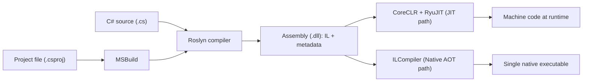

### 1.1 What C# and .NET Are

**C#** is a statically typed, garbage-collected, multi-paradigm language. **.NET** is the platform it runs on: a runtime (CoreCLR), a just-in-time compiler (RyuJIT), a garbage collector, a large base class library (BCL) and the `dotnet` SDK that builds and runs everything. The same IL assembly runs on Windows, Linux and macOS, on x64 and Arm64.

Three ideas run through modern C#, and this guide comes back to each of them:

1. **Low-allocation code is ordinary code.** `Span<T>`, `ReadOnlySpan<T>` and `Memory<T>` are type-safe windows over arrays, stack memory or native memory. With `ArrayPool<T>` and `ref struct` you can parse network traffic without creating garbage, and the compiler still checks bounds and lifetimes.
2. **Two ways to reach machine code.** The default path JIT-compiles IL at runtime and uses Dynamic Profile-Guided Optimization (PGO) to inline hot methods and devirtualize interface calls based on what the program actually does. The Native AOT path compiles everything ahead of time into one executable that starts fast and needs no JIT, at the cost of restrictions on reflection.
3. **Expressive types with value semantics.** Records, primary constructors, pattern matching and generic math (`INumber<T>`) remove boilerplate while keeping the type checker in charge.

How modern .NET compares with its predecessor and with the runtimes it usually competes against:

| Dimension | .NET Framework 4.x | Modern .NET (10) | Java 25 (LTS) | Go (current stable) | Rust |
| :--- | :--- | :--- | :--- | :--- | :--- |
| **Platforms** | Windows only | Windows, Linux, macOS; x64 and Arm64 | Any JVM platform | Cross-compiles to most OS/arch pairs | Cross-compiles to most targets |
| **Execution** | Legacy JIT | Tiered RyuJIT with Dynamic PGO, or Native AOT | HotSpot C1/C2 JIT, GraalVM native image | Ahead-of-time compiled | Ahead-of-time compiled |
| **Low-allocation tools** | Few; heavy boxing in older APIs | `Span<T>`, `Memory<T>`, `ArrayPool<T>`, `stackalloc`, `ref struct` | Mostly heap; value classes still in progress (Valhalla) | Escape analysis decides stack vs heap | Stack by default, explicit heap via `Box` |
| **Concurrency** | Threads, APM/EAP callbacks, early TPL | `Task`, `ValueTask`, `IAsyncEnumerable<T>`, `Channel<T>` | Virtual threads, `CompletableFuture` | Goroutines and channels | `async`/`await` with an external runtime (Tokio) |
| **Memory management** | Generational GC | Generational GC with regions, Server GC with DATAS | G1 by default, ZGC and Shenandoah for low pause | Concurrent mark-sweep, non-moving | No GC; ownership and borrowing |
| **Metaprogramming** | Runtime reflection, `Reflection.Emit` | Roslyn source generators at compile time; reflection still available on the JIT path | Annotation processors, bytecode libraries | `go generate`, reflection | Declarative and procedural macros |
| **Typical container image** | Windows Server Core (gigabytes) | Chiseled Ubuntu `aspnet` images, tens of MB; smaller with AOT | JRE images, roughly 100-200 MB | Static binary on `scratch` or distroless | Static binary on `scratch` or distroless |

When to pick C#: services and APIs where throughput and latency matter but you want a garbage collector and a rich standard library; cross-platform tools; game development with Unity or Godot; desktop and mobile apps with .NET MAUI or Avalonia; anything that must integrate with the Microsoft and Azure ecosystem.

### 1.2 Installing the SDK and the dotnet CLI

You need the **SDK** to build code. The **runtime** alone can only run already-built apps, which is what production containers ship.

```bash
# Windows
winget install Microsoft.DotNet.SDK.10

# macOS
brew install --cask dotnet-sdk

# Ubuntu 24.04: .NET 10 comes from the dotnet backports archive
sudo add-apt-repository ppa:dotnet/backports
sudo apt-get update && sudo apt-get install -y dotnet-sdk-10.0

# Any OS, no admin rights: the official install script into ~/.dotnet
curl -sSL https://dot.net/v1/dotnet-install.sh | bash -s -- --channel 10.0

# Verify
dotnet --version        # e.g. 10.0.1xx
dotnet --list-sdks
dotnet --list-runtimes
```

The SDK version and the runtime version are different numbers. SDK `10.0.403` ships runtime `10.0.x`; the hundreds digit of the SDK patch is the "feature band" (`1xx`, `2xx`, `3xx`, `4xx`).

| Installed thing | Contains | Who needs it |
| --- | --- | --- |
| .NET SDK | Compiler, MSBuild, NuGet, templates, all runtimes for its version | Developers and CI build agents |
| ASP.NET Core Runtime | .NET Runtime plus the ASP.NET Core shared framework | Servers that run web apps (the `aspnet` image) |
| .NET Runtime | CoreCLR and the base class library | Machines that run console apps (the `runtime` image) |
| `runtime-deps` image | Only native OS dependencies, no .NET at all | Self-contained and Native AOT apps |

`global.json` pins the SDK a repository builds with, so a newer SDK installed on a laptop does not silently change compiler behaviour. This repo pins 10.0.100 and allows any newer 10.0 feature band:

```json
{
  "sdk": {
    "version": "10.0.100",
    "rollForward": "latestFeature"
  }
}
```

#### Your first program, two ways

Since .NET 10 a single file runs directly. This is the fastest way to try any snippet in this guide:

```csharp
// hello.cs  ->  dotnet run hello.cs
Console.Write("What is your name? ");
string? name = Console.ReadLine();
Console.WriteLine($"Hello, {(string.IsNullOrWhiteSpace(name) ? "stranger" : name.Trim())}!");
```

For anything larger, create a project. Templates generate the folder, the `.csproj` and a starting `Program.cs`:

```bash
dotnet new console -o Hello          # console app
dotnet new web -o HelloApi           # empty ASP.NET Core app (what the starter is based on)
dotnet new xunit -o Hello.Tests      # xUnit test project
dotnet new sln -n Hello              # solution file that groups projects
dotnet sln add Hello/Hello.csproj Hello.Tests/Hello.Tests.csproj

cd Hello
dotnet run                           # restore + build + run
dotnet watch                         # rebuild and hot-reload on file changes
```

#### The commands you use every day

| Command | What it does | Notes |
| --- | --- | --- |
| `dotnet restore` | Downloads NuGet packages into `~/.nuget/packages` and writes `obj/project.assets.json` | Runs implicitly before `build`, `run`, `test`, `publish` unless you pass `--no-restore`. |
| `dotnet build -c Release` | Compiles to `bin/Release/net10.0/` | Default configuration is `Debug`. |
| `dotnet run` | Builds and starts the project | `dotnet run -- --port 9000` passes arguments after `--` to your app. |
| `dotnet test` | Builds and runs every test project | `--filter "FullyQualifiedName~Parser"` runs a subset. |
| `dotnet publish -c Release -o out` | Produces the deployable folder | Add `-r linux-x64` for a runtime-specific build, `-p:PublishAot=true` for Native AOT. |
| `dotnet format` | Applies `.editorconfig` style rules | CI runs `dotnet format --verify-no-changes`. |
| `dotnet package add <id>` | Adds a NuGet reference | Older spelling: `dotnet add package <id>`. |

### 1.3 Project Anatomy: Solutions, Project Files and MSBuild

A `.csproj` is an MSBuild file. The `Sdk` attribute imports hundreds of default targets and properties, which is why a modern project file is a few lines long.

```text
learn-c-sharp/
├── global.json                    SDK pin
├── Directory.Build.props          settings shared by every project below this folder
├── LearnCSharp.sln                groups the two projects for IDEs and `dotnet build`
├── src/LearnCSharp/
│   ├── LearnCSharp.csproj         Sdk="Microsoft.NET.Sdk.Web"
│   ├── packages.lock.json         exact package graph (committed)
│   ├── Program.cs                 top-level statements: the entry point
│   ├── Models/  Curriculum/  Numerics/  Parsing/  Concurrency/  Serialization/
└── tests/LearnCSharp.Tests/
    ├── LearnCSharp.Tests.csproj   references xUnit and the app project
    └── *Tests.cs
```

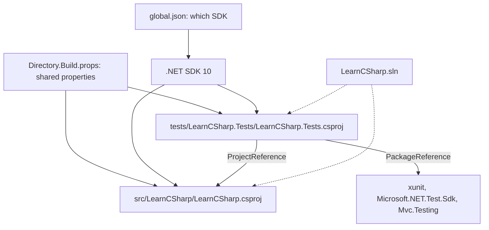

The shared settings in this repo:

```xml
<Project>
  <PropertyGroup>
    <TargetFramework>net10.0</TargetFramework>
    <ImplicitUsings>enable</ImplicitUsings>
    <Nullable>enable</Nullable>
    <TreatWarningsAsErrors>true</TreatWarningsAsErrors>
    <RestorePackagesWithLockFile>true</RestorePackagesWithLockFile>
  </PropertyGroup>
</Project>
```

| Property | Effect |
| --- | --- |
| `TargetFramework` | Which API surface you compile against, and therefore the default C# version (`net10.0` gives C# 14). Use `TargetFrameworks` (plural) with `;` to multi-target a library. |
| `ImplicitUsings` | Adds `global using` directives for common namespaces (`System`, `System.Linq`, `System.Threading.Tasks` and, for the Web SDK, `Microsoft.AspNetCore.*`). They are written to `obj/*.GlobalUsings.g.cs`. |
| `Nullable` | Turns on nullable reference type analysis (section 1.8). Always enable it in new code. |
| `TreatWarningsAsErrors` | A warning fails the build. Keeps nullable and analyzer warnings from piling up. |
| `RestorePackagesWithLockFile` | Writes `packages.lock.json`. `dotnet restore --locked-mode` then fails if the graph would change, which makes CI and Docker builds reproducible. |

The app project uses the Web SDK and adds one property:

```xml
<Project Sdk="Microsoft.NET.Sdk.Web">
  <PropertyGroup>
    <RootNamespace>LearnCSharp</RootNamespace>
    <InvariantGlobalization>true</InvariantGlobalization>
  </PropertyGroup>
</Project>
```

`InvariantGlobalization` makes every culture behave like the invariant culture and removes the dependency on the ICU native library. That shrinks containers and removes a class of "works on my machine" parsing bugs (section 1.6), but it is only right for services that do not format text for users in their own language.

Solution files: `.sln` is the long-standing format; `.slnx` is a newer XML format that is much easier to read and merge. The .NET SDK and current IDEs understand both, and `dotnet sln migrate` converts one to the other.

### 1.4 Line-by-Line Breakdown of the Starter Project

The starter in [`src/LearnCSharp`](./src/LearnCSharp) is an ASP.NET Core minimal API. It is small on purpose: each endpoint exists to show a Stage 1-3 language feature with a test around it.

```csharp
using System.Runtime;
using System.Runtime.InteropServices;
using LearnCSharp.Concurrency;
using LearnCSharp.Curriculum;
using LearnCSharp.Models;
using LearnCSharp.Numerics;
using LearnCSharp.Parsing;
using LearnCSharp.Serialization;
using Microsoft.AspNetCore.Http.HttpResults;

var builder = WebApplication.CreateBuilder(args);

string port = Environment.GetEnvironmentVariable("PORT") ?? "8080";
builder.WebHost.UseUrls($"http://0.0.0.0:{port}");

builder.Services.ConfigureHttpJsonOptions(options =>
    options.SerializerOptions.TypeInfoResolverChain.Insert(0, AppJsonContext.Default));
builder.Services.AddProblemDetails();

var app = builder.Build();

app.MapGet("/health", () => new HealthReport("ok", RuntimeInformation.FrameworkDescription));

app.MapGet("/api/roadmap/{number:int}", Results<Ok<RoadmapStage>, ProblemHttpResult> (int number) =>
    RoadmapQueries.Find(Roadmap.Stages, number) switch
    {
        Result<RoadmapStage>.Success found => TypedResults.Ok(found.Value),
        Result<RoadmapStage>.Failure missing => TypedResults.Problem(missing.Error, statusCode: StatusCodes.Status404NotFound),
        _ => throw new InvalidOperationException("Unknown result."),
    });

// ... /api/runtime, /api/roadmap, /api/roadmap/summary, /api/stats, /api/endpoint

app.Run();

public partial class Program;
```

| Line / API | Role | What happens at runtime |
| :--- | :--- | :--- |
| No `Main` method | **Top-level statements** (C# 9) | The compiler wraps the file in a generated `Program` class with a `Main(string[] args)`; `args` is in scope. Only one file per project may do this. |
| `using ...;` | Imports namespaces | Purely compile-time. Together with implicit global usings, it decides which `Endpoint`, `Result` and so on a name refers to. |
| `WebApplication.CreateBuilder(args)` | Creates the host builder | Loads configuration (`appsettings.json`, environment variables, command line), sets up logging and the dependency-injection container. |
| `Environment.GetEnvironmentVariable("PORT") ?? "8080"` | Reads the port | `??` returns the right side when the left is `null`. The process listens on one port that the Dockerfile and CI also use. |
| `UseUrls("http://0.0.0.0:...")` | Binds Kestrel | `0.0.0.0` means every network interface, which a container needs. `localhost` would be unreachable from outside the container. |
| `ConfigureHttpJsonOptions(...)` | Registers source-generated JSON | Puts `AppJsonContext` first in the resolver chain so known types serialize without reflection (Stage 5). |
| `AddProblemDetails()` | Error format | Error responses use the RFC 9457 `application/problem+json` shape. |
| `builder.Build()` | Freezes services | After this point the DI container is read-only. |
| `app.MapGet("/health", () => ...)` | Route plus handler | A lambda is the handler. Its return value, a record, is serialized to JSON with status 200. |
| `Results<Ok<RoadmapStage>, ProblemHttpResult> (int number) => ...` | Lambda with an explicit return type | The union type tells the compiler and OpenAPI that the handler returns one of exactly two results. `{number:int}` in the route binds and validates the parameter. |
| `... switch { Result<...>.Success found => ... }` | Switch expression with type patterns | Tests the runtime type of the `Result` and binds the matching case to a variable in one step (Stage 2). |
| `app.Run()` | Starts the server | Blocks until the process receives a shutdown signal (Ctrl+C or `SIGTERM` from Docker). |
| `public partial class Program;` | Makes the generated class public | `WebApplicationFactory<Program>` in the tests needs to name it. |

Try it:

```bash
dotnet run --project src/LearnCSharp
curl http://localhost:8080/health
curl "http://localhost:8080/api/stats?values=2,4,4,4,5,5,7,9"
curl -i http://localhost:8080/api/roadmap/42      # 404 with a problem+json body
dotnet test                                       # 35 tests
```

### 1.5 From Source to Machine Code: Roslyn, IL and the Tiered JIT

Roslyn (`csc`) compiles C# into **Common Intermediate Language** (IL), a stack-based bytecode, plus **metadata** that describes every type and member. Both go into a portable executable file (`.dll`). This method:

```csharp
static int Add(int a, int b) => a + b;
```

compiles to IL along these lines (view it with ILSpy, or `ildasm`):

```text
.method private hidebysig static int32 Add(int32 a, int32 b) cil managed
{
    ldarg.0      // push a
    ldarg.1      // push b
    add          // pop two, push their sum
    ret          // return the top of the stack
}
```

At runtime CoreCLR loads the assembly, and the first call to a method triggers the JIT. Modern .NET uses **tiered compilation**:

1. **Tier 0.** The first time a method runs, RyuJIT generates code quickly with almost no optimization, so startup is fast. Methods in the framework itself usually skip this step because they ship precompiled as ReadyToRun (R2R) code.
2. **Instrumentation.** Methods that get called often are recompiled with probes that record which branches are taken and which concrete types sit behind interface and virtual calls. This is **Dynamic PGO**, on by default since .NET 8.
3. **Tier 1.** After a method has been called about 30 times (and a short delay to let startup settle), it is recompiled with full optimization, using the recorded profile: inlining, guarded devirtualization (if the object is almost always a `List<int>`, call `List<int>` methods directly with a cheap type check as a guard), hot/cold block layout, loop optimizations and vectorization.
4. **On-Stack Replacement (OSR).** A method stuck in a long loop at Tier 0 cannot wait to be called again, so the runtime switches the running frame to optimized code mid-loop.

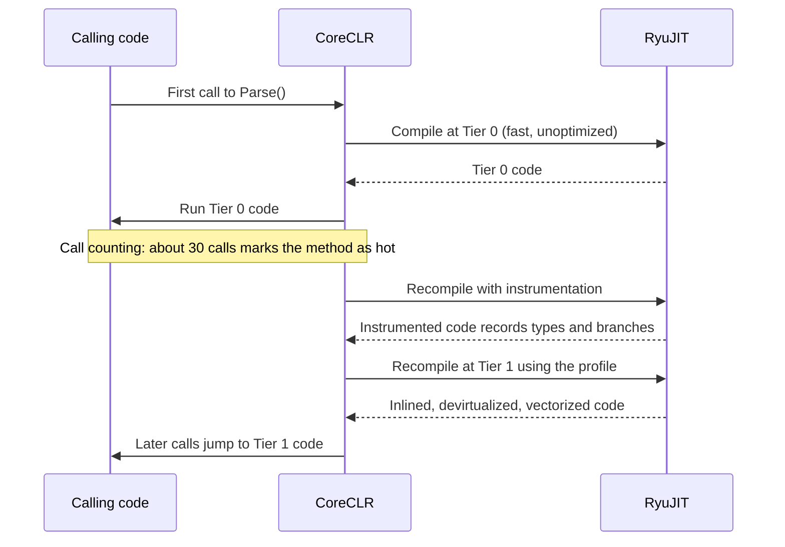

Practical consequences:

- The first requests after a deploy are slower than steady state. Warm up critical paths, or use ReadyToRun (`-p:PublishReadyToRun=true`) to start from precompiled code.
- Micro-benchmarks that time the first few calls with `Stopwatch` measure Tier 0 code. Use BenchmarkDotNet (Stage 6), which runs warm-up iterations first.
- `[MethodImpl(MethodImplOptions.AggressiveOptimization)]` skips tiering for a method, which also disables Dynamic PGO for it. It is rarely what you want.

### 1.6 Built-in Types, Variables and Operators

Every C# keyword type is an alias for a .NET type: `int` is `System.Int32`, `string` is `System.String`.

| Keyword | .NET type | Size | Range or precision | Use for |
| --- | --- | --- | --- | --- |
| `bool` | `Boolean` | 1 byte | `true` / `false` | Flags |
| `byte` / `sbyte` | `Byte` / `SByte` | 1 byte | 0..255 / -128..127 | Binary data |
| `short` / `ushort` | `Int16` / `UInt16` | 2 bytes | ±32 767 / 0..65 535 | Wire formats |
| `int` / `uint` | `Int32` / `UInt32` | 4 bytes | about ±2.1 billion | Default integer |
| `long` / `ulong` | `Int64` / `UInt64` | 8 bytes | about ±9.2 × 10^18 | IDs, timestamps, file sizes |
| `nint` / `nuint` | `IntPtr` / `UIntPtr` | pointer size | platform dependent | Interop, pointer arithmetic |
| `Int128` / `UInt128` | (no keyword) | 16 bytes | about ±1.7 × 10^38 | Very large counters, hashes |
| `float` | `Single` | 4 bytes | ~6-9 significant digits | Graphics, ML tensors |
| `double` | `Double` | 8 bytes | ~15-17 significant digits | Measurements, science |
| `decimal` | `Decimal` | 16 bytes | 28-29 significant **decimal** digits | Money |
| `char` | `Char` | 2 bytes | one UTF-16 code unit | Text processing |
| `string` | `String` | reference | immutable UTF-16 sequence | Text |
| `object` | `Object` | reference | base of every type | Rarely, in new code |

```csharp
using System.Globalization;

int count = 42;                 // explicit type
var total = 0L;                 // var: the compiler infers long from the literal suffix
const double Pi = 3.14159;      // compile-time constant, inlined at every use
long big = 1_000_000_000_000;   // digit separators
byte mask = 0b1010_0001;        // binary literal
int hex = 0xFF;

// Integer division truncates toward zero; % has the sign of the dividend.
Console.WriteLine(7 / 2);       // 3
Console.WriteLine(-7 / 2);      // -3
Console.WriteLine(-7 % 3);      // -1

// Integer overflow wraps silently by default...
int max = int.MaxValue;
Console.WriteLine(max + 1);     // -2147483648
// ...unless you ask for checking.
try { Console.WriteLine(checked(max + 1)); }
catch (OverflowException) { Console.WriteLine("overflow caught"); }

// double is binary floating point: 0.1 has no exact representation.
Console.WriteLine(0.1 + 0.2 == 0.3);     // False
Console.WriteLine(0.1m + 0.2m == 0.3m);  // True: decimal is base 10

// Conversions: implicit when no data can be lost, explicit (a cast) otherwise.
long widened = count;               // int -> long, implicit
int narrowed = (int)3.99;           // 3: the cast truncates
int rounded = (int)Math.Round(2.5); // 2: banker's rounding (to even) by default

// Parse throws on bad input; TryParse returns false instead. Always pass a culture for data.
int parsed = int.Parse("123", CultureInfo.InvariantCulture);
bool ok = double.TryParse("3,5", NumberStyles.Float, CultureInfo.InvariantCulture, out double d);
Console.WriteLine($"{parsed} {ok} {d}");  // 123 False 0
```

Operators worth knowing beyond arithmetic: `is` and `as` for type tests, `??` and `??=` for null fallbacks, `?.` and `?[]` for null-conditional access, `^` for "from the end" indices, `..` for ranges, `<<`, `>>` and `>>>` (unsigned shift, C# 11) for bits, and `with` for copying records.

`var` is not dynamic typing: the variable gets one static type, fixed at compile time. Use it when the type is obvious from the right-hand side (`var list = new List<int>();`) and spell the type out when it is not (`int count = GetCount();`).

### 1.7 Value Types vs Reference Types

This is the single most important distinction in C#, and it decides performance as much as correctness.

- **Reference types** (`class`, `interface`, `delegate`, `record`, arrays, `string`) live on the managed heap. A variable holds a reference to the object. Every object carries a 16-byte overhead on 64-bit (an 8-byte object header used for locking and hashing, plus an 8-byte pointer to its type's method table), and the smallest object is 24 bytes. Assigning a reference copies the reference: two variables then point to one object.
- **Value types** (`struct`, `enum`, `record struct`, all numeric types, `bool`, `char`) store their data inline wherever they are declared: in a local variable slot (stack or CPU register), inside an array's element storage, or inside the object that contains them as a field. There is no header. Assigning a value type copies all its fields.

"Structs live on the stack" is only a rule of thumb. A struct field inside a class lives on the heap with the class; a local captured by a lambda, or held across an `await`, moves into a heap-allocated closure or state machine.

```csharp
var p1 = new PointStruct(1, 2);
var p2 = p1;                // copies both fields
p2.X = 99;
Console.WriteLine(p1.X);    // 1: p1 is unaffected

var c1 = new PointClass(1, 2);
var c2 = c1;                // copies the reference
c2.X = 99;
Console.WriteLine(c1.X);    // 99: both variables refer to one object

// Boxing: converting a value type to object or an interface allocates a heap copy.
object boxed = p1;          // allocation
p1.X = 5;
Console.WriteLine(((PointStruct)boxed).X);   // 1: the box holds the old copy

public struct PointStruct(int x, int y) { public int X = x; public int Y = y; }
public class PointClass(int x, int y) { public int X = x; public int Y = y; }
```

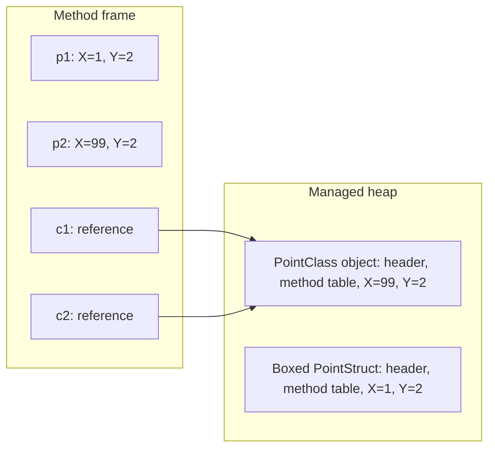

| Question | Choose a `struct` when... | Choose a `class` when... |
| --- | --- | --- |
| Size | It is small (a rule of thumb: 16 bytes or less) | It is large, or its size varies |
| Identity | Two instances with equal fields are interchangeable | Each instance has its own identity and lifetime |
| Mutation | It is immutable (`readonly struct`) | It changes state over time |
| Polymorphism | You do not need inheritance | You need a base class or virtual members |
| Usage | It is created and dropped in large numbers in hot loops | It is shared between many owners |

### 1.8 Nullable Reference Types

With `<Nullable>enable</Nullable>`, `string` means "never null" and `string?` means "may be null". The compiler tracks null-state through your code and warns when you might dereference null. The annotations do not change the runtime: `string` and `string?` compile to the same type, so the protection is only as good as your attention to the warnings.

```csharp
string? input = Console.ReadLine();   // ReadLine returns null at end of input

// Warning CS8602: Dereference of a possibly null reference.
// int length = input.Length;

int length = input?.Length ?? 0;      // null-conditional plus null-coalescing
input ??= "default";                  // assign only when null
Console.WriteLine(input.Length);      // no warning: the compiler knows input is not null now

if (input is { Length: > 3 })         // property pattern: not null AND length > 3
{
    Console.WriteLine(input[..3]);
}

static string Describe(Customer? customer) =>
    customer switch
    {
        null => "no customer",
        { Email: null } => $"{customer.Name} (no email)",
        _ => $"{customer.Name} <{customer.Email}>",
    };

Console.WriteLine(Describe(new Customer("Ada", null)));

public sealed record Customer(string Name, string? Email);
```

| Tool | Meaning | Use it when |
| --- | --- | --- |
| `T?` on a reference type | May be null | The value is genuinely optional. |
| `x!` (null-forgiving) | "Trust me, not null here" | Rarely: test setup, or after a check the compiler cannot see. Each `!` is a hole in the analysis. |
| `ArgumentNullException.ThrowIfNull(x)` | Runtime guard | Public API boundaries, where callers may have nullable analysis off. |
| `[NotNullWhen(true)]` | Teaches the analyzer about your method | `bool TryGet(..., [NotNullWhen(true)] out T? value)` patterns. |
| `required` members | Must be set in the object initializer | DTOs and options classes (Stage 2). |

### 1.9 Strings, Interpolation and Raw String Literals

`string` is an immutable sequence of UTF-16 code units. Every "modification" (`Replace`, `+`, `ToUpper`, `Substring`) allocates a new string.

```csharp
using System.Globalization;
using System.Text;

string name = "Ada";
decimal price = 1234.5m;

// Interpolation with format specifiers and alignment.
Console.WriteLine($"{name,-6}|{price,10:N2}|");          // "Ada   |  1,234.50|"
Console.WriteLine(string.Create(CultureInfo.GetCultureInfo("de-DE"), $"{price:N2}")); // "1.234,50" (needs ICU)

// Raw string literals (C# 11): no escaping, indentation trimmed to the closing quotes.
string json = """
    {
      "name": "Ada",
      "path": "C:\temp\file.txt"
    }
    """;

// Interpolated raw strings: the number of $ signs sets how many braces open a hole.
string template = $$"""
    { "user": "{{name}}", "total": {{price}} }
    """;

// Building strings in a loop: StringBuilder grows one buffer instead of copying every time.
var sb = new StringBuilder();
for (int i = 0; i < 5; i++)
{
    sb.Append(i).Append(',');
}
sb.Length--;                     // drop the trailing comma
Console.WriteLine(sb.ToString()); // "0,1,2,3,4"

// Comparisons: say what you mean.
Console.WriteLine(string.Equals("STRASSE", "strasse", StringComparison.OrdinalIgnoreCase)); // True
Console.WriteLine("file.TXT".EndsWith(".txt", StringComparison.OrdinalIgnoreCase));          // True

// Text elements: Length counts UTF-16 code units, not what a user sees as characters.
string family = "👨‍👩‍👧";
Console.WriteLine(family.Length);                                   // 8
Console.WriteLine(new StringInfo(family).LengthInTextElements);     // 1
Console.WriteLine(json.Length > 0 && template.Length > 0);
```

| Comparison | Use for |
| --- | --- |
| `StringComparison.Ordinal` | Identifiers, keys, file paths, protocol tokens: byte-for-byte, fastest |
| `StringComparison.OrdinalIgnoreCase` | Case-insensitive identifiers (HTTP header names, file extensions) |
| `StringComparison.CurrentCulture` | Sorting and comparing text shown to the current user |
| `StringComparison.InvariantCulture` | Rarely; culture-aware but stable across machines |

### 1.10 Control Flow, Indices and Ranges

```csharp
int[] scores = [72, 95, 88, 41, 60];

// foreach works on anything with GetEnumerator(): arrays, lists, spans, strings.
foreach (int score in scores)
{
    string grade = score switch
    {
        >= 90 => "A",
        >= 80 => "B",
        >= 70 => "C",
        _ => "F",
    };
    Console.Write($"{grade} ");
}
Console.WriteLine();

// for when you need the index; break and continue as in other C-family languages.
for (int i = 0; i < scores.Length; i++)
{
    if (scores[i] < 50) continue;
    if (scores[i] == 60) break;
    Console.Write(i);
}
Console.WriteLine();

// while and do-while
int attempts = 0;
do { attempts++; } while (attempts < 3);

// Indices and ranges (C# 8): ^1 is the last element, a..b is [a, b).
Console.WriteLine(scores[^1]);                       // 60
Console.WriteLine(string.Join(",", scores[1..3]));   // 95,88  (a new array: a copy)
Console.WriteLine(string.Join(",", scores[^2..]));   // 41,60
ReadOnlySpan<int> window = scores.AsSpan(1..4);      // a span slice: no copy
Console.WriteLine(window.Length);                    // 3

// goto case and labelled statements exist, but switch expressions and early returns read better.
```

`switch` statements in C# do not fall through: every non-empty section must end with `break`, `return`, `throw` or `goto case`. A range over an array allocates a new array; a range over a `Span<T>` or `string`-as-span does not. That difference matters in Stage 3.

### 1.11 Pitfalls

| Pitfall | Symptom | Fix |
| --- | --- | --- |
| Building with the SDK on the machine instead of the repo's | `error NETSDK1045: The current .NET SDK does not support targeting .NET 10.0` or different behaviour on CI | Commit `global.json`; install the SDK it names. |
| Two files with top-level statements | `error CS8802: Only one compilation unit can have top-level statements` | Keep top-level statements in `Program.cs` only. |
| Binding to `localhost` in a container | Container starts, `curl` from the host gets "connection reset" | Bind `0.0.0.0` (or `http://+:8080`). |
| Parsing with the current culture | `double.Parse("3.5")` throws `FormatException` or returns 35 on a machine set to German | Pass `CultureInfo.InvariantCulture` for data; reserve the current culture for user-facing text. |
| Silent integer overflow | A counter jumps from 2147483647 to -2147483648 | Use `long`, `checked(...)`, or `<CheckForOverflowUnderflow>true</CheckForOverflowUnderflow>` in Debug. |
| Comparing doubles with `==` | `0.1 + 0.2 == 0.3` is `false` | Compare with a tolerance (`Math.Abs(a - b) < 1e-9`) or use `decimal` for money. |
| Mutating a struct through a copy | `list[0].X = 5` gives `CS1612: Cannot modify the return value ... because it is not a variable` | Make structs immutable and replace the element, or use a class. |
| Ignoring nullable warnings | `NullReferenceException` in production despite "nullable enabled" | Treat warnings as errors; avoid `!`. |
| `string.Length` as "characters" | Truncating an emoji or accented name produces broken text | Use `StringInfo` / `Rune` APIs for user-visible characters. |
| `dotnet run` from the wrong folder | `Couldn't find a project to run` | Use `dotnet run --project src/LearnCSharp` or `cd` into the project. |

### 1.12 Best Practices

- **Pin the SDK with `global.json`**: builds then mean the same thing on every machine and in CI.
- **Put shared settings in `Directory.Build.props`**: one place to change the target framework, nullable and warning policy.
- **Enable nullable and `TreatWarningsAsErrors` from day one**: retrofitting them into a large codebase costs weeks.
- **Commit lock files and restore with `--locked-mode` in CI**: a transitive package cannot change under you.
- **Use `var` only when the type is obvious**: code is read more than it is written.
- **Use `decimal` for money, `double` for measurements, `long` for counters that can grow**: each type's failure mode is different.
- **Always state the culture and the comparison type for strings**: `StringComparison.Ordinal` and `CultureInfo.InvariantCulture` for anything machine-readable.
- **Prefer `TryParse` on input you do not control**: exceptions are for unexpected failures, not for bad user input.
- **Run snippets as file-based apps**: `dotnet run snippet.cs` is the fastest way to check an idea.

### 1.13 Hands-on Exercise

Add an endpoint `GET /api/runtime` that returns the framework description, the OS description, the process architecture, the processor count and whether Server GC is enabled, as JSON.

Expected output (values depend on your machine):

```json
{
  "framework": ".NET 10.0.14",
  "operatingSystem": "Ubuntu 24.04.3 LTS",
  "architecture": "X64",
  "processorCount": 8,
  "serverGarbageCollector": true
}
```

Hints: `System.Runtime.InteropServices.RuntimeInformation`, `Environment.ProcessorCount`, `System.Runtime.GCSettings.IsServerGC`. Model the response as a positional record. Then run the app in Docker and compare `processorCount` and `serverGarbageCollector` with `docker run --cpus=1`.

Solution: the `RuntimeInfo` record in [`src/LearnCSharp/Models/ApiModels.cs`](./src/LearnCSharp/Models/ApiModels.cs), the `/api/runtime` endpoint in [`src/LearnCSharp/Program.cs`](./src/LearnCSharp/Program.cs), and the test `Runtime_reports_processor_count` in [`tests/LearnCSharp.Tests/ApiTests.cs`](./tests/LearnCSharp.Tests/ApiTests.cs).

[Back to top ⤴️](#-table-of-contents)

---

## 2. Stage 2: Methods, Types, Collections & LINQ

Stage 2 is about modelling: how to write methods, which kind of type to declare for which job, how to branch on the shape of data with pattern matching, which collection to pick, and how LINQ queries those collections. It assumes Stage 1. Afterwards you can model a domain with records and enums, match on it exhaustively, and query it with LINQ without accidental re-enumeration, which is exactly what the starter's `Roadmap` and `RoadmapQueries` do.

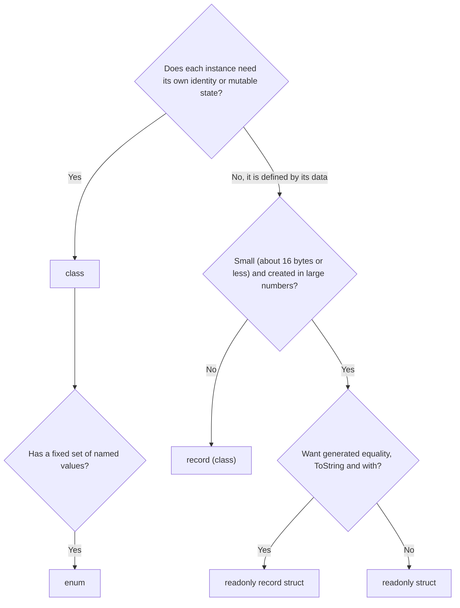

### 2.1 Methods and Parameters

A method's signature decides how arguments travel: by value (a copy), or by reference with `ref`, `out`, `in` or `ref readonly`.

```csharp
using System.Globalization;

// Optional and named parameters
static string Pad(string text, int width = 10, char fill = ' ') => text.PadLeft(width, fill);
Console.WriteLine(Pad("7", fill: '0', width: 3));   // "007"

// ref: the callee can read and replace the caller's variable
static void Swap<T>(ref T a, ref T b) => (a, b) = (b, a);
int x = 1, y = 2;
Swap(ref x, ref y);
Console.WriteLine($"{x} {y}");                       // "2 1"

// out: the callee must assign it; the Try pattern
static bool TryParsePercent(string text, out double value)
{
    value = 0;
    if (!text.EndsWith('%')) return false;
    return double.TryParse(text[..^1], NumberStyles.Float, CultureInfo.InvariantCulture, out value);
}
if (TryParsePercent("12.5%", out double pct)) Console.WriteLine(pct / 100);   // 0.125

// in / ref readonly: pass a large struct by reference without allowing writes
static double Length(in Vector3D v) => Math.Sqrt(v.X * v.X + v.Y * v.Y + v.Z * v.Z);
var v = new Vector3D(3, 4, 12);
Console.WriteLine(Length(v));                        // 13

// params collections (C# 13): params works with spans and other collection types,
// so a call with a few arguments does not allocate an array.
static int Sum(params ReadOnlySpan<int> values)
{
    int total = 0;
    foreach (int value in values) total += value;
    return total;
}
Console.WriteLine(Sum(1, 2, 3));                     // 6

// Local functions: helpers visible only inside the enclosing method.
static IEnumerable<int> Evens(int limit)
{
    if (limit < 0) throw new ArgumentOutOfRangeException(nameof(limit)); // runs eagerly
    return Iterate();

    IEnumerable<int> Iterate()                                           // runs lazily
    {
        for (int i = 0; i <= limit; i += 2) yield return i;
    }
}
Console.WriteLine(string.Join(",", Evens(6)));       // 0,2,4,6

public readonly record struct Vector3D(double X, double Y, double Z);
```

| Modifier | Caller writes | Callee may read | Callee may write | Typical use |
| --- | --- | --- | --- | --- |
| (none) | `M(x)` | a copy | the copy only | Default |
| `ref` | `M(ref x)` | yes | yes, and the caller sees it | Swap, in-place update of a struct |
| `out` | `M(out var x)` | no (unassigned) | must assign before returning | `TryParse`, `TryGetValue` |
| `in` | `M(x)` or `M(in x)` | yes | no | Large readonly structs |
| `ref readonly` | `M(ref x)` or `M(in x)` | yes | no | APIs that need a real variable, not a temporary (C# 12) |

The local-function pattern in `Evens` is worth remembering. Because iterators run lazily, argument validation written directly inside an iterator only runs when someone starts enumerating. Splitting the method makes the check run at the call.

### 2.2 Classes, Properties and Constructors

```csharp
public sealed class BankAccount
{
    private readonly List<decimal> _transactions = [];   // a field: private state

    public BankAccount(string owner, decimal openingBalance = 0)
    {
        ArgumentException.ThrowIfNullOrWhiteSpace(owner);
        Owner = owner;
        if (openingBalance > 0) Deposit(openingBalance);
    }

    public string Owner { get; }                          // get-only: set in the constructor
    public decimal Balance { get; private set; }          // readable by all, writable inside
    public int TransactionCount => _transactions.Count;   // computed on every read
    public static int MaxDailyTransactions { get; } = 50; // shared by all instances

    public void Deposit(decimal amount)
    {
        ArgumentOutOfRangeException.ThrowIfNegativeOrZero(amount);
        _transactions.Add(amount);
        Balance += amount;
    }
}
```

Object initializers, `init` accessors and `required` members (C# 11) give a type that is immutable after construction without a long constructor:

```csharp
var options = new RetryOptions { MaxAttempts = 5, Delay = TimeSpan.FromMilliseconds(200) };
// options.MaxAttempts = 6;   // error CS8852: init-only property
// new RetryOptions { };      // error CS9035: required member 'MaxAttempts' must be set

public sealed class RetryOptions
{
    public required int MaxAttempts { get; init; }
    public TimeSpan Delay { get; init; } = TimeSpan.FromSeconds(1);

    // C# 14 `field`: validation without declaring a backing field by hand.
    public double JitterFactor
    {
        get;
        init => field = value is >= 0 and <= 1 ? value : throw new ArgumentOutOfRangeException(nameof(value));
    } = 0.2;
}
```

**Primary constructors** (C# 12) put the constructor parameters on the type declaration. On a class, the parameters are in scope for the whole body; they are not properties, and the compiler captures them in hidden fields only if members use them.

```csharp
public interface IClock { DateTimeOffset UtcNow { get; } }
public interface IMetrics { void Increment(string name); }

public sealed class LatencyRecorder(IClock clock, IMetrics metrics, ILogger<LatencyRecorder> logger)
{
    public void Record(string endpoint, DateTimeOffset startedAt)
    {
        TimeSpan elapsed = clock.UtcNow - startedAt;
        logger.LogInformation("{Endpoint} took {ElapsedMs} ms", endpoint, elapsed.TotalMilliseconds);
        metrics.Increment("http_requests_total");
    }
}
```

| Feature | Records | Classes and structs with primary constructors |
| --- | --- | --- |
| Generates public properties | Yes (`init`-only on `record`, settable on non-readonly `record struct`) | No; parameters are plain captured variables |
| Parameters can be reassigned in the body | No (they become properties) | Yes, which is a common source of bugs; treat them as readonly |
| Typical use | Data: DTOs, messages, value objects | Services that receive dependencies |

`sealed` stops inheritance. Seal classes by default: the JIT can devirtualize calls on sealed types, and you can always unseal later without breaking callers.

### 2.3 Structs, Records and Record Structs

Records are types whose identity is their data. The compiler generates value-based `Equals`/`GetHashCode`, `==`/`!=`, a readable `ToString()`, a `Deconstruct` method for positional records, and support for `with` expressions (non-destructive mutation).

```csharp
var original = new UserAccount(Guid.NewGuid(), "ada", "member");
UserAccount admin = original.PromoteToAdmin();

Console.WriteLine(original == admin);            // False: Role differs
Console.WriteLine((admin with { Role = "member" }) == original);   // True: same values
Console.WriteLine(admin);                        // UserAccount { Id = ..., Username = ada, Role = admin }

var (id, username, role) = admin;                // positional deconstruction
Console.WriteLine($"{username}:{role}");

var a = new Money(10m, "EUR");
var b = new Money(10m, "EUR");
Console.WriteLine(a.Equals(b));                  // True, and no boxing: record struct implements IEquatable

public record UserAccount(Guid Id, string Username, string Role)
{
    public UserAccount PromoteToAdmin() => this with { Role = "admin" };
}

public readonly record struct Money(decimal Amount, string Currency)
{
    public static Money operator +(Money left, Money right) =>
        left.Currency == right.Currency
            ? left with { Amount = left.Amount + right.Amount }
            : throw new InvalidOperationException($"Cannot add {left.Currency} to {right.Currency}.");
}
```

| Kind | Allocation | Equality by default | `with` | Mutability | Good for |
| --- | --- | --- | --- | --- | --- |
| `class` | Heap | Reference (same object) | No | Anything | Entities and services with identity |
| `struct` | Inline | Field by field via `ValueType.Equals`, which can use reflection and box; override it | No (C# 10 allows `with` on any struct) | Mutable unless `readonly` | Small, short-lived values |
| `record` / `record class` | Heap | Value-based, generated | Yes | `init`-only positional properties | DTOs, events, immutable messages |
| `record struct` | Inline | Value-based, generated, no boxing | Yes | Mutable positional properties | Small values that need equality |
| `readonly record struct` | Inline | Value-based, generated | Yes | Immutable | Value objects: `Money`, `Coordinate` |

Two traps: a record's generated equality compares collections by reference, so two records that each hold a `List<int>` with the same contents are not equal; and inheritance between records includes the runtime type in equality (`EqualityContract`), so a `Student` record is never equal to a `Person` record with the same fields.

### 2.4 Enums, Tuples and Deconstruction

```csharp
[Flags]
public enum Permissions
{
    None = 0,
    Read = 1 << 0,
    Write = 1 << 1,
    Delete = 1 << 2,
    Admin = Read | Write | Delete,
}

public static class EnumDemo
{
    public static void Run()
    {
        Permissions p = Permissions.Read | Permissions.Write;
        Console.WriteLine(p);                                    // "Read, Write"
        Console.WriteLine(p.HasFlag(Permissions.Write));         // True
        Console.WriteLine((p & Permissions.Delete) != 0);        // False

        // Enums are just integers underneath: any value casts in.
        var bogus = (Permissions)64;
        Console.WriteLine(Enum.IsDefined(bogus));                // False: validate input

        Console.WriteLine(Enum.TryParse<Permissions>("write", ignoreCase: true, out var parsed) && parsed == Permissions.Write);

        // Tuples: lightweight, named, value types (System.ValueTuple).
        (int Min, int Max) range = MinMax([4, 8, 1, 9]);
        Console.WriteLine($"{range.Min}..{range.Max}");          // 1..9
        var (low, high) = range;                                 // deconstruction
        Console.WriteLine(high - low);
    }

    private static (int Min, int Max) MinMax(ReadOnlySpan<int> values)
    {
        int min = int.MaxValue, max = int.MinValue;
        foreach (int value in values)
        {
            min = Math.Min(min, value);
            max = Math.Max(max, value);
        }
        return (min, max);
    }
}
```

The starter's `StageLevel` enum carries `[JsonConverter(typeof(JsonStringEnumConverter<StageLevel>))]`, so the API returns `"Foundations"` instead of `0`. Integer enums on the wire break silently when someone inserts a member in the middle.

Use tuples for private and internal helpers that return two or three values. Once a tuple escapes into a public API or gets a fourth element, replace it with a record: names on tuples are compile-time only and vanish across reflection, serialization and `dynamic`.

### 2.5 Pattern Matching and Switch Expressions

Patterns test a value's type and shape and bind variables in one step. The switch expression combines patterns into an expression that the compiler checks for unreachable arms and, for enums and closed sets of constants, for missing cases.

```csharp
public abstract record NetworkCommand;
public sealed record ConnectCommand(string Host, int Port, bool UseTls) : NetworkCommand;
public sealed record QueryCommand(string Table, string[] Columns, int Limit) : NetworkCommand;
public sealed record DisconnectCommand(string Reason) : NetworkCommand;

public static class CommandPolicy
{
    public static string Evaluate(NetworkCommand command) => command switch
    {
        // Property pattern with relational and logical patterns
        ConnectCommand { Port: <= 1024, UseTls: false } => "REJECT: privileged port without TLS",
        ConnectCommand { Host: var host, Port: 443 } when host.EndsWith(".internal", StringComparison.Ordinal)
            => "ACCEPT: internal TLS link",
        ConnectCommand => "ACCEPT: standard connection",

        // List patterns (C# 11): match on the elements of an array or list
        QueryCommand { Columns: ["id", "secret", ..] } => "WARN: sensitive columns requested",
        QueryCommand { Columns: [] } => "REJECT: no columns",
        QueryCommand { Limit: > 1000 } => "REJECT: limit above 1,000 rows",
        QueryCommand => "ACCEPT: valid query",

        DisconnectCommand { Reason: "TIMEOUT" or "RESET" } => "LOG: abrupt termination",
        DisconnectCommand => "LOG: graceful termination",

        null => throw new ArgumentNullException(nameof(command)),
        _ => throw new InvalidOperationException($"Unknown command {command.GetType().Name}"),
    };
}
```

| Pattern | Syntax | Matches |
| --- | --- | --- |
| Type | `ConnectCommand c` | Runtime type check plus binding |
| Constant | `"TIMEOUT"`, `null`, `42` | Equality with a constant |
| Relational | `> 1000`, `<= 1024` | Comparisons on numbers, chars, enums |
| Logical | `and`, `or`, `not` | `not null`, `>= 0 and < 10` |
| Property | `{ Port: 443, Host: var h }` | Nested member checks |
| Positional | `Point(0, 0)` | Uses `Deconstruct` |
| List | `[first, .., last]`, `[_, _]` | Length and elements; `..` is a slice |
| `var` | `var x` | Always matches, binds a variable |
| Discard | `_` | Anything |

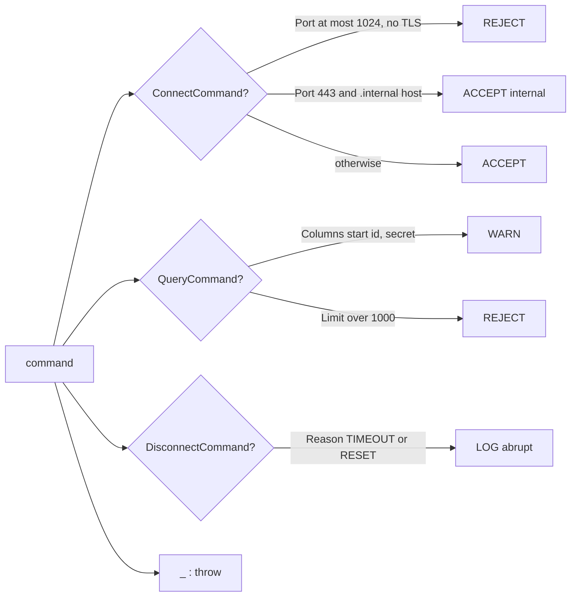

Arms are tested top to bottom, so put specific patterns before general ones; the compiler reports `CS8510: The pattern has already been handled by a previous arm` when an arm can never match. The starter uses the same tool in two places: switching on `Result<T>.Success` / `Failure` in `Program.cs`, and matching a `ReadOnlySpan<char>` against constant strings in `EndpointParser.DefaultPort`.

### 2.6 Collections: Arrays, Lists, Dictionaries and Friends

```csharp
using System.Collections.Frozen;
using System.Collections.Immutable;

int[] primes = [2, 3, 5, 7];                         // collection expression (C# 12)
List<string> names = ["ada", "grace"];
names.Add("linus");
int[] more = [.. primes, 11, 13];                    // spread

var stock = new Dictionary<string, int>(StringComparer.OrdinalIgnoreCase)
{
    ["apple"] = 3,
    ["pear"] = 0,
};
stock["APPLE"] += 2;                                  // same key: the comparer ignores case
if (stock.TryGetValue("kiwi", out int kiwis)) Console.WriteLine(kiwis);
CollectionsMarshalDemo(stock);

var seen = new HashSet<int>();
Console.WriteLine(seen.Add(1) && !seen.Add(1));       // True: the second Add returns false

var queue = new Queue<string>(["first", "second"]);   // FIFO
var stack = new Stack<int>([1, 2, 3]);                // LIFO: Pop returns 3
var jobs = new PriorityQueue<string, int>();          // smallest priority first
jobs.Enqueue("low", 10);
jobs.Enqueue("urgent", 1);
Console.WriteLine($"{queue.Dequeue()} {stack.Pop()} {jobs.Dequeue()}");   // first 3 urgent

// Read-mostly lookups: build once at startup, read millions of times.
FrozenDictionary<string, int> ports = new Dictionary<string, int>
{
    ["http"] = 80, ["https"] = 443, ["redis"] = 6379,
}.ToFrozenDictionary();
Console.WriteLine(ports["https"]);

// Immutable collections: every "change" returns a new collection that shares structure.
ImmutableList<int> v1 = [1, 2, 3];
ImmutableList<int> v2 = v1.Add(4);
Console.WriteLine($"{v1.Count} {v2.Count}");          // 3 4

static void CollectionsMarshalDemo(Dictionary<string, int> counts)
{
    // Update in place with one hash lookup instead of two (TryGetValue + indexer set).
    ref int slot = ref System.Runtime.InteropServices.CollectionsMarshal.GetValueRefOrAddDefault(counts, "kiwi", out _);
    slot++;
    Console.WriteLine(counts["kiwi"]);                // 1
}
```

| Collection | Lookup | Insert | Ordered | Thread-safe | Use when |
| --- | --- | --- | --- | --- | --- |
| `T[]` | O(1) by index | fixed size | yes | reads only | Size known up front; hot loops |
| `List<T>` | O(1) by index, O(n) search | amortized O(1) at end | yes | no | Default growable sequence |
| `Dictionary<TKey,TValue>` | O(1) average | O(1) average | no (do not rely on order) | no | Key lookups |
| `HashSet<T>` | O(1) average | O(1) average | no | no | Membership, de-duplication |
| `SortedDictionary<TKey,TValue>` | O(log n) | O(log n) | by key | no | Ordered keys with frequent inserts |
| `Queue<T>` / `Stack<T>` | ends only | O(1) | FIFO / LIFO | no | Work lists, undo stacks |
| `PriorityQueue<TElement,TPriority>` | min only | O(log n) | by priority | no | Schedulers, Dijkstra |
| `FrozenDictionary` / `FrozenSet` | O(1), faster than `Dictionary` | none after creation | no | reads yes | Static lookup tables |
| `ImmutableList<T>` / `ImmutableDictionary` | O(log n) | O(log n), new instance | yes / no | yes | Snapshots shared across threads |
| `ConcurrentDictionary<TKey,TValue>` | O(1) average | O(1) average | no | yes | Shared caches (Stage 4) |

Expose the narrowest interface that callers need: `IReadOnlyList<T>` or `IReadOnlyCollection<T>` for results, `IEnumerable<T>` only when the data is genuinely streamed. The starter's `Roadmap.Stages` is an `IReadOnlyList<RoadmapStage>` built from a collection expression, so callers can index and count it but cannot add to it.

### 2.7 Delegates, Lambdas, Closures and Events

A delegate is a type-safe reference to a method. `Func<..., TResult>` returns a value, `Action<...>` returns nothing, `Predicate<T>` returns `bool`. Lambdas create delegate instances.

```csharp
Func<int, int, int> add = (a, b) => a + b;
Func<int, bool> isEven = static n => n % 2 == 0;   // static lambda: cannot capture, never allocates a closure
Action<string> log = Console.WriteLine;              // method group conversion
log($"{add(2, 3)} {isEven(4)}");                    // "5 True"

// Natural types (C# 10) and default parameters (C# 12) for lambdas
var greet = (string name = "world") => $"Hello, {name}";
Console.WriteLine(greet());

// Closures capture variables, not values.
var actions = new List<Action>();
for (int i = 0; i < 3; i++)
{
    actions.Add(() => Console.Write(i));             // `for` has one i for the whole loop
}
actions.ForEach(a => a());                           // prints "333"
Console.WriteLine();

actions.Clear();
foreach (int i in new[] { 0, 1, 2 })
{
    actions.Add(() => Console.Write(i));             // `foreach` gets a fresh i per iteration
}
actions.ForEach(a => a());                           // prints "012"
Console.WriteLine();

// Events: a delegate field that outsiders can only subscribe to and unsubscribe from.
var thermostat = new Thermostat();
thermostat.TemperatureChanged += (_, celsius) => Console.WriteLine($"now {celsius} C");
thermostat.Set(21.5);

public sealed class Thermostat
{
    public event EventHandler<double>? TemperatureChanged;

    public void Set(double celsius) => TemperatureChanged?.Invoke(this, celsius);
}
```

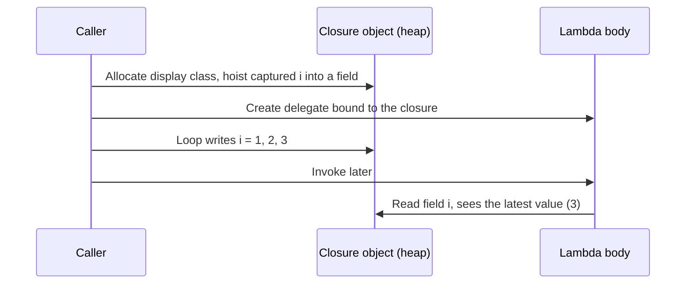

Capturing a variable forces the compiler to move it into a heap-allocated closure class, so lambdas in hot paths that capture state allocate on every creation. Mark lambdas `static` when they do not need to capture; the compiler then rejects accidental captures. Events hold strong references to subscribers: a long-lived publisher keeps short-lived subscribers alive until they unsubscribe.

### 2.8 LINQ Fundamentals

LINQ (Language Integrated Query) is a set of extension methods on `IEnumerable<T>` (and `IQueryable<T>` for databases, Stage 5). Most operators are **deferred**: they build a pipeline and do no work until something enumerates it.

```csharp
public sealed record Order(int Id, string Customer, decimal Total, DateOnly Placed);

public static class LinqDemo
{
    public static void Run()
    {
        List<Order> orders =
        [
            new(1, "ada", 120m, new DateOnly(2026, 1, 3)),
            new(2, "grace", 40m, new DateOnly(2026, 1, 3)),
            new(3, "ada", 75m, new DateOnly(2026, 2, 9)),
            new(4, "linus", 300m, new DateOnly(2026, 2, 11)),
        ];

        // Method syntax: filter, project, sort.
        IEnumerable<string> big = orders
            .Where(o => o.Total >= 75m)
            .OrderByDescending(o => o.Total)
            .Select(o => $"{o.Id}:{o.Customer}");
        Console.WriteLine(string.Join(" ", big));                 // 4:linus 1:ada 3:ada

        // Query syntax compiles to the same method calls.
        var perCustomer =
            from o in orders
            group o by o.Customer into g
            orderby g.Key
            select new { Customer = g.Key, Count = g.Count(), Spent = g.Sum(o => o.Total) };
        foreach (var row in perCustomer) Console.WriteLine(row);

        // .NET 9 additions: CountBy and AggregateBy avoid building groups.
        foreach (var (month, count) in orders.CountBy(o => o.Placed.Month))
            Console.WriteLine($"month {month}: {count} orders");

        Dictionary<string, decimal> totals = orders
            .AggregateBy(o => o.Customer, seed: 0m, (sum, o) => sum + o.Total)
            .ToDictionary();
        Console.WriteLine(totals["ada"]);                          // 195

        // Index() (.NET 9) pairs each element with its position.
        foreach (var (index, order) in orders.Index().Take(2))
            Console.WriteLine($"{index}: {order.Id}");

        // Deferred execution: the query runs again on every enumeration.
        int evaluations = 0;
        IEnumerable<Order> lazy = orders.Where(o => { evaluations++; return o.Total > 100m; });
        _ = lazy.Count();
        _ = lazy.Any();
        Console.WriteLine(evaluations);                             // 5: four for Count, one for Any (stops early)

        List<Order> materialized = lazy.ToList();                   // run once, keep the results
        Console.WriteLine(materialized.Count);
    }
}
```

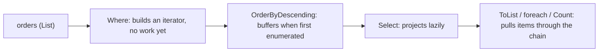

| Operator kind | Examples | When it runs |
| --- | --- | --- |
| Streaming, deferred | `Where`, `Select`, `Take`, `Skip`, `Concat`, `Index` | Item by item, during enumeration |
| Buffering, deferred | `OrderBy`, `GroupBy`, `Reverse`, `Distinct`, `CountBy` | Reads the whole source on first `MoveNext` |
| Immediate | `ToList`, `ToArray`, `ToDictionary`, `Count`, `Sum`, `First`, `Any`, `Max` | At the call |

The starter's `RoadmapQueries.SummarizeByLevel` is a typical production query: `GroupBy` to bucket, `OrderBy` to make the output stable, `Select` to project into a record, and `ToList` at the end so the caller receives a materialized `IReadOnlyList` that will not re-run.

### 2.9 Namespaces, Assemblies, Access Modifiers and NuGet

A **namespace** organizes names; an **assembly** (`.dll`) is the unit of deployment and versioning; a **NuGet package** ships one or more assemblies plus metadata.

```csharp
// File-scoped namespace (C# 10): applies to the whole file, saves one indent level.
namespace LearnCSharp.Parsing;

// A global using applies to every file in the project. Keep them in one file, e.g. GlobalUsings.cs.
// global using System.Globalization;

// Using alias for any type (C# 12), including tuples and arrays.
using Range2D = (int Start, int End);

public static class Ranges
{
    public static Range2D Widen(Range2D r, int by) => (r.Start - by, r.End + by);
}

// file-local type (C# 11): visible only inside this source file. Useful for helpers and generators.
file static class Scratch
{
    public static int Twice(int x) => x * 2;
}
```

| Modifier | Visible to |
| --- | --- |
| `public` | Everyone |
| `internal` (default for top-level types) | The same assembly (and friends named with `[InternalsVisibleTo]`) |
| `protected` | The type and its subclasses |
| `protected internal` | Subclasses **or** the same assembly |
| `private protected` | Subclasses **in** the same assembly |
| `private` (default for members) | The containing type only |
| `file` | The containing source file only (types only) |

Default to the most restrictive modifier. `internal` is under-used: everything a library does not intend to support forever should be `internal`, because every `public` member is a promise to callers.

Working with packages:

```bash
dotnet package add Polly --version 8.*          # adds <PackageReference> to the csproj
dotnet package list                             # direct references
dotnet package list --include-transitive        # everything that came along
dotnet package list --vulnerable                # known CVEs in the graph
dotnet package remove Polly
dotnet restore --locked-mode                    # CI: fail if the lock file is out of date
```

Central Package Management keeps versions in one `Directory.Packages.props` file, so ten projects cannot drift onto ten versions of the same package:

```xml
<!-- Directory.Packages.props -->
<Project>
  <PropertyGroup>
    <ManagePackageVersionsCentrally>true</ManagePackageVersionsCentrally>
  </PropertyGroup>
  <ItemGroup>
    <PackageVersion Include="xunit" Version="2.9.3" />
    <PackageVersion Include="Microsoft.NET.Test.Sdk" Version="18.11.0" />
  </ItemGroup>
</Project>
```

Each project then writes `<PackageReference Include="xunit" />` without a version.

### 2.10 Extension Methods and C# 14 Extension Members

Extension methods add methods to types you do not own. They are static methods that the compiler lets you call with instance syntax; nothing changes in the extended type, and the call binds at compile time.

```csharp
public static class EnumerableExtensions
{
    // Classic extension method: `this` on the first parameter.
    public static IEnumerable<IReadOnlyList<T>> Batch<T>(this IEnumerable<T> source, int size)
    {
        ArgumentOutOfRangeException.ThrowIfNegativeOrZero(size);
        var batch = new List<T>(size);
        foreach (T item in source)
        {
            batch.Add(item);
            if (batch.Count == size)
            {
                yield return batch;
                batch = new List<T>(size);
            }
        }
        if (batch.Count > 0) yield return batch;
    }
}

public static class ReadOnlyListExtensions
{
    // C# 14 extension block: properties and static members for a receiver type.
    extension<T>(IReadOnlyList<T> list)
    {
        public bool IsEmpty => list.Count == 0;
        public T? SecondOrDefault => list.Count > 1 ? list[1] : default;
    }
}

public static class Demo
{
    public static void Run()
    {
        foreach (var batch in Enumerable.Range(1, 7).Batch(3))
            Console.WriteLine(string.Join(",", batch));   // 1,2,3  4,5,6  7

        IReadOnlyList<string> names = ["ada", "grace"];
        Console.WriteLine($"{names.IsEmpty} {names.SecondOrDefault}");  // False grace
    }
}
```

The BCL already ships `Enumerable.Chunk`, which does what `Batch` does; the example is there to show the mechanics. Before writing an extension, check `System.Linq`, `MemoryExtensions` and `CollectionExtensions`.

Extension members resolve only when their namespace is imported, and an instance member with the same signature always wins. Keep extensions in a namespace that callers opt into, and never use them to hide work (an extension property that runs a database query surprises everyone).

### 2.11 Pitfalls

| Pitfall | Symptom | Fix |
| --- | --- | --- |
| Multiple enumeration of a deferred query | Database or API called twice; side effects run twice; analyzer `CA1851` | Materialize once with `ToList()` / `ToArray()` and reuse the result. |
| Capturing a `for` loop variable in a lambda | All callbacks see the final value ("333") | Copy to a local inside the loop, or use `foreach`, which has a fresh variable per iteration. |
| Records holding collections | Two "equal" records compare unequal; hash keys break | Use an immutable collection with value equality, or override `Equals` in the record. |
| Mutable struct in a collection | `CS1612: Cannot modify the return value of 'List<T>.this[int]'` | Make the struct `readonly` and replace the element. |
| Missing arm in a switch expression | `warning CS8509: The switch expression does not handle all possible values`, then `SwitchExpressionException` at runtime | Add the case or an explicit `_ => throw` arm. |
| Dictionary lookup on a missing key | `KeyNotFoundException: The given key 'x' was not present in the dictionary.` | Use `TryGetValue` or `GetValueOrDefault`. |
| Modifying a collection while iterating | `InvalidOperationException: Collection was modified; enumeration operation may not execute.` | Iterate over a copy (`ToList()`), or collect changes and apply them afterwards. |
| Enum values from outside not validated | A cast like `(Status)99` flows into a switch and hits the default arm | Check `Enum.IsDefined`, and give the switch a throwing default. |
| `First()` on an empty sequence | `InvalidOperationException: Sequence contains no elements` | Use `FirstOrDefault()` and handle `null`, or check `Any()`. |
| Event handlers never removed | Memory grows; subscribers stay alive after they are "closed" | Unsubscribe with `-=` in `Dispose`, or use a weak-event pattern. |

### 2.12 Best Practices

- **Model data with records and behaviour with classes**: records give correct equality and `ToString` for free; services need identity, not equality.
- **Seal classes unless you designed them for inheritance**: inheritance is a public contract, and sealed types are faster to call.
- **Use `required` and `init` instead of long constructors for options and DTOs**: callers see names at the call site and cannot forget a member.
- **Prefer switch expressions with an explicit throwing default**: the compiler finds unreachable arms and the runtime fails loudly on unknown cases.
- **Return `IReadOnlyList<T>` from methods that already have the data in memory**: callers can count and index without re-running anything.
- **Pass `StringComparer.Ordinal` or `OrdinalIgnoreCase` to dictionaries keyed by strings**: the default culture-sensitive comparer is slower and surprising.
- **Freeze lookup tables built at startup**: `FrozenDictionary` trades a slower build for faster reads.
- **Mark non-capturing lambdas `static`**: the compiler then proves they allocate no closure.
- **Keep extension members discoverable and cheap**: a property-like name must behave like a property.
- **Manage NuGet versions centrally and commit lock files**: dependency drift becomes a reviewed change.

### 2.13 Hands-on Exercise

Write `RoadmapQueries.SummarizeByLevel(IEnumerable<RoadmapStage>)` that returns one `LevelSummary(Level, StageCount, StageNumbers)` per `StageLevel`, ordered by the enum's declaration order, with the stage numbers sorted. Expose it as `GET /api/roadmap/summary`.

Expected output:

```json
[
  { "level": "Foundations", "stageCount": 2, "stageNumbers": [1, 2] },
  { "level": "Core", "stageCount": 2, "stageNumbers": [3, 4] },
  { "level": "Advanced", "stageCount": 2, "stageNumbers": [5, 6] },
  { "level": "Staff", "stageCount": 1, "stageNumbers": [7] }
]
```

Stretch: add `RoadmapQueries.Find(stages, number)` returning `Result<RoadmapStage>`, and map a failure to a 404 `application/problem+json` response with a switch expression.

Solution: [`src/LearnCSharp/Curriculum/RoadmapQueries.cs`](./src/LearnCSharp/Curriculum/RoadmapQueries.cs), the endpoints in [`src/LearnCSharp/Program.cs`](./src/LearnCSharp/Program.cs), and the tests `Summary_groups_stages_by_level_in_enum_order` and `Unknown_stage_is_a_404_problem` in [`tests/LearnCSharp.Tests`](./tests/LearnCSharp.Tests).

[Back to top ⤴️](#-table-of-contents)

---

## 3. Stage 3: OOP, Generics, Memory & Error Handling

Stage 3 covers the parts of C# that decide whether code scales: inheritance and interfaces, generics and their constraints, generic math, how failures travel (exceptions and the Result pattern), how resources are released, and how to control memory layout and allocation with structs, `Span<T>` and pooling. It assumes Stages 1 and 2. Afterwards you can write one numeric algorithm for every number type, parse text without allocating, and choose deliberately between throwing and returning a failure, as the starter's `Statistics`, `NumberListParser`, `EndpointParser` and `Result<T>` do.

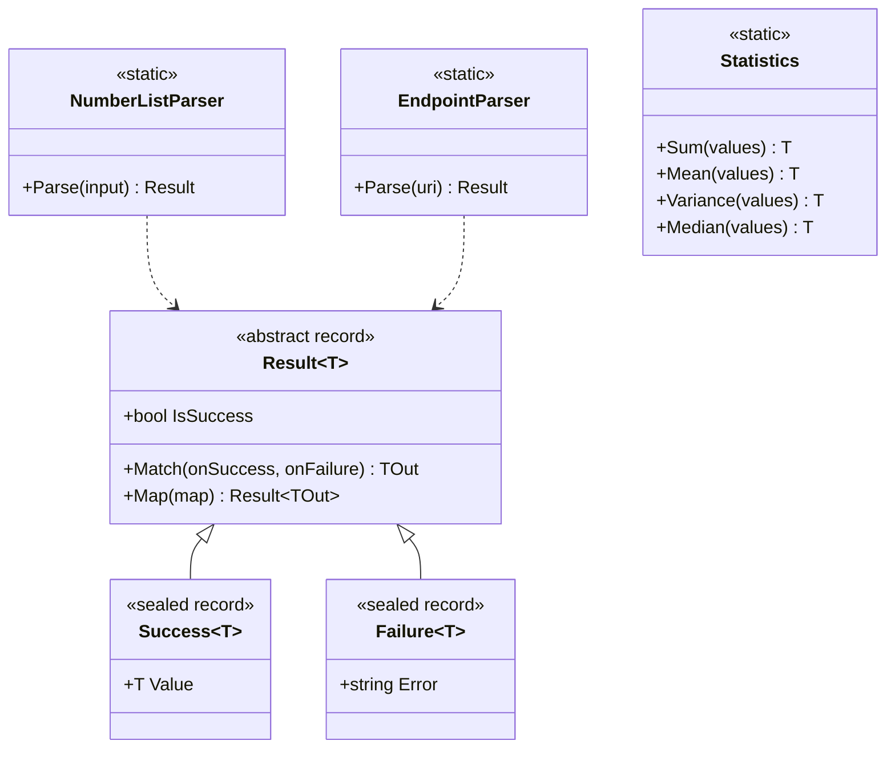

### 3.1 Inheritance, Interfaces and Polymorphism

C# has single inheritance of classes and multiple inheritance of interfaces. `virtual` members can be overridden, `abstract` members must be, and `sealed` stops further overriding or derivation.

```csharp
public interface IShape
{
    double Area { get; }
    string Describe() => $"{GetType().Name} with area {Area:F2}";   // default interface method (C# 8)
}

public abstract class Shape : IShape
{
    public abstract double Area { get; }
    public virtual string Name => GetType().Name;
    public override string ToString() => $"{Name}({Area:F1})";
}

public sealed class Circle(double radius) : Shape
{
    public override double Area => Math.PI * radius * radius;
}

public class Rectangle(double width, double height) : Shape
{
    public double Width { get; } = width;
    public double Height { get; } = height;
    public override double Area => Width * Height;
}

public sealed class Square(double side) : Rectangle(side, side)
{
    public override string Name => "Square";
}

public static class ShapeDemo
{
    public static void Run()
    {
        Shape[] shapes = [new Circle(1), new Rectangle(2, 3), new Square(2)];
        foreach (Shape s in shapes)
        {
            Console.WriteLine(s);                        // virtual dispatch picks the override
        }

        IShape shape = new Square(3);
        Console.WriteLine(shape.Describe());             // "Square with area 9.00"
    }
}
```

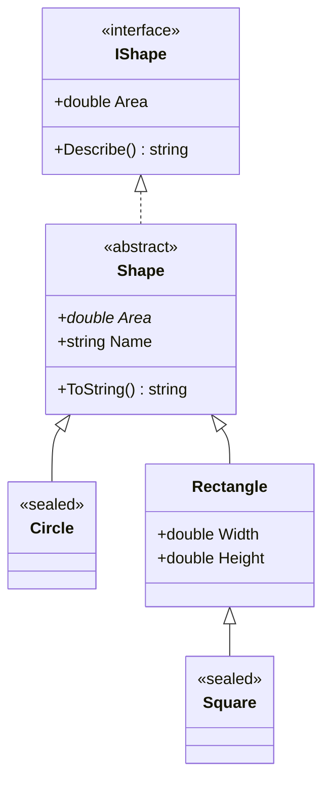

| Keyword | On a method or property | On a class |
| --- | --- | --- |
| `virtual` | Can be overridden | n/a |
| `abstract` | Must be overridden; no body | Cannot be instantiated; may hold abstract members |
| `override` | Replaces a base `virtual`/`abstract` member | n/a |
| `sealed` | `sealed override`: no further overrides | Cannot be derived from |
| `new` | Hides a base member (no polymorphism: the static type decides) | n/a |

Interface or abstract class? Use an interface for a capability many unrelated types can have (`IComparable<T>`, `IDisposable`, `IShape`); use an abstract base class when subclasses share real implementation and state. Default interface methods let you add a member to a published interface without breaking implementers, but they cannot hold instance state, and a class calling its own default method must cast itself to the interface first.

Prefer composition over deep hierarchies. `Square : Rectangle` is the textbook example of why: if `Rectangle` had setters for `Width` and `Height`, a `Square` could not honour them, which violates the Liskov substitution principle. The immutable version above is fine.

### 3.2 Generics and Constraints

Generics let one type or method work over many types with full type checking. Unlike Java, .NET generics are **reified**: `List<int>` and `List<string>` are different runtime types, and `typeof(T)` works inside the generic code.

How the runtime implements them matters for performance:

- For **value-type** arguments, the JIT generates separate specialized code per type (`List<int>`, `List<double>`), with no boxing.
- For **reference-type** arguments, all instantiations share one copy of the code (`List<string>` and `List<object>` run the same machine code), with a hidden lookup for type-specific details.

```csharp
public static class Generic
{
    // Constraints say what T can do, so the body may use it.
    public static T Max<T>(IEnumerable<T> items) where T : IComparable<T>
    {
        using IEnumerator<T> e = items.GetEnumerator();
        if (!e.MoveNext()) throw new InvalidOperationException("Empty sequence.");
        T best = e.Current;
        while (e.MoveNext())
        {
            if (e.Current.CompareTo(best) > 0) best = e.Current;
        }
        return best;
    }

    public static T Create<T>() where T : new() => new T();

    public static unsafe int SizeOf<T>() where T : unmanaged => sizeof(T);   // needs <AllowUnsafeBlocks>

    // allows ref struct (C# 13): T may be a span or another ref struct. Func<T, TResult>
    // declares the same anti-constraint since .NET 9, so a span can flow through it.
    public static TResult Apply<T, TResult>(T value, Func<T, TResult> map)
        where T : allows ref struct => map(value);

    public static void Run()
    {
        Console.WriteLine(Max(new[] { 3, 9, 4 }));                                 // 9
        Console.WriteLine(Apply("hello world".AsSpan(), s => s.IndexOf(' '))); // 5
    }
}

public sealed class Cache<TKey, TValue>(int capacity) where TKey : notnull
{
    private readonly Dictionary<TKey, TValue> _items = new(capacity);

    public TValue GetOrAdd(TKey key, Func<TKey, TValue> factory)
    {
        if (!_items.TryGetValue(key, out TValue? value))
        {
            value = factory(key);
            _items[key] = value;
        }
        return value;
    }
}
```

| Constraint | Meaning |
| --- | --- |
| `where T : class` / `class?` | Reference type (non-nullable / nullable) |
| `where T : struct` | Non-nullable value type |
| `where T : notnull` | Any non-nullable type; typical for dictionary keys |
| `where T : unmanaged` | Value type with no references anywhere inside; can be used with pointers and `sizeof` |
| `where T : new()` | Has a public parameterless constructor |
| `where T : SomeBase` / `ISomething` | Derives from or implements it |
| `where T : allows ref struct` | Anti-constraint (C# 13): T **may** be a ref struct, so the body must not box it or store it on the heap |
| `where T : INumber<T>` | Static abstract members are available (section 3.4) |

The `allows ref struct` anti-constraint is why `IEnumerable<T>`-like interfaces and helpers in the BCL can now accept `Span<T>` as a type argument. Write it when your generic code only passes values along and never stores them.

### 3.3 Variance: Covariance and Contravariance

Variance answers "can I use an `IEnumerable<string>` where an `IEnumerable<object>` is expected?" It applies only to generic **interfaces and delegates**, and only for reference-type arguments.

- **Covariance (`out T`)**: T appears only in output positions (return values). A producer of `string` is a producer of `object`. Example: `IEnumerable<out T>`, `IReadOnlyList<out T>`, `Func<out TResult>`.
- **Contravariance (`in T`)**: T appears only in input positions (parameters). A consumer of `object` can consume `string`. Example: `IComparer<in T>`, `Action<in T>`, `IEqualityComparer<in T>`.

```csharp
public interface IProducer<out T> { T Produce(); }
public interface IConsumer<in T> { void Consume(T item); }

public sealed class StringProducer : IProducer<string> { public string Produce() => "hello"; }
public sealed class ObjectPrinter : IConsumer<object> { public void Consume(object item) => Console.WriteLine(item); }

public static class VarianceDemo
{
    public static void Run()
    {
        IProducer<object> producer = new StringProducer();      // covariance: string -> object
        IConsumer<string> consumer = new ObjectPrinter();        // contravariance: object -> string
        consumer.Consume(producer.Produce().ToString()!);

        IEnumerable<object> objects = new List<string> { "a" };  // OK: IEnumerable<out T>
        // List<object> list = new List<string>();               // error CS0029: List<T> is invariant

        // Arrays are covariant too, unsafely: the check moves to runtime.
        object[] array = new string[1];
        try { array[0] = 42; }
        catch (ArrayTypeMismatchException) { Console.WriteLine("array covariance bites at runtime"); }

        // Variance does not apply to value types: IEnumerable<int> is not IEnumerable<object>.
        Console.WriteLine(new List<int>() is IEnumerable<object>);   // False
        Console.WriteLine(objects.Count());
    }
}
```

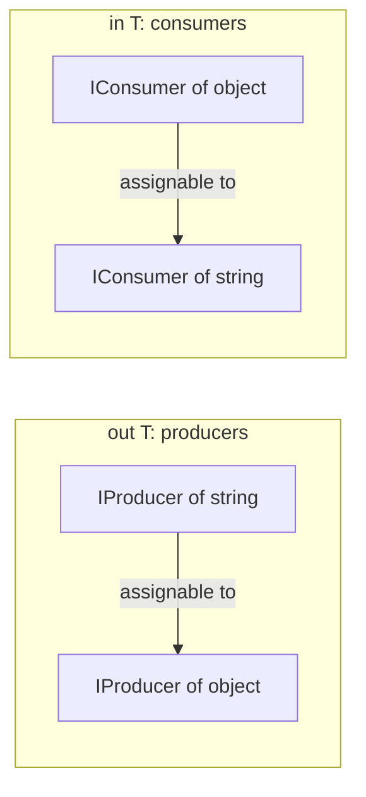

The compiler enforces the rules: putting `T` in a parameter of an `out T` interface is `error CS1961: Invalid variance`. Mutable collections (`List<T>`, `IList<T>`) are invariant because they both produce and consume `T`.

### 3.4 Static Abstract Interface Members and Generic Math

Before C# 11, a generic method could not write `a + b` for a type parameter: operators are static, and interfaces could only declare instance members. **Static abstract members** let an interface require static methods, properties and operators. .NET 7 used this to build **generic math**: `INumber<T>` and its relatives (`IAdditionOperators`, `IMultiplyOperators`, `IFloatingPoint<T>`, `IBinaryInteger<T>`...).

The starter's `Statistics` class works for `int`, `long`, `double`, `decimal`, `Half`, `BigInteger` and any user type that implements `INumber<T>`:

```csharp
using System.Numerics;

public static class Statistics
{
    public static T Sum<T>(ReadOnlySpan<T> values) where T : INumber<T>
    {
        T total = T.Zero;
        foreach (T value in values)
        {
            total += value;
        }

        return total;
    }

    public static T Mean<T>(ReadOnlySpan<T> values) where T : INumber<T>
    {
        ThrowIfEmpty(values);
        return Sum(values) / T.CreateChecked(values.Length);
    }

    public static T Variance<T>(ReadOnlySpan<T> values) where T : INumber<T>
    {
        T mean = Mean(values);
        T squares = T.Zero;
        foreach (T value in values)
        {
            T distance = value - mean;
            squares += distance * distance;
        }

        return squares / T.CreateChecked(values.Length);
    }

    private static void ThrowIfEmpty<T>(ReadOnlySpan<T> values)
    {
        if (values.IsEmpty)
        {
            throw new ArgumentException("At least one value is required.", nameof(values));
        }
    }
}
```

| Line / API | Role | What happens at runtime |
| :--- | :--- | :--- |
| `where T : INumber<T>` | Self-referencing constraint | "T is a number type whose operators take and return T." The `<T>` repeated inside is the curiously recurring template pattern. |
| `T.Zero` | Static abstract property | Resolved per type: `0`, `0.0`, `0m`. No virtual call, no boxing. |
| `total += value` | Static abstract `operator +` | For `int` the JIT emits a plain `add` instruction, because value-type generics are specialized. |
| `T.CreateChecked(values.Length)` | Conversion from `int` to T | Throws `OverflowException` if the value does not fit (e.g. `byte` with 300 items). `CreateSaturating` clamps; `CreateTruncating` wraps. |
| `ReadOnlySpan<T>` parameter | Accepts arrays, lists via `CollectionsMarshal.AsSpan`, stack memory | No copy and no allocation to call it. |

Defining your own number-like type is a matter of implementing the operator interfaces you need:

```csharp
using System.Numerics;

public readonly record struct Meters(double Value) :
    IAdditionOperators<Meters, Meters, Meters>,
    IAdditiveIdentity<Meters, Meters>
{
    public static Meters operator +(Meters left, Meters right) => new(left.Value + right.Value);
    public static Meters AdditiveIdentity => new(0);
}

public static class Totals
{
    public static T SumAll<T>(ReadOnlySpan<T> items)
        where T : IAdditionOperators<T, T, T>, IAdditiveIdentity<T, T>
    {
        T total = T.AdditiveIdentity;
        foreach (T item in items) total += item;
        return total;
    }

    public static void Run() =>
        Console.WriteLine(SumAll<Meters>([new(1.5), new(2.5)]));   // Meters { Value = 4 }
}
```

Ask for the narrowest interface that works: `IAdditionOperators` is enough for a sum, and more types implement it than `INumber<T>`.

### 3.5 Exceptions and the Result Pattern

Exceptions are .NET's built-in error channel. A `throw` unwinds the stack, running `finally` blocks, until a matching `catch` is found; if none is, the process terminates.

```csharp
using System.Runtime.ExceptionServices;

public sealed class InsufficientFundsException(decimal requested, decimal available)
    : InvalidOperationException($"Requested {requested}, but only {available} is available.")
{
    public decimal Requested { get; } = requested;
    public decimal Available { get; } = available;
}

public static class ExceptionDemo
{
    public static void Run()
    {
        try
        {
            Withdraw(balance: 50m, amount: 80m);
        }
        catch (InsufficientFundsException ex) when (ex.Requested - ex.Available < 50m)   // exception filter
        {
            Console.WriteLine($"Small shortfall: {ex.Message}");
        }
        catch (InvalidOperationException ex)
        {
            Console.WriteLine($"Other failure: {ex.Message}");
        }
        finally
        {
            Console.WriteLine("finally always runs");
        }
    }

    private static decimal Withdraw(decimal balance, decimal amount)
    {
        ArgumentOutOfRangeException.ThrowIfNegativeOrZero(amount);       // guard clauses
        if (amount > balance) throw new InsufficientFundsException(amount, balance);
        return balance - amount;
    }

    public static void Rethrow(Action work)
    {
        try { work(); }
        catch (Exception ex) when (Log(ex))   // filter that logs and returns false: the stack is not unwound yet
        {
        }
        catch (TimeoutException)
        {
            throw;          // rethrow, keeping the original stack trace
            // throw ex;    // would reset the stack trace to this line: avoid
        }
    }

    public static Exception? Captured;

    public static void RethrowLater()
    {
        // Rethrow an exception captured earlier (e.g. on another thread) with its original trace.
        if (Captured is not null) ExceptionDispatchInfo.Capture(Captured).Throw();
    }

    private static bool Log(Exception ex)
    {
        Console.Error.WriteLine(ex.GetType().Name);
        return false;
    }
}
```

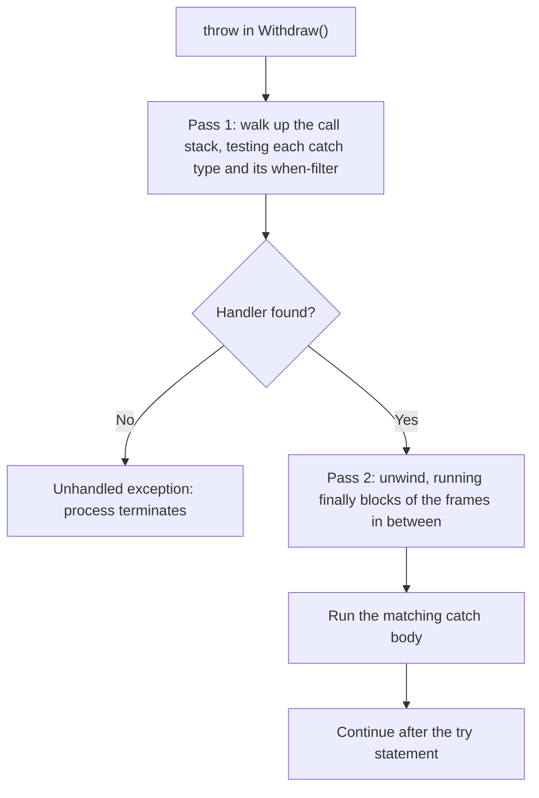

Exceptions are expensive when thrown (capturing the stack trace costs microseconds, far more than a return value) and invisible in signatures. For **expected** outcomes such as "the user typed a bad number" or "that stage does not exist", the starter returns a `Result<T>` instead:

```csharp
public abstract record Result<T>
{
    private Result() { }

    public sealed record Success(T Value) : Result<T>;

    public sealed record Failure(string Error) : Result<T>;

    public bool IsSuccess => this is Success;

    public TOut Match<TOut>(Func<T, TOut> onSuccess, Func<string, TOut> onFailure) => this switch
    {
        Success s => onSuccess(s.Value),
        Failure f => onFailure(f.Error),
        _ => throw new InvalidOperationException("Result has an unknown case."),
    };

    public Result<TOut> Map<TOut>(Func<T, TOut> map) => this switch
    {
        Success s => new Result<TOut>.Success(map(s.Value)),
        Failure f => new Result<TOut>.Failure(f.Error),
        _ => throw new InvalidOperationException("Result has an unknown case."),
    };
}
```

The private constructor closes the hierarchy: only the nested `Success` and `Failure` can derive from `Result<T>`, so a switch over those two covers every value that can exist. The `/api/stats` endpoint chains it: `NumberListParser.Parse(values).Map(Summarize).Match(ok => 200, error => 400)`.

| Use an exception when... | Use a Result when... |
| --- | --- |
| The failure is a bug or an environment problem (null argument, disk full, network down) | The failure is a normal outcome of valid use (validation, "not found") |
| The caller usually cannot handle it locally | The caller almost always handles it right away |
| It is rare, so the cost of throwing does not matter | It can happen on every request, so throwing would cost CPU |
| You want the stack trace for diagnosis | The message is for an end user |

Rules that hold either way: catch the most specific exception you can handle; never `catch (Exception) { }` and carry on silently; let `OperationCanceledException` propagate; and do not use exceptions for control flow in loops.

### 3.6 Resource Management: IDisposable, using and Finalizers

The garbage collector reclaims memory, not other resources. File handles, sockets, database connections and timers must be released explicitly, by implementing `IDisposable` (or `IAsyncDisposable`) and calling `Dispose`, which `using` does for you even when an exception is thrown.

```csharp
using System.Text;

public static class FileDemo
{
    public static async Task RunAsync()
    {
        string path = Path.Combine(Path.GetTempPath(), "demo.txt");

        // using statement: disposed at the closing brace, even if an exception is thrown.
        using (var writer = new StreamWriter(path, append: false, Encoding.UTF8))
        {
            await writer.WriteLineAsync("first line");
        } // writer.Dispose() here: flushes and closes the handle

        // await using for IAsyncDisposable: DisposeAsync flushes without blocking a thread.
        await using var stream = new FileStream(path, FileMode.Open, FileAccess.Read, FileShare.Read,
            bufferSize: 4096, useAsync: true);
        using var reader = new StreamReader(stream);   // using declaration (C# 8): disposed at the end of the scope
        Console.WriteLine(await reader.ReadLineAsync());
    } // reader, then stream, disposed here in reverse order of declaration
}

// A class that owns a disposable resource disposes it in its own Dispose.
public sealed class AuditLog(string path) : IDisposable
{
    private readonly StreamWriter _writer = new(path, append: true);
    private bool _disposed;

    public void Write(string message)
    {
        ObjectDisposedException.ThrowIf(_disposed, this);
        _writer.WriteLine($"{DateTimeOffset.UtcNow:O} {message}");
    }

    public void Dispose()
    {
        if (_disposed) return;
        _writer.Dispose();
        _disposed = true;
    }
}
```

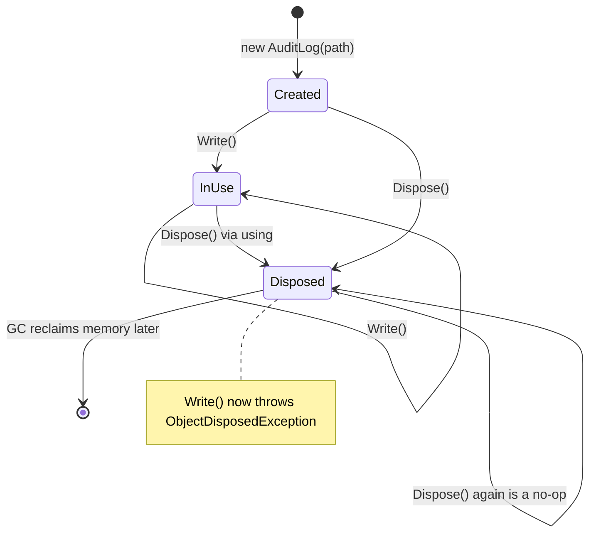

| Situation | What to write |
| --- | --- |
| Your type holds a managed disposable (stream, `HttpClient`, `DbConnection`) | A `sealed` class with a simple `Dispose()` that disposes the field, as above. No finalizer. |
| Your type holds a raw OS handle | Wrap it in a `SafeHandle` subclass. `SafeHandle` has the finalizer, so you do not need one. |
| Your type is unsealed and others may derive | The full pattern: `public void Dispose() { Dispose(true); GC.SuppressFinalize(this); }` plus `protected virtual void Dispose(bool disposing)`. |
| Disposal does I/O (flush, network close) | Implement `IAsyncDisposable` too and use `await using`. |

Finalizers (`~AuditLog()`) run on a dedicated thread at an unpredictable time after the object becomes unreachable, and they keep the object alive for an extra GC cycle. Writing one is almost never right in modern code.

### 3.7 Memory Layout: StructLayout, InlineArray, readonly struct and ref struct

Binary protocols and native libraries need exact byte offsets. `[StructLayout]` controls how the runtime lays out a struct's fields.

```csharp
using System.Buffers.Binary;
using System.Runtime.CompilerServices;
using System.Runtime.InteropServices;

// A fixed-size buffer of 6 bytes inside a struct, without unsafe code (C# 12).
[InlineArray(6)]
public struct MacAddress
{
    private byte _element0;
}

// Sequential layout with no padding: 6 + 6 + 2 = 14 bytes, exactly an Ethernet II header.
[StructLayout(LayoutKind.Sequential, Pack = 1)]
public struct EthernetHeader
{
    public MacAddress Destination;
    public MacAddress Source;
    private ushort _etherTypeBigEndian;     // network byte order on the wire

    public ushort EtherType
    {
        readonly get => BinaryPrimitives.ReverseEndianness(_etherTypeBigEndian);   // assumes a little-endian CPU
        set => _etherTypeBigEndian = BinaryPrimitives.ReverseEndianness(value);
    }
}

// Explicit layout: overlapping fields, like a C union. Byte order follows the CPU (little-endian on x64 and Arm64).
[StructLayout(LayoutKind.Explicit)]
public struct Register32
{
    [FieldOffset(0)] public uint Value;
    [FieldOffset(0)] public ushort Low;
    [FieldOffset(2)] public ushort High;
    [FieldOffset(0)] public byte Byte0;
}

public static class LayoutDemo
{
    public static void Run()
    {
        Console.WriteLine(Unsafe.SizeOf<EthernetHeader>());   // 14

        ReadOnlySpan<byte> frame = [0xFF, 0xFF, 0xFF, 0xFF, 0xFF, 0xFF, 0x02, 0, 0, 0, 0, 1, 0x08, 0x00];
        EthernetHeader header = MemoryMarshal.Read<EthernetHeader>(frame);   // reinterpret 14 bytes, no parsing
        Console.WriteLine($"0x{header.EtherType:X4}");                        // 0x0800 = IPv4
        Console.WriteLine(header.Destination[0]);                             // 255: inline arrays index like arrays

        var r = new Register32 { Value = 0xAABBCCDD };
        Console.WriteLine($"{r.High:X} {r.Low:X} {r.Byte0:X}");              // AABB CCDD DD
    }
}
```

`readonly struct` promises that no member mutates the instance. The compiler enforces it, and in return it never makes **defensive copies** when the struct is passed by `in` or stored in a `readonly` field. A non-readonly struct in a readonly field gets silently copied before every method call, because the compiler cannot prove the method will not mutate it.

`ref struct` types are restricted to the stack so that they can safely hold references into stack memory. `Span<T>` is the best-known one.

```csharp
using System.Buffers.Binary;

public readonly struct GeoCoordinate(double latitude, double longitude)
{
    public double Latitude { get; } = latitude;
    public double Longitude { get; } = longitude;

    // `in` passes 16 bytes by reference; readonly struct means no defensive copy.
    public double DistanceTo(in GeoCoordinate other)
    {
        double dLat = Latitude - other.Latitude;
        double dLon = Longitude - other.Longitude;
        return Math.Sqrt(dLat * dLat + dLon * dLon);   // flat approximation; use haversine for real distances
    }
}

// A ref struct writer over a caller-supplied buffer. Since C# 11 a ref struct can hold ref fields too.
public ref struct BufferWriter(Span<byte> buffer)
{
    private readonly Span<byte> _buffer = buffer;
    private int _position;

    public readonly int Written => _position;

    public void WriteUInt32(uint value)
    {
        BinaryPrimitives.WriteUInt32LittleEndian(_buffer[_position..], value);
        _position += sizeof(uint);
    }
}

public static class RefStructDemo
{
    public static void Run()
    {
        Span<byte> scratch = stackalloc byte[16];
        var writer = new BufferWriter(scratch);
        writer.WriteUInt32(0xDEADBEEF);
        writer.WriteUInt32(42);
        Console.WriteLine(writer.Written);                    // 8
        Console.WriteLine(new GeoCoordinate(0, 0).DistanceTo(new GeoCoordinate(3, 4)));   // 5
    }
}
```

| A `ref struct` cannot... | Because... |
| --- | --- |
| Be boxed, or be a field of a class or a normal struct | The heap object could outlive the stack frame the ref struct points into |
| Be an element of an array | Arrays live on the heap |
| Be captured by a lambda or a local function that becomes a delegate | The closure is a heap object |
| Live across an `await` or a `yield return` (local use between them is allowed since C# 13) | The state machine is moved to the heap when it suspends |
| Be a type argument, unless the generic declares `allows ref struct` (C# 13) | Generic code might box or store it |

Since C# 13, ref structs can implement interfaces, which they can only be used through generics with `allows ref struct`, never by converting to the interface type (that would box).

### 3.8 Span, ReadOnlySpan and Memory

Before `Span<T>`, parsing meant `Substring`, `Split` and `Array.Copy`: every slice was a new allocation. A `Span<T>` is a `ref struct` made of a managed reference to the first element and a length (16 bytes on 64-bit, after padding). It can point at:

1. part of a managed array on the heap,
2. stack memory from `stackalloc`,
3. native memory (`NativeMemory.Alloc`, memory-mapped files),
4. the characters of a string (`ReadOnlySpan<char>` only).

Slicing a span creates another span over the same memory: no copy and no allocation, with bounds checks on every access.

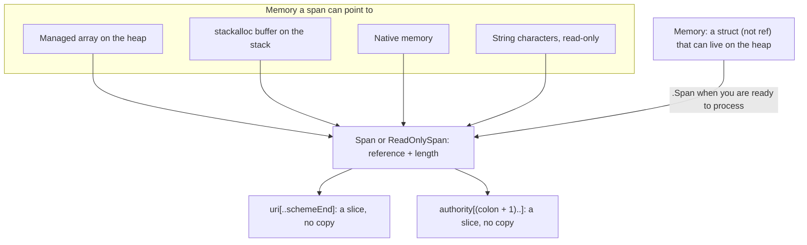

The starter's `EndpointParser` turns `"HTTPS://api.example.com:8443/v1"` into a `NetworkEndpoint` and allocates only the two strings in the result:

```csharp
public static Result<NetworkEndpoint> Parse(ReadOnlySpan<char> uri)
{
    int schemeEnd = uri.IndexOf("://");
    if (schemeEnd <= 0)
    {
        return Result.Fail<NetworkEndpoint>("Expected scheme://host[:port].");
    }

    ReadOnlySpan<char> scheme = uri[..schemeEnd];
    if (scheme.Length > MaxSchemeLength)
    {
        return Result.Fail<NetworkEndpoint>("Scheme is too long.");
    }

    ReadOnlySpan<char> authority = uri[(schemeEnd + 3)..];
    int slash = authority.IndexOf('/');
    if (slash >= 0)
    {
        authority = authority[..slash];
    }

    int colon = authority.LastIndexOf(':');
    ReadOnlySpan<char> host = colon >= 0 ? authority[..colon] : authority;
    if (host.IsEmpty)
    {
        return Result.Fail<NetworkEndpoint>("Host is missing.");
    }

    Span<char> lowerScheme = stackalloc char[scheme.Length];
    scheme.ToLowerInvariant(lowerScheme);

    // ... port parsing with int.TryParse(ReadOnlySpan<char>, ...) and a default-port switch

    return Result.Ok(new NetworkEndpoint(lowerScheme.ToString(), host.ToString(), port));
}
```

| Line / API | Role | What happens at runtime |
| :--- | :--- | :--- |
| `ReadOnlySpan<char> uri` parameter | Accepts a `string`, a `char[]` or a slice | A `string` argument converts implicitly; the span points into the string's characters. |
| `uri.IndexOf("://")` | Vectorized search | `MemoryExtensions.IndexOf` uses SIMD instructions where available. |
| `uri[..schemeEnd]` | Range on a span | Produces a new span (reference + length). Zero allocation. On a `string` the same syntax would call `Substring` and allocate. |
| `stackalloc char[scheme.Length]` | Stack buffer | Allocated in the current frame and freed automatically on return. Guarded by `MaxSchemeLength` so a hostile input cannot overflow the stack. |
| `scheme.ToLowerInvariant(lowerScheme)` | Copy-and-transform into a destination span | Writes into the caller's buffer instead of returning a new string. |
| `int.TryParse(portText, ...)` | Span overload of parsing | Parses straight from the slice; no `Substring`. |
| `host.ToString()` | Materialize | The only allocations: the final strings that outlive the call. |

`NumberListParser` does the same for comma-separated numbers, using the .NET 9 `MemoryExtensions.Split` that yields `Range` values instead of a `string[]`:

```csharp
foreach (Range range in input.Split(','))
{
    ReadOnlySpan<char> token = input[range].Trim();
    if (!double.TryParse(token, NumberStyles.Float, CultureInfo.InvariantCulture, out double value)
        || !double.IsFinite(value))
    {
        return Result.Fail<double[]>($"Item {position} ('{token}') is not a finite number.");
    }
    // ...
}
```

`Span<T>` versus `Memory<T>`:

- `Span<T>` is a `ref struct`, so it can only exist on the stack. It cannot be a field of a class, be boxed, or be held across an `await` (the async state machine lives on the heap).
- `Memory<T>` is an ordinary struct that wraps an array, a string or a `MemoryManager<T>` together with an offset and length. It can be a field, be captured in a closure and survive an `await`. When it is time to process the data, call `.Span`.

```csharp
public sealed class LineBuffer
{
    private Memory<byte> _pending = Memory<byte>.Empty;   // OK: Memory can be a field

    public async Task<int> FillAsync(Stream stream, byte[] storage, CancellationToken ct)
    {
        Memory<byte> target = storage.AsMemory();
        int read = await stream.ReadAsync(target, ct);   // OK: Memory survives the await
        _pending = target[..read];
        return CountNewLines(_pending.Span);              // switch to Span for the CPU work
    }

    private static int CountNewLines(ReadOnlySpan<byte> data) => data.Count((byte)'\n');
}
```

| Type | Kind | Heap field | Across `await` | Use for |
| --- | --- | --- | --- | --- |
| `Span<T>` / `ReadOnlySpan<T>` | `ref struct` | No | No | Synchronous processing, parsing, formatting |
| `Memory<T>` / `ReadOnlyMemory<T>` | struct | Yes | Yes | Async I/O buffers, storing slices |
| `ArraySegment<T>` | struct | Yes | Yes | Older APIs; prefer `Memory<T>` |
| `T[]` | class | Yes | Yes | Owning storage |

### 3.9 Pooling Buffers with ArrayPool

Allocating a fresh byte array per request creates garbage, and arrays of 85,000 bytes or more go straight to the Large Object Heap, which is collected only with Gen 2 (Stage 6). `ArrayPool<T>.Shared` rents arrays from a thread-safe pool and takes them back.

```csharp
using System.Buffers;
using System.Text;

public static class PooledEncoding
{
    public static int CountUtf8Chars(ReadOnlySpan<byte> payload)
    {
        // Rent may return a larger array than requested: always slice to the length you asked for.
        byte[] rented = ArrayPool<byte>.Shared.Rent(payload.Length);
        try
        {
            Span<byte> work = rented.AsSpan(0, payload.Length);
            payload.CopyTo(work);
            return Encoding.UTF8.GetCharCount(work);
        }
        finally
        {
            // clearArray: true wipes the buffer before the next renter sees it. Use it for secrets.
            ArrayPool<byte>.Shared.Return(rented, clearArray: false);
        }
    }

    public static string Hex(ReadOnlySpan<byte> data)
    {
        // Small and bounded: the stack. Large or unbounded: the pool. Never stackalloc unbounded input.
        const int StackLimit = 256;
        char[]? pooled = null;
        Span<char> chars = data.Length * 2 <= StackLimit
            ? stackalloc char[StackLimit]
            : (pooled = ArrayPool<char>.Shared.Rent(data.Length * 2));
        try
        {
            bool ok = Convert.TryToHexString(data, chars, out int written);
            return ok ? new string(chars[..written]) : throw new InvalidOperationException();
        }
        finally
        {
            if (pooled is not null) ArrayPool<char>.Shared.Return(pooled);
        }
    }
}
```

| Rule | Why |
| --- | --- |
| Return in a `finally` | An exception would otherwise leak the array; the pool then allocates new ones. |
| Slice to the requested length | `Rent(100)` may return a 128-element array holding old data in the tail. |
| Never use an array after returning it | Another thread may already be writing to it. This is a use-after-free bug with no crash, only corrupted data. |
| Do not return an array twice, or return one you did not rent | The pool will hand the same array to two renters. |
| `clearArray: true` for sensitive data | Otherwise the next renter can read your passwords or tokens. |
| Prefer `stackalloc` for small, bounded sizes | No pool contention at all; the frame frees it. |

### 3.10 Pitfalls

| Pitfall | Symptom | Fix |
| --- | --- | --- |
| `Substring` / `Split` in parsing loops | Gen 0 collections climb with request rate; allocation profiler shows `String` on top | Slice `ReadOnlySpan<char>` and parse with span overloads. |
| Boxing value types | Allocations from `object` parameters, non-generic collections (`ArrayList`), or calling an interface method on a struct through the interface type | Use generics with constraints (`where T : struct, IComparable<T>`) so the struct stays unboxed. |
| `throw ex;` instead of `throw;` | The stack trace starts at the rethrow line; the real origin is lost | Use `throw;`, or `ExceptionDispatchInfo.Capture(ex).Throw()` for a captured exception. |
| Swallowing exceptions | `catch (Exception) { }` hides failures; data is silently wrong | Catch only what you can handle; log and rethrow the rest. |
| Forgetting `Dispose` | `IOException: The process cannot access the file because it is being used by another process`, socket exhaustion, connection-pool timeouts | `using` / `await using` on every disposable you own. |
| Holding a `Span<T>` across `await` | `error CS4007: Instance of type 'System.Span<byte>' cannot be preserved across 'await' or 'yield' boundary` | Store a `Memory<T>` and take `.Span` after the await. |
| Unbounded `stackalloc` | `StackOverflowException` kills the process; it cannot be caught | Cap the size and fall back to `ArrayPool<T>` above the cap. |
| Using a pooled array after `Return` | Intermittent corrupted data under load | Treat `Return` like `free`; null out your reference. |
| Mutable struct in a `readonly` field | Mutating method calls have no effect (they run on a defensive copy) | Make the struct `readonly`, or the field non-readonly. |
| Assuming `CreateChecked` never throws | `OverflowException: Arithmetic operation resulted in an overflow.` with small types such as `byte` | Choose `CreateSaturating` or `CreateTruncating` deliberately, or use a wider T. |
| Integer generic math surprises | `Mean<int>([1, 2, 4])` returns 2, not 2.33 | Integer division truncates; compute in `double` or `decimal` when you need fractions. |
| Variance with value types | `List<int>` is not assignable to `IEnumerable<object>` | Variance is for reference types only; project with `.Cast<object>()` if you must. |

### 3.11 Best Practices

- **Seal classes and prefer composition**: hierarchies deeper than two levels are hard to change safely.
- **Constrain generics to the narrowest interface**: `IAdditionOperators<T,T,T>` instead of `INumber<T>` when you only add.
- **Return a Result for expected failures, throw for bugs**: the signature then tells callers what can go wrong.
- **Validate arguments with the `ThrowIf` helpers**: `ArgumentNullException.ThrowIfNull`, `ArgumentOutOfRangeException.ThrowIfNegative` and friends are short and produce standard messages.
- **Dispose what you create, not what you were given**: ownership decides who calls `Dispose`.
- **Make structs `readonly` unless mutation is the point**: it removes defensive copies and a class of bugs.
- **Take `ReadOnlySpan<T>` parameters in parsing and math helpers**: callers can then pass arrays, strings, slices and stack memory.
- **Cap every `stackalloc`**: use a constant limit and fall back to the pool.
- **Measure before and after**: use BenchmarkDotNet's `[MemoryDiagnoser]` (Stage 6) to prove that an allocation really went away.

### 3.12 Hands-on Exercise

Add `Statistics.Median<T>(ReadOnlySpan<T>) where T : INumber<T>` that returns the middle value of the sorted input (the mean of the two middle values for an even count), does not modify the caller's data, and throws `ArgumentException` for empty input. Add `Median` to the `/api/stats` response.

Expected results:

| Input | Median |
| --- | --- |
| `[3, 1, 2]` | `2` |
| `[4, 1, 3, 2]` | `2.5` |
| `[7]` | `7` |
| `[]` | `ArgumentException` |

```bash
curl "http://localhost:8080/api/stats?values=2,4,4,4,5,5,7,9"
# {"count":8,"sum":40,"mean":5,"variance":4,"median":4.5}
```

Hints: copy the span with `values.ToArray()` and sort the copy with `Span<T>.Sort()`; divide with `T.CreateChecked(2)`. Stretch: implement it in O(n) average time with Quickselect on a pooled buffer.

Solution: `Median` in [`src/LearnCSharp/Numerics/Statistics.cs`](./src/LearnCSharp/Numerics/Statistics.cs), the `Summarize` function in [`src/LearnCSharp/Program.cs`](./src/LearnCSharp/Program.cs), and `Median_handles_odd_and_even_lengths` in [`tests/LearnCSharp.Tests/StatisticsTests.cs`](./tests/LearnCSharp.Tests/StatisticsTests.cs).

[Back to top ⤴️](#-table-of-contents)

---

## 4. Stage 4: Async, Concurrency & Parallelism

Stage 4 explains what `async` and `await` compile into, when to return `ValueTask`, how async streams and ambient context flow, how the ThreadPool schedules work, and how to coordinate threads with `Interlocked`, locks and channels. It assumes Stage 3, in particular `Span<T>` versus `Memory<T>`. The starter's `ChannelPipeline` is the worked example.

### 4.1 The async/await State Machine

When you compile an `async` method, Roslyn rewrites it into a state machine type that implements `IAsyncStateMachine`. The method body is cut at each `await` into numbered states, and locals that are live across an `await` become fields of the state machine. In Release builds the state machine is a struct; it is copied to the heap (boxed into a runtime-provided box) only the first time an `await` actually has to suspend. A method that completes synchronously therefore allocates nothing for the state machine.

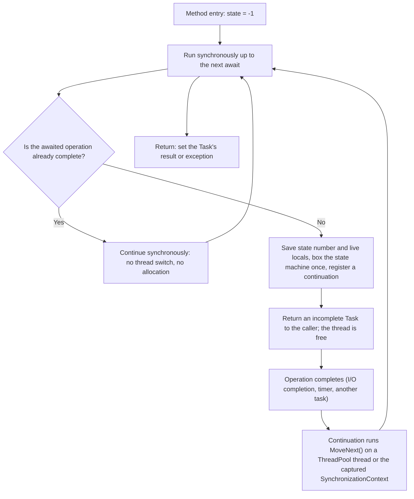

### 4.2 Task vs ValueTask

- **`Task<T>`** is a class. An async method that returns `Task<T>` allocates a task object whenever it completes asynchronously, and also when it completes synchronously with a result that is not cached by the runtime (the runtime caches a few, such as `Task<bool>` results and small integers).
- **`ValueTask<T>`** is a struct that holds either the result directly, a `Task<T>`, or an `IValueTaskSource<T>` (a reusable, poolable completion source). When a method usually completes synchronously, for example from a cache, `ValueTask<T>` removes the allocation.

```csharp
using System.Collections.Concurrent;

public sealed class CacheAccessor
{
    private readonly ConcurrentDictionary<string, byte[]> _memoryCache = new();

    public ValueTask<byte[]> GetPayloadAsync(string key)
    {
        // Cache hit: the result goes straight into the ValueTask struct. No allocation.
        if (_memoryCache.TryGetValue(key, out byte[]? cachedPayload))
        {
            return ValueTask.FromResult(cachedPayload);
        }

        // Cache miss: wrap the real asynchronous work.
        return new ValueTask<byte[]>(FetchFromRemoteDatabaseAsync(key));
    }

    private async Task<byte[]> FetchFromRemoteDatabaseAsync(string key)
    {
        await Task.Delay(50);         // stands in for network I/O
        byte[] data = [0x01, 0x02, 0x03];
        _memoryCache[key] = data;
        return data;
    }
}
```

A `ValueTask` may be awaited **once**. Awaiting it twice, awaiting it concurrently, or calling `.Result` before it has completed is undefined behaviour when it is backed by a pooled `IValueTaskSource`. If you need to await it more than once, call `.AsTask()` once and keep the `Task`.

### 4.3 Async Streams with IAsyncEnumerable

`IAsyncEnumerable<T>` combines `yield return` with `await`: a consumer pulls items with `await foreach`, and the producer can await between items without buffering the whole sequence.

```csharp
using System.Runtime.CompilerServices;

public static class TelemetryStreamer
{
    public static async IAsyncEnumerable<int> GenerateAsync(
        int count,
        [EnumeratorCancellation] CancellationToken cancellationToken = default)
    {
        for (int i = 0; i < count; i++)
        {
            await Task.Delay(20, cancellationToken);   // non-blocking delay; throws when cancelled
            yield return i * 10;
        }
    }
}

// Consumers can pass a token at the call or with WithCancellation; [EnumeratorCancellation] merges both.
// await foreach (int value in TelemetryStreamer.GenerateAsync(10).WithCancellation(ct)) { ... }
```

The starter's `/api/roadmap` endpoint returns an `IAsyncEnumerable<RoadmapStage>`, and ASP.NET Core writes the JSON array to the response as items arrive.

### 4.4 Context Propagation with AsyncLocal

An async call chain can resume on a different thread after every `await`, so `[ThreadStatic]` fields are useless for per-request data. `AsyncLocal<T>` stores a value in the `ExecutionContext`, which flows with the logical call chain across awaits, `Task.Run` and thread-pool callbacks.

```csharp
public static class RequestContext
{
    private static readonly AsyncLocal<string?> s_traceId = new();

    public static string? TraceId
    {
        get => s_traceId.Value;
        set => s_traceId.Value = value;
    }

    public static async Task HandleAsync()
    {
        TraceId = Guid.NewGuid().ToString("N");
        Console.WriteLine($"before await on thread {Environment.CurrentManagedThreadId}: {TraceId}");
        await Task.Delay(100);
        Console.WriteLine($"after await on thread {Environment.CurrentManagedThreadId}: {TraceId}");  // same value
    }
}
```

Values flow **down** into called methods and tasks started from them, not back **up**: a value set inside an awaited child method is not visible to the caller after the await returns. `System.Diagnostics.Activity.Current`, which carries distributed-tracing context, is built on the same mechanism.

### 4.5 The ThreadPool and Work Stealing

The .NET ThreadPool (implemented in managed code since .NET 6) runs `Task`s, async continuations and timer callbacks on a pool of worker threads.

1. **Global queue.** Work queued from a non-pool thread, or with `preferLocal: false`, goes into a shared FIFO queue.
2. **Per-thread local queues.** Work queued from a pool thread (for example a `Task` started inside another task) goes into that thread's local queue. The owner pushes and pops at one end (LIFO), which keeps related work cache-warm.
3. **Work stealing.** A worker with an empty local queue first checks the global queue, then steals from the other end (FIFO) of another worker's local queue.
4. **Thread injection.** A hill-climbing algorithm adds and removes threads to maximize throughput. When all threads are blocked, the pool adds threads slowly (roughly one or two per second beyond the minimum), which is why blocking calls cause **ThreadPool starvation**: queued work waits while the pool grows.

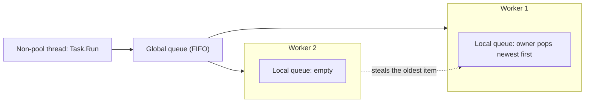

### 4.6 Lock-Free Synchronization with Interlocked

For a single variable, a hardware atomic instruction is cheaper than a lock and can never deadlock.

```csharp
public sealed class AtomicCounter
{
    private long _counter;

    public long Increment() => Interlocked.Increment(ref _counter);

    public long Read() => Interlocked.Read(ref _counter);   // atomic 64-bit read, also on 32-bit platforms

    // Compare-and-swap: set to `update` only if the current value is still `expected`.
    public bool CompareAndSwap(long expected, long update) =>
        Interlocked.CompareExchange(ref _counter, update, expected) == expected;
}
```

When several fields must change together, use a lock. Since C# 13 and .NET 9, prefer the dedicated `System.Threading.Lock` type over locking on an arbitrary `object`:

```csharp
public sealed class Inventory
{
    private readonly Lock _gate = new();
    private int _reserved;
    private int _available = 100;

    public bool TryReserve(int quantity)
    {
        lock (_gate)                       // compiles to _gate.EnterScope(); faster than Monitor
        {
            if (_available < quantity) return false;
            _available -= quantity;
            _reserved += quantity;
            return true;
        }
    }
}
```

### 4.7 Producer-Consumer Pipelines with Channels

`System.Threading.Channels` provides thread-safe, async-first queues. A bounded channel applies **backpressure**: when it is full, `WriteAsync` waits without blocking a thread until the consumer catches up. That is the main reason to prefer it over `BlockingCollection<T>`, which blocks threads and therefore starves the pool under load.

```csharp
using System.Threading.Channels;

public sealed class EventBroker
{
    private readonly Channel<string> _channel = Channel.CreateBounded<string>(new BoundedChannelOptions(10_000)
    {
        FullMode = BoundedChannelFullMode.Wait,   // backpressure instead of unbounded growth
        SingleWriter = false,
        SingleReader = true,                      // lets the channel use a faster single-reader implementation
    });

    public ValueTask PublishAsync(string payload, CancellationToken ct = default) =>
        _channel.Writer.WriteAsync(payload, ct);

    public void Complete() => _channel.Writer.Complete();

    public async Task ConsumeAsync(Action<string> process, CancellationToken ct = default)
    {
        // WaitToReadAsync + TryRead drains everything available before awaiting again.
        while (await _channel.Reader.WaitToReadAsync(ct))
        {
            while (_channel.Reader.TryRead(out string? message))
            {
                process(message);
            }
        }
    }
}
```

The starter's [`ChannelPipeline`](./src/LearnCSharp/Concurrency/ChannelPipeline.cs) adds two details that production code needs: a linked `CancellationTokenSource` that stops the producer when the consumer leaves early, and `writer.TryComplete(exception)` so a failure in the producer is rethrown to the consumer instead of hanging it. Both behaviours have tests in [`CurriculumTests.cs`](./tests/LearnCSharp.Tests/CurriculumTests.cs).

### 4.8 Pitfalls

| Pitfall | Symptom | Fix |
| --- | --- | --- |
| `async void` methods (outside UI event handlers) | An exception crashes the process; callers cannot await completion | Return `Task` or `ValueTask`. |
| Sync-over-async (`.Result`, `.Wait()`, `GetAwaiter().GetResult()`) | ThreadPool starvation and high latency under load; deadlocks where a single-threaded `SynchronizationContext` exists | Use `await` all the way up the call stack. |
| Unbounded `Channel<T>` for network ingestion | Memory grows until `OutOfMemoryException` when consumers fall behind | `Channel.CreateBounded<T>(capacity)` with `FullMode = Wait`. |
| Missing `ConfigureAwait(false)` in libraries used by UI or legacy ASP.NET apps | Extra context switches; deadlocks when the caller blocks | Use `ConfigureAwait(false)` in general-purpose libraries. ASP.NET Core has no `SynchronizationContext`, so app code there does not need it. |
| Awaiting a `ValueTask` twice | Wrong results or `InvalidOperationException` with pooled sources | Await once, or convert with `.AsTask()` once. |

[Back to top ⤴️](#-table-of-contents)

---

## 5. Stage 5: I/O, Serialization, HTTP, Data & Testing

Stage 5 moves from the language to the libraries every service uses: expression trees behind LINQ providers, source-generated JSON, streams, HTTP clients, data access and testing. It assumes Stages 1-4.

### 5.1 Expression Trees and LINQ Providers

LINQ providers such as Entity Framework Core do not execute your lambda. They accept an `Expression<Func<T, bool>>`, a data structure describing the code, walk the tree at runtime and translate it into SQL.

```csharp
using System.Linq.Expressions;

public static class ExpressionInspector
{
    public static void Describe(Expression<Func<int, bool>> predicate)
    {
        Console.WriteLine($"Root node: {predicate.NodeType}");           // Lambda
        if (predicate.Body is BinaryExpression binary)
        {
            Console.WriteLine($"Left: {binary.Left}");                   // x
            Console.WriteLine($"Operator: {binary.NodeType}");           // GreaterThan
            Console.WriteLine($"Right: {binary.Right}");                 // 5
        }

        Func<int, bool> compiled = predicate.Compile();                  // turn the tree back into a delegate
        Console.WriteLine(compiled(7));                                  // True
    }
}

// ExpressionInspector.Describe(x => x > 5);
```

The same lambda syntax produces a delegate when the target type is `Func<...>` and a tree when it is `Expression<Func<...>>`. That is why `IQueryable<T>.Where` can become SQL while `IEnumerable<T>.Where` runs in memory, and why a method call the provider does not understand inside a query fails at runtime with "could not be translated".

### 5.2 Source-Generated JSON with System.Text.Json

Reflection-based serialization inspects types at runtime: it costs startup time, allocates metadata, and breaks under trimming and Native AOT. The System.Text.Json source generator writes the serialization code during compilation instead.

```csharp
using System.Text.Json;
using System.Text.Json.Serialization;

public sealed record OrderDto(long OrderId, decimal Amount, string Currency);

[JsonSourceGenerationOptions(JsonSerializerDefaults.Web)]
[JsonSerializable(typeof(OrderDto))]
public sealed partial class OrderJsonContext : JsonSerializerContext;

public static class SerializationDemo
{
    public static string Serialize(OrderDto order) =>
        JsonSerializer.Serialize(order, OrderJsonContext.Default.OrderDto);   // generated metadata, no reflection

    public static OrderDto? Deserialize(string json) =>
        JsonSerializer.Deserialize(json, OrderJsonContext.Default.OrderDto);
}

// SerializationDemo.Serialize(new OrderDto(42, 9.99m, "EUR"))  ->  {"orderId":42,"amount":9.99,"currency":"EUR"}
```

The starter registers its own context, [`AppJsonContext`](./src/LearnCSharp/Serialization/AppJsonContext.cs), at the front of ASP.NET Core's resolver chain, so every response type it lists is serialized by generated code.

[Back to top ⤴️](#-table-of-contents)

---

## 6. Stage 6: Performance, Diagnostics, Security & Deployment

Stage 6 covers how the garbage collector works, how to measure performance correctly, how to instrument a service, which diagnostic tools to reach for, and how Native AOT changes deployment. It assumes Stages 1-5.

### 6.1 Generational Garbage Collection

CoreCLR uses a tracing, generational, compacting garbage collector built on the generational hypothesis: most objects die young.

- **Gen 0**: new small objects. Collected most often; a Gen 0 collection is usually short because it only scans young objects plus references into them from older ones (tracked with a card table).
- **Gen 1**: objects that survived one Gen 0 collection; a buffer between short- and long-lived data.
- **Gen 2**: long-lived objects such as caches and singletons. A full (Gen 2) collection scans the whole heap and is the expensive one; background GC does most of that work concurrently with your threads.
- **Large Object Heap (LOH)**: objects of 85,000 bytes or more. Logically part of Gen 2, so only collected with Gen 2, and not compacted by default, which can fragment it.
- **Pinned Object Heap (POH)**: since .NET 5, for objects allocated pinned (`GC.AllocateArray<T>(length, pinned: true)`), typically buffers handed to native code. Keeping them apart stops pinned objects from blocking compaction of the other generations.

Since .NET 7 the GC manages memory in **regions** rather than one large segment per generation, which lets it return memory to the OS and rebalance between generations more easily.

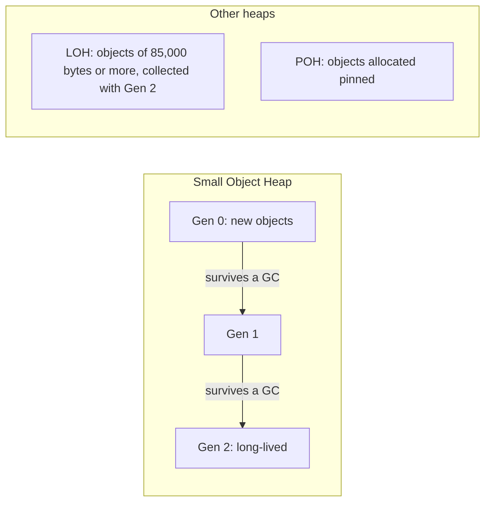

### 6.2 Workstation vs Server GC

- **Workstation GC** uses one heap and does collections on the thread that triggered them (plus a background GC thread for concurrent Gen 2). It is the default for console and desktop apps and keeps CPU and memory use modest.
- **Server GC** creates one heap and one dedicated GC thread per logical core and collects them in parallel, which maximizes throughput on multi-core servers. ASP.NET Core apps use it by default.
- **DATAS** (Dynamic Adaptation To Application Sizes), on by default with Server GC since .NET 9, starts with fewer heaps and grows or shrinks the count with the load. It makes Server GC far less memory-hungry in containers with small limits.

```xml
<PropertyGroup>
  <ServerGarbageCollection>true</ServerGarbageCollection>
  <ConcurrentGarbageCollection>true</ConcurrentGarbageCollection>
  <!-- Opt out of DATAS if you have measured that a fixed heap count is better: -->
  <!-- <GarbageCollectionAdaptationMode>0</GarbageCollectionAdaptationMode> -->
</PropertyGroup>
```

### 6.3 Micro-benchmarking with BenchmarkDotNet

Do not time micro-benchmarks with `Stopwatch` around a loop: you will measure Tier 0 code, JIT time and noise. BenchmarkDotNet runs a separate process per benchmark, warms up until tiering settles, runs many iterations, reports statistics and, with `[MemoryDiagnoser]`, allocated bytes per operation.

```csharp
using System.Text;
using BenchmarkDotNet.Attributes;
using BenchmarkDotNet.Running;

BenchmarkRunner.Run<StringConcatenationBenchmark>();

[MemoryDiagnoser]   // adds Allocated and Gen0/Gen1/Gen2 columns
public class StringConcatenationBenchmark
{
    private const int Iterations = 1_000;

    [Benchmark(Baseline = true)]
    public string Concatenation()
    {
        string result = string.Empty;
        for (int i = 0; i < Iterations; i++)
        {
            result += i.ToString();   // a new string every iteration: O(n^2) copying
        }
        return result;
    }

    [Benchmark]
    public string Builder()
    {
        var sb = new StringBuilder(Iterations * 4);
        for (int i = 0; i < Iterations; i++)
        {
            sb.Append(i);             // appends into one growing buffer, no per-item string
        }
        return sb.ToString();
    }
}
```

```bash
dotnet package add BenchmarkDotNet
dotnet run -c Release     # benchmarks must run in Release; BenchmarkDotNet refuses Debug builds
```

### 6.4 Tracing and Metrics with OpenTelemetry

.NET has tracing and metrics APIs built in: `System.Diagnostics.ActivitySource` creates spans and `System.Diagnostics.Metrics.Meter` creates instruments. The OpenTelemetry .NET SDK listens to both and exports them, so library code needs no OpenTelemetry dependency at all.

```csharp
using System.Diagnostics;
using System.Diagnostics.Metrics;

public static class PaymentTelemetry
{
    private static readonly ActivitySource Source = new("Shop.Payments");
    private static readonly Meter Meter = new("Shop.Payments");
    private static readonly Counter<long> Processed = Meter.CreateCounter<long>("payments.processed");
    private static readonly Histogram<double> Duration = Meter.CreateHistogram<double>("payments.duration", unit: "ms");

    public static void Process(string orderId, decimal amount)
    {
        long start = Stopwatch.GetTimestamp();
        using Activity? activity = Source.StartActivity("ProcessPayment");   // null when nobody listens: near-zero cost
        activity?.SetTag("order.id", orderId);
        activity?.SetTag("payment.amount", amount);

        // ... the real work ...

        Processed.Add(1, new KeyValuePair<string, object?>("currency", "EUR"));
        Duration.Record(Stopwatch.GetElapsedTime(start).TotalMilliseconds);
    }
}
```

### 6.5 Diagnostic CLI Tools

```bash
dotnet tool install --global dotnet-counters
dotnet tool install --global dotnet-trace
dotnet tool install --global dotnet-dump

# Live CPU, GC, allocation rate, ThreadPool queue length and lock contention
dotnet-counters monitor --process-id <PID> --counters System.Runtime

# Low-overhead CPU sampling trace; open the .nettrace in PerfView or Visual Studio, or convert to speedscope
dotnet-trace collect --process-id <PID> --profile cpu-sampling
dotnet-trace convert trace.nettrace --format Speedscope

# Heap dump for leak analysis
dotnet-dump collect --process-id <PID>
dotnet-dump analyze <dump-file>
#   > dumpheap -stat         objects by type and total size
#   > gcroot <address>       why an object is still alive
#   > clrstack -all          managed stacks of every thread (deadlocks, starvation)
```

### 6.6 Native AOT

Native AOT compiles IL to machine code at publish time and links the runtime into one self-contained executable.

```bash
dotnet publish -c Release -r linux-x64 -p:PublishAot=true
```

- **Benefits**: startup in tens of milliseconds instead of hundreds, a smaller working set, no JIT CPU cost at startup, and a single file that needs only the `runtime-deps` base image.
- **Constraints**: the app is trimmed, so code must be statically analysable. Unbounded reflection over types the compiler cannot see, `Reflection.Emit`, loading assemblies at runtime and some dynamic serialization patterns do not work. Serializers, DI and configuration binding must use source generators (System.Text.Json source generation, the configuration binder generator). There is no Dynamic PGO, so peak steady-state throughput can be lower than the JIT's. You must publish once per OS/architecture.

Build with `<IsAotCompatible>true</IsAotCompatible>` in libraries to get trimming and AOT analyzer warnings during normal builds, long before publish.

### 6.7 Pitfalls

| Pitfall | Symptom | Fix |
| --- | --- | --- |
| LINQ in hot paths | Allocations from enumerators, closures and intermediate lists show up in `[MemoryDiagnoser]` | Use `for`/`foreach` over spans or arrays in latency-critical loops; keep LINQ elsewhere. |
| Large temporary buffers | LOH grows and fragments; frequent Gen 2 collections | Rent from `ArrayPool<T>`; stream instead of buffering whole payloads. |
| Benchmarking in Debug or with `Stopwatch` | Numbers that change between runs and do not match production | BenchmarkDotNet in Release. |

[Back to top ⤴️](#-table-of-contents)

---

## M1. Masterclass: Zero-Allocation Event Processor Blueprint

A complete ingestion pipeline that combines `ValueTask`, a bounded `Channel<T>`, span-based binary decoding and orderly shutdown. Packets have a 12-byte big-endian header: 4-byte magic, 4-byte sequence number, 4-byte payload length.

### M1.1 Complete Worked Example

```csharp
using System.Buffers.Binary;
using System.Threading.Channels;

var processor = new EventProcessor();
processor.Start();

byte[] packet = new byte[32];
BinaryPrimitives.WriteUInt32BigEndian(packet.AsSpan(0, 4), EventProcessor.Magic);
BinaryPrimitives.WriteUInt32BigEndian(packet.AsSpan(4, 4), 101);
BinaryPrimitives.WriteInt32BigEndian(packet.AsSpan(8, 4), 20);

for (int i = 0; i < 100_000; i++)
{
    // The same immutable buffer is reused here. Real code that reuses a buffer
    // must copy or rent per packet, because the consumer may still be reading it.
    await processor.IngestAsync(packet);
}

await processor.DisposeAsync();
Console.WriteLine($"Processed {processor.Processed} packets, rejected {processor.Rejected}.");

public sealed class EventProcessor : IAsyncDisposable
{
    public const uint Magic = 0xDEADBEEF;
    private const int HeaderSize = 12;

    private readonly Channel<ReadOnlyMemory<byte>> _ingress;
    private readonly CancellationTokenSource _abort = new();
    private Task? _worker;
    private long _processed;
    private long _rejected;

    public EventProcessor(int queueCapacity = 50_000)
    {
        _ingress = Channel.CreateBounded<ReadOnlyMemory<byte>>(new BoundedChannelOptions(queueCapacity)
        {
            FullMode = BoundedChannelFullMode.Wait,
            SingleWriter = false,
            SingleReader = true,
        });
    }

    public long Processed => Interlocked.Read(ref _processed);
    public long Rejected => Interlocked.Read(ref _rejected);

    public void Start() => _worker = Task.Run(() => ConsumeAsync(_abort.Token));

    public ValueTask IngestAsync(ReadOnlyMemory<byte> packet) =>
        _ingress.Writer.WriteAsync(packet, _abort.Token);   // waits when the queue is full: backpressure

    private async Task ConsumeAsync(CancellationToken token)
    {
        ChannelReader<ReadOnlyMemory<byte>> reader = _ingress.Reader;
        while (await reader.WaitToReadAsync(token))
        {
            while (reader.TryRead(out ReadOnlyMemory<byte> packet))
            {
                if (TryDecode(packet.Span, out _)) Interlocked.Increment(ref _processed);
                else Interlocked.Increment(ref _rejected);
            }
        }
    }

    private static bool TryDecode(ReadOnlySpan<byte> packet, out uint sequence)
    {
        sequence = 0;
        if (packet.Length < HeaderSize) return false;

        uint magic = BinaryPrimitives.ReadUInt32BigEndian(packet[..4]);
        sequence = BinaryPrimitives.ReadUInt32BigEndian(packet[4..8]);
        int length = BinaryPrimitives.ReadInt32BigEndian(packet[8..12]);
        if (magic != Magic || length < 0 || length > packet.Length - HeaderSize) return false;

        ReadOnlySpan<byte> payload = packet.Slice(HeaderSize, length);   // a slice, not a copy
        return !payload.IsEmpty;
    }

    public async ValueTask DisposeAsync()
    {
        // Graceful: stop accepting, let the consumer drain what is queued, and only
        // abort if draining takes too long.
        _ingress.Writer.TryComplete();
        if (_worker is not null)
        {
            try
            {
                await _worker.WaitAsync(TimeSpan.FromSeconds(10));
            }
            catch (TimeoutException)
            {
                await _abort.CancelAsync();
            }
        }
        _abort.Dispose();
    }
}
```

The key design points: the bounded channel turns a fast producer into backpressure rather than memory growth; decoding works on `ReadOnlySpan<byte>` slices, so the hot loop allocates nothing; counters use `Interlocked` because they are read from other threads; and shutdown completes the writer first, so queued packets are processed instead of dropped.

[Back to top ⤴️](#-table-of-contents)

---

## 7. Stage 7: Staff C# Engineer Interview Handbook & Cheatsheet

Questions are grouped by theme and numbered continuously. Answers aim at the depth a staff-level interview expects: what the mechanism is, why it exists, and where it fails.

### 7.1 Core Concepts (Q1-Q10)

#### Q1. What is the exact difference between Span and Memory?

`Span<T>` is a `ref struct`, so it can only exist on the stack. It cannot be a field of a class, be boxed, be captured by a lambda, or live across an `await` or `yield` (the async state machine and iterator objects live on the heap, and a span may point into stack memory that will be gone).

`Memory<T>` is an ordinary struct that holds a reference to an array, a string or a `MemoryManager<T>` plus an offset and length. It can be stored in fields, captured in closures and held across `await`. The usual design is to pass `Memory<T>` through async APIs and take `.Span` at the point where synchronous CPU work happens. `Memory<T>.Span` is slightly more expensive than slicing a span, so do it once per batch, not per element.

#### Q2. How do tiered compilation and Dynamic PGO improve performance?

Tiered compilation first compiles a method quickly with few optimizations (Tier 0) so startup is fast, then recompiles hot methods with full optimization (Tier 1). Dynamic PGO, on by default since .NET 8, inserts an instrumented step in between that records what the program actually does:

1. **Type feedback**: which concrete type sits behind an interface or virtual call. Tier 1 then emits a guarded direct call (often inlined) for the dominant type, with a fallback for others.
2. **Branch and block counts**: Tier 1 lays out the hot path as straight-line code and moves cold blocks away, improving branch prediction and instruction-cache use.
3. **Loop behaviour**: combined with On-Stack Replacement, long-running loops in Tier 0 methods get optimized code without waiting for the method to be called again.

The trade-off is a warm-up period after each deploy; ReadyToRun images reduce it, and Native AOT removes it at the cost of losing PGO.

#### Q3. Why should general-purpose libraries use ConfigureAwait(false)?

By default, `await` captures the current `SynchronizationContext` (a UI dispatcher, or the request context of legacy ASP.NET) and posts the continuation back to it. In library code that does not touch UI, that is wasted work, and it can deadlock if the caller blocks on the task with `.Result` while holding the single context thread that the continuation needs. `ConfigureAwait(false)` tells the awaiter to continue on any thread-pool thread.

ASP.NET Core and console apps have no `SynchronizationContext`, so application code there gains nothing from it. It still matters in libraries, because you do not know who will call them.

#### Q4. What is the Large Object Heap threshold and why does it matter?

Objects of 85,000 bytes or more go to the Large Object Heap. (On 32-bit processes, `double[]` arrays of 1,000 elements or more also go there, for alignment; that rule does not apply to 64-bit.) The LOH is logically part of Gen 2, so large objects are only collected during full collections, and it is not compacted by default because copying megabytes is expensive. Frequent short-lived large allocations therefore cause Gen 2 collections and fragmentation.

Fixes: rent large buffers from `ArrayPool<T>`, stream data instead of buffering it whole, and, if fragmentation is proven, request a one-time compaction with `GCSettings.LargeObjectHeapCompactionMode = GCLargeObjectHeapCompactionMode.CompactOnce`.

#### Q5. How do Roslyn source generators differ from reflection?

Reflection (`Type.GetProperties()`, `MethodInfo.Invoke()`) discovers metadata and invokes members at runtime. That costs startup time and allocations, and trimming or Native AOT may remove the members it needs because the linker cannot see the dynamic access.

Source generators run inside the compiler. They inspect the syntax and semantic model of your code and add new C# source files to the compilation, which are then compiled like hand-written code. The work moves to build time, the result is statically analysable (so trimming and AOT work), and you can read and debug the generated code. The cost is build-time complexity: incremental generators must be written carefully to keep IDE performance acceptable. Examples in the BCL include System.Text.Json source generation, `[LoggerMessage]`, `[GeneratedRegex]` and the configuration binder generator.

#### Q6. What is ValueTask for, and when should you not use it?

`ValueTask<T>` avoids allocating a `Task<T>` when a method usually completes synchronously, for example a cache hit, and lets high-throughput APIs (sockets, channels, pipes) complete from pooled `IValueTaskSource` objects.

Do not use it when:

1. The method almost always completes asynchronously: a `Task<T>` will be allocated anyway, and `ValueTask<T>` adds size and complexity.
2. Callers need to await the result more than once, store it, or await it concurrently. A `ValueTask` must be consumed exactly once; with a pooled source, a second await can observe another operation's result. If you need multiple awaits, call `.AsTask()` once.
3. You expose it in a public API without a measured reason. `Task` is easier to use correctly.

#### Q7. Explain the differences between class, struct, record class and record struct.

- `class`: reference type on the heap, reference equality by default, supports inheritance.
- `struct`: value type stored inline, copied on assignment. Default `Equals` compares fields, through reflection unless the struct contains only blittable fields, and boxes; override `Equals`/`GetHashCode` or use `record struct` for performance.
- `record class`: reference type with compiler-generated value equality (including an `EqualityContract` so derived records are never equal to base records), `ToString`, `Deconstruct` for positional records, and `with` expressions.
- `record struct` (C# 10): value type with generated value equality via `IEquatable<T>` (no boxing, no reflection), `ToString` and `with`. Positional properties are mutable unless declared `readonly record struct`.

Choose by semantics first (identity versus value) and by size and allocation profile second.

#### Q8. What is the Pinned Object Heap?

Introduced in .NET 5, the POH holds objects that were allocated as pinned from the start, with `GC.AllocateArray<T>(length, pinned: true)` or `GC.AllocateUninitializedArray<T>(..., pinned: true)`. Pinned objects cannot be moved by the GC, and when they are scattered among normal objects they block compaction and fragment the heap. Putting long-lived pinned buffers (typically I/O buffers handed to native code) in their own heap keeps the rest of the heap compactable. Short-term pinning with `fixed` or `GCHandle.Alloc(obj, GCHandleType.Pinned)` still pins objects where they are, so keep those pins brief.

#### Q9. Why does System.Threading.Channels outperform BlockingCollection under load?

`BlockingCollection<T>` blocks the calling thread when the collection is empty (consumer) or full (bounded producer). In a server, blocked thread-pool threads cannot run other work, so the pool injects threads slowly and latency climbs: ThreadPool starvation.

`Channel<T>` is asynchronous: `WriteAsync` and `ReadAsync`/`WaitToReadAsync` return `ValueTask`s that complete later without holding a thread. Its implementations are specialized by options (`SingleReader`, `SingleWriter`, bounded or unbounded) and avoid allocation on the fast path. Bounded channels add backpressure policies (`Wait`, `DropOldest`, `DropNewest`, `DropWrite`).

#### Q10. What are static abstract interface members and why were they added?

Static abstract (and static virtual) members, added in C# 11, let an interface require static methods, properties and operators from implementing types. Before, generic code could not call `T.Parse` or use `+` on a `T`, because those are static.

They enable generic math: `INumber<T>`, `IAdditionOperators<TSelf,TOther,TResult>`, `IParsable<T>` and friends, so one algorithm can work for every numeric type with no boxing, since value-type generics are specialized by the JIT and the static calls resolve to the concrete type's operators. They also enable patterns such as static factory interfaces (`IParsable<T>.Parse`) for generic parsing and serialization. See [section 3.4](#34-static-abstract-interface-members-and-generic-math).

### 7.2 Internals & Performance (Q11-Q15)

#### Q11. What is the difference between Server GC and Workstation GC?

Workstation GC uses one managed heap; collections run on the thread that triggered them (with background GC for Gen 2 by default). It minimizes CPU and memory use and suits client apps and small services.

Server GC creates one heap and one dedicated, high-priority GC thread per logical core, and collects all heaps in parallel. It maximizes throughput on multi-core servers at the cost of more memory. Since .NET 9, DATAS adapts the number of heaps to the actual load, which fixes the classic problem of Server GC reserving large amounts of memory in small containers. ASP.NET Core defaults to Server GC; set `<ServerGarbageCollection>` explicitly when you have measured a reason.

#### Q12. What does ref struct enforce, and why?

A `ref struct` must stay on the stack. The compiler forbids boxing it, storing it in a field of a class or a non-ref struct, making it an array element, capturing it in a lambda, keeping it alive across `await` or `yield`, and (unless the generic declares `allows ref struct`) using it as a type argument. These rules guarantee that a `Span<T>` pointing at `stackalloc` memory, or a `ref` field (C# 11), can never outlive the stack frame it refers to. Escape analysis (`scoped`, ref-safe-to-escape rules) extends the same guarantee to methods that return spans.

#### Q13. How does the in parameter modifier work?

`in` passes an argument by reference, avoiding a copy of a large struct, and forbids the callee from assigning to it. The caller may omit `in` at the call site, and the compiler may pass a temporary when the argument is not a variable. If the struct is not `readonly`, the compiler must assume any method or property call might mutate it, so it makes a defensive copy before each call, which can make `in` slower than passing by value. Use `in` with `readonly struct` types larger than about 16 bytes. C# 12's `ref readonly` parameters are the stricter alternative when the API must receive a real variable.

#### Q14. What is Native AOT, and what trade-offs does it introduce?

Native AOT compiles an application to machine code at publish time and links the runtime into a single native executable, so no JIT runs at runtime.

Benefits: very fast startup, lower memory use, a single file, and a minimal base image. Trade-offs: the app is trimmed, so unbounded reflection and `Reflection.Emit` do not work and all serialization and DI must be statically analysable (source generators); there is no Dynamic PGO, so steady-state throughput can be lower than the JIT path; builds are per-platform; and some libraries are not yet compatible. It suits serverless functions, CLIs, sidecars and scale-to-zero services; long-running, high-throughput services often stay on the JIT.

#### Q15. How does ArrayPool reduce Large Object Heap pressure?

Without pooling, every large temporary buffer is a new LOH allocation that is only reclaimed by a Gen 2 collection, and repeated allocate-and-drop cycles fragment the LOH. `ArrayPool<T>.Shared` keeps per-core and shared buckets of arrays in power-of-two sizes, so threads rent and return buffers and the steady state allocates nothing. The cost is discipline: callers must return arrays exactly once, never touch them afterwards, slice to the requested length, and clear sensitive data.

### 7.5 Staff Cheatsheet

| Need | C# answer | Gotcha |
| --- | --- | --- |
| Zero-allocation slicing | `Span<T>`, `ReadOnlySpan<T>` (C# 7.2) | Not across `await`; use `Memory<T>`. |
| Async streaming | `IAsyncEnumerable<T>` with `await foreach` (C# 8) | Add `[EnumeratorCancellation]` to the token parameter. |
| Exhaustive branching | `expr switch { pattern => value }` (C# 8) | Add a throwing `_` arm for open hierarchies. |
| Immutable data with value equality | `record` (C# 9), `readonly record struct` (C# 10) | Collections inside records compare by reference. |
| Arithmetic over any number type | `where T : INumber<T>` (C# 11) | Integer division still truncates. |
| Multi-line literals | Raw strings `"""..."""` (C# 11) | Indentation is trimmed to the closing quotes. |
| Constructor injection without boilerplate | `class Service(ILogger<Service> log)` (C# 12) | Parameters are mutable captured variables, not properties. |
| Collection literals | `int[] a = [1, 2, 3];`, spread `[.. a, 4]` (C# 12) | Target type decides the collection created. |
| Allocation-free variadic arguments | `params ReadOnlySpan<T>` (C# 13) | Callers on older compilers see an array overload only if you provide one. |
| A faster lock | `System.Threading.Lock` with `lock` (C# 13) | Do not cast it to `object`. |
| Properties with logic but no backing field | `field` keyword (C# 14) | A member named `field` now needs `@field`. |
| Extension properties and static members | `extension(T receiver) { ... }` blocks (C# 14) | Instance members still win over extensions. |

[Back to top ⤴️](#-table-of-contents)

---

## 🧪 Example Projects

| Project | Builds on | What you practise | Stretch goal |
| --- | --- | --- | --- |
| [Starter API](./src/LearnCSharp) (in this repo) | [Stage 1](#1-stage-1-toolchain-runtime--c-fundamentals) to [Stage 3](#3-stage-3-oop-generics-memory--error-handling) | Minimal APIs, records, pattern matching, generic math, span parsing, the Result pattern, xUnit with `WebApplicationFactory` | Add `/api/percentile?p=95` with Quickselect on a pooled buffer. |
| Log file analyzer CLI | [1.9](#19-strings-interpolation-and-raw-string-literals), [2.8](#28-linq-fundamentals), [3.8](#38-span-readonlyspan-and-memory) | Streaming a large file line by line, span parsing, `CountBy` aggregation | Process a 1 GB file in constant memory and report allocations with BenchmarkDotNet. |
| Money and currency library | [2.3](#23-structs-records-and-record-structs), [3.4](#34-static-abstract-interface-members-and-generic-math) | `readonly record struct`, operator overloading, generic math interfaces | Publish it as a NuGet package with Central Package Management and SourceLink. |
| Rule engine for API requests | [2.5](#25-pattern-matching-and-switch-expressions), [3.1](#31-inheritance-interfaces-and-polymorphism) | Sealed record hierarchies, property and list patterns | Load rules from JSON with source-generated serialization. |
| Binary protocol decoder | [3.7](#37-memory-layout-structlayout-inlinearray-readonly-struct-and-ref-struct), [3.9](#39-pooling-buffers-with-arraypool) | `StructLayout`, `[InlineArray]`, `BinaryPrimitives`, `ArrayPool<T>` | Decode a pcap capture with zero allocations per packet. |
| Rate-limited job queue | [4.6](#46-lock-free-synchronization-with-interlocked), [4.7](#47-producer-consumer-pipelines-with-channels) | Bounded channels, backpressure, cancellation, graceful shutdown | Add per-tenant fairness and expose queue depth as an OpenTelemetry gauge. |
| Event processor service | [M1](#m1-masterclass-zero-allocation-event-processor-blueprint) | The full blueprint: ingestion, decoding, counters, shutdown | Publish with Native AOT and compare startup and memory with the JIT build. |

## 📝 Cheat Sheets

### CLI / Commands

```bash
# Create
dotnet new console -o App
dotnet new web -o Api                          # empty ASP.NET Core app
dotnet new webapiaot -o FastApi                # Web API template preconfigured for Native AOT
dotnet new xunit -o App.Tests
dotnet new sln -n App && dotnet sln add App/App.csproj App.Tests/App.Tests.csproj
dotnet new globaljson --sdk-version 10.0.100 --roll-forward latestFeature

# Run single files (.NET 10)
dotnet run script.cs
dotnet project convert script.cs

# Build, run, test
dotnet build -c Release
dotnet run --project src/LearnCSharp
dotnet watch --project src/LearnCSharp
dotnet test --filter "FullyQualifiedName~Parser"
dotnet test --collect:"XPlat Code Coverage"
dotnet format --verify-no-changes

# Packages
dotnet package add BenchmarkDotNet
dotnet package list --outdated
dotnet package list --vulnerable --include-transitive
dotnet restore --locked-mode

# Publish
dotnet publish -c Release -o out
dotnet publish -c Release -r linux-x64 --self-contained -p:PublishSingleFile=true
dotnet publish -c Release -r linux-x64 -p:PublishAot=true
dotnet publish -c Release -p:PublishReadyToRun=true -r linux-x64

# Run benchmarks (always Release)
dotnet run -c Release --project benchmarks/Benchmarks.csproj

# Diagnostics
dotnet-counters monitor --process-id <PID> --counters System.Runtime
dotnet-trace collect --process-id <PID> --profile cpu-sampling
dotnet-dump collect --process-id <PID>
```

### C# Syntax Quick Reference

| Task | Code |
| --- | --- |
| Null fallback and assignment | `name ?? "anon"`, `cache ??= new()` |
| Null-conditional access and assignment | `order?.Customer?.Name`, `order?.ShippedAt = now` (C# 14) |
| Last element, slice | `items[^1]`, `items[1..^1]` |
| Type test and bind | `if (shape is Circle { Radius: > 0 } c)` |
| Switch expression | `var tax = region switch { "EU" => 0.2m, "US" => 0.07m, _ => 0m };` |
| List pattern | `if (args is ["--port", var p, ..])` |
| Record copy | `var b = a with { Name = "new" };` |
| Deconstruct | `var (x, y) = point;` |
| Collection expression and spread | `int[] all = [.. first, .. second, 99];` |
| Raw interpolated string | `$$"""{ "id": {{id}} }"""` |
| Tuple return | `(int Min, int Max) Range() => (1, 9);` |
| Local function | `int Twice(int x) => x * 2;` |
| Static lambda | `Func<int, int> sq = static x => x * x;` |
| Using declaration | `using var file = File.OpenRead(path);` |
| Guard clauses | `ArgumentNullException.ThrowIfNull(x); ArgumentOutOfRangeException.ThrowIfNegative(n);` |
| Generic math | `static T Sum<T>(ReadOnlySpan<T> v) where T : INumber<T>` |
| Stack buffer | `Span<byte> buf = stackalloc byte[256];` |
| Lock | `private readonly Lock _gate = new(); lock (_gate) { ... }` |

## 📚 Resources

- [C# documentation](https://learn.microsoft.com/dotnet/csharp/)
- [What's new in C# 14](https://learn.microsoft.com/dotnet/csharp/whats-new/csharp-14)
- [.NET documentation](https://learn.microsoft.com/dotnet/)
- [What's new in .NET 10](https://learn.microsoft.com/dotnet/core/whats-new/dotnet-10/overview)
- [Breaking changes in .NET](https://learn.microsoft.com/dotnet/core/compatibility/breaking-changes)
- [.NET support policy](https://dotnet.microsoft.com/platform/support/policy/dotnet-core)
- [C# language design repository](https://github.com/dotnet/csharplang)
- [.NET runtime repository](https://github.com/dotnet/runtime)
- [Roslyn compiler repository](https://github.com/dotnet/roslyn)
- [.NET Blog](https://devblogs.microsoft.com/dotnet/)
- [.NET diagnostics tools](https://learn.microsoft.com/dotnet/core/diagnostics/)

## 🤝 Contributing

Contributions are welcome. Read the [contributing guide](https://github.com/TheLearningHubOrg/.github/blob/main/CONTRIBUTING.md) and the [code of conduct](https://github.com/TheLearningHubOrg/.github/blob/main/CODE_OF_CONDUCT.md) before you open a pull request. Commit messages follow [Conventional Commits](https://www.conventionalcommits.org/), which drive the automated changelog.

Code changes in this repo follow three extra rules:

1. Run `dotnet format`, `dotnet build -warnaserror` and `dotnet test` before pushing; CI runs the same commands.
2. Back claims about allocation or speed with a BenchmarkDotNet run using `[MemoryDiagnoser]`, and paste the table into the pull request.
3. Code meant to be Native AOT friendly must publish with `-p:PublishAot=true` without trim or AOT warnings.

## 📄 License

This project is licensed under the MIT License. See the [LICENSE](LICENSE) file for details.

## 🙏 Acknowledgments

- [.NET](https://dotnet.microsoft.com/) and the C# language and runtime teams
- [ASP.NET Core](https://learn.microsoft.com/aspnet/core/), which hosts the starter API
- [xUnit.net](https://xunit.net/), the starter's test framework
- [BenchmarkDotNet](https://benchmarkdotnet.org/), used in the performance sections

## 🌐 Connect with me

- [Twitter](https://twitter.com/manthan_ank)
- [LinkedIn](https://www.linkedin.com/in/manthanank)
- [Facebook](https://www.facebook.com/manthanank/)
- [Instagram](https://www.instagram.com/manthan_ank/)
- [YouTube](https://www.youtube.com/@manthanank)
- [GitHub](https://github.com/manthanank)

## ☕ Support

If you like this learning repository and find it useful, consider buying me a coffee or sponsoring me through GitHub Sponsors. Your support helps me keep these guides up to date. Thank you!

[](https://www.buymeacoffee.com/manthanank)

[](https://github.com/sponsors/manthanank)

---

Show your support by 🌟 the repository.
