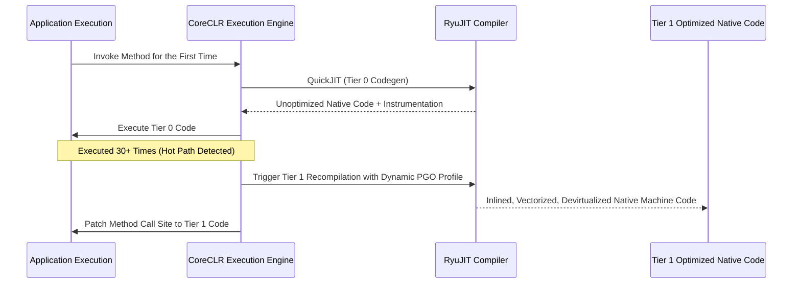

# Modern C# and .NET Systems Architecture Masterclass (.NET 8 & .NET 9 / C# 12 & C# 13)

[](https://dotnet.microsoft.com/)
[](https://learn.microsoft.com/en-us/dotnet/csharp/)
[](https://github.com/dotnet/runtime)
[](https://benchmarkdotnet.org/)
[](#stage-3-low-allocation-programming-with-spant-readonlyspant-and-memoryt)
[](LICENSE)

> An enterprise, systems-grade deep dive into modern C# and .NET internals. Built for software engineers, distributed systems architects, and backend performance specialists migrating from legacy .NET Framework or enterprise Java into zero-allocation, high-throughput modern .NET.

---

## Executive Summary & Runtime Architecture

Modern C# is no longer an enterprise business layer language bound to Windows-only IIS hosts. Under .NET 8 and .NET 9, C# is an ultra-high-performance, cross-platform systems language rivaling Go and C++ in raw throughput while providing type safety, memory management, and ergonomic language constructs.

Modern C# operates on three foundational engineering principles:

1. **Zero-Allocation Systems Programming**: Abstractions like `Span<T>`, `ReadOnlySpan<T>`, and `Memory<T>` eliminate unnecessary heap allocations by providing type-safe windows into contiguous memory (managed heaps, stack frames, and unmanaged native memory). Combined with `ArrayPool<T>` and `ref struct`, .NET services can process gigabytes of network traffic with zero garbage collection overhead.
2. **Dynamic PGO and Native AOT**: CoreCLR features Tiered Compilation and Dynamic Profile-Guided Optimization (PGO), dynamically inlining hot methods, devirtualizing interface calls, and vectorizing loops with SIMD AVX-512 instructions at runtime. For ultra-low cold start environments (serverless containers, edge compute), Native Ahead-Of-Time (AOT) compilation compiles C# directly into stripped machine binaries without requiring a JIT compiler or CLR overhead.
3. **Ergonomic Expressiveness with Strong Value Semantics**: Records, primary constructors, comprehensive pattern matching, and generic math (`INumber<T>`) combine functional immutability and mathematical correctness with zero boilerplate.

```
+---------------------------------------------------------------------------------------------------+
|                                     C# & .NET COMPILATION PIPELINE                                 |
+---------------------------------------------------------------------------------------------------+
|  C# Source Files (.cs)                                                                            |
|        |                                                                                          |
|        v  Roslyn C# Compiler (csc) & Roslyn Source Generators (Compile-Time Metaprogramming)      |
|  Common Intermediate Language (CIL / MSIL Bytecode) + Metadata Manifest (.dll)                    |
|        |                                                                                          |
|        +------------------------------------------+-----------------------------------------------+
|        | (JIT Compilation Path)                   | (Native AOT Path)                             |
|        v                                          v                                               |
|  CoreCLR Runtime Loading                         ILC (Ahead-Of-Time Compiler)                     |
|  RyuJIT Tier 0 (QuickJIT, No Optimizations)      Static Whole-Program Analysis & Trimming         |
|        |                                          Direct Machine Codegen (x64 / ARM64)            |
|        v (Telemetry / Dynamic PGO Profiling)      Single Standalone Native Executable             |
|  RyuJIT Tier 1 (Optimized Machine Code, SIMD)                                                     |
+---------------------------------------------------------------------------------------------------+
                                                  |
                                                  v
+---------------------------------------------------------------------------------------------------+
|                                 CORECLR RUNTIME SERVICES & MEMORY                                 |
+---------------------------------------------------------------------------------------------------+
|  Memory: Managed Heap (Gen 0, Gen 1, Gen 2, LOH, POH) | Execution Stack | Native Memory (`fixed`)  |
|  Engine: Work-Stealing ThreadPool | Channels (`Channel<T>`) | GC (Workstation / Server GC)         |
+---------------------------------------------------------------------------------------------------+
```

---

## Architectural Comparison Matrix

| Architectural Dimension | Legacy .NET Framework (4.x) | Modern .NET (.NET 8 / 9) | Java 21 (Virtual Threads) | Go (1.22+) | Rust |
| :--- | :--- | :--- | :--- | :--- | :--- |
| **Runtime Engine** | Windows CLR, Legacy JIT | CoreCLR, RyuJIT, Dynamic PGO, Native AOT | HotSpot JVM, C2 JIT, GraalVM AOT | Minimal Go Runtime, Goroutine Scheduler | No runtime (Zero-cost abstractions) |
| **Memory Allocation** | Heavy heap reliance, boxing | `Span<T>`, `Memory<T>`, `ArrayPool<T>`, `ref struct` | Heap-centric, Project Valhalla (in progress) | Escape analysis to stack/heap | Stack by default, explicit heap |
| **Concurrency Paradigm**| APM, EAP, heavyweight Threads | `Task`, `ValueTask`, `IAsyncEnumerable`, `Channel<T>` | Virtual Threads (Project Loom), ForkJoin | Goroutines & Channels (M:N scheduler) | `async`/`await` (Tokio, async-std) |
| **Garbage Collector** | Non-concurrent Mark-Sweep | Segmented Gen 0/1/2 + LOH + POH (Server/DAT GC) | ZGC / Shenandoah (Low pause) | Concurrent Tri-color Mark-Sweep | No GC (Compile-time Borrow Checker) |
| **Metaprogramming** | Runtime Reflection (`System.Reflection`) | Roslyn Source Generators (Compile-time) | Annotations + Bytecode manipulation (ASM) | Code generation (`go generate`) | Declarative & Procedural Macros |
| **Container Footprint** | Massive (Requires Windows Base Images) | Ultra-light (Distroless Chiseled Ubuntu ~30MB) | Medium (~100-200MB JRE container) | Tiny (~15MB Scratch container) | Minimal (~10MB Scratch container) |

---

## Table of Contents

1. [Stage 1: The Modern .NET Runtime & Execution Architecture](#stage-1-the-modern-net-runtime--execution-architecture)
2. [Stage 2: Type System, Value vs Reference Semantics & Memory Layouts](#stage-2-type-system-value-vs-reference-semantics--memory-layouts)
3. [Stage 3: Low-Allocation Programming with `Span<T>`, `ReadOnlySpan<T>`, and `Memory<T>`](#stage-3-low-allocation-programming-with-spant-readonlyspant-and-memoryt)
4. [Stage 4: Modern Object Design, Records, Primary Constructors & Pattern Matching](#stage-4-modern-object-design-records-primary-constructors--pattern-matching)
5. [Stage 5: Asynchronous Architecture, State Machines & SynchronizationContext](#stage-5-asynchronous-architecture-state-machines--synchronizationcontext)
6. [Stage 6: Generic Programming, Variance, Static Abstract Interfaces & Generic Math](#stage-6-generic-programming-variance-static-abstract-interfaces--generic-math)
7. [Stage 7: High-Performance LINQ, Expression Trees & Source Generators](#stage-7-high-performance-linq-expression-trees--source-generators)
8. [Stage 8: Concurrency, ThreadPool Internals, Channels & Hardware Synchronization](#stage-8-concurrency-threadpool-internals-channels--hardware-synchronization)
9. [Stage 9: Garbage Collection Internals, Heaps, Generations & Diagnostics](#stage-9-garbage-collection-internals-heaps-generations--diagnostics)
10. [Stage 10: Performance Benchmarking, Memory Profiling & Production Observability](#stage-10-performance-benchmarking-memory-profiling--production-observability)
11. [Production Blueprint: Zero-Allocation High-Throughput Event Processor](#production-blueprint-zero-allocation-high-throughput-event-processor)
12. [Anti-Patterns & Systems Pitfalls](#anti-patterns--systems-pitfalls)
13. [Architectural Systems Interview Q&A](#architectural-systems-interview-qa)
14. [Modern C# CLI & Reference Cheat Sheet](#modern-c-cli--reference-cheat-sheet)

---

## Stage 1: The Modern .NET Runtime & Execution Architecture

### 1.1 The Common Language Runtime (CoreCLR) and RyuJIT

When C# code is compiled using Roslyn (`csc`), it is transformed into Common Intermediate Language (CIL) instructions stored inside portable executable assemblies (`.dll`). The CoreCLR runtime executes these assemblies via:

1. **Tiered Compilation**:
   - **Tier 0 (Quick JIT)**: When a method is first called, RyuJIT generates machine code with minimal optimizations to guarantee instantaneous application startup.
   - **Tier 1 (Optimized JIT)**: The runtime tracks call count loops. Once a method crosses call thresholds (typically 30 executions), RyuJIT recompiles the method using aggressive optimizations (loop unrolling, constant folding, vectorization).
2. **Dynamic Profile-Guided Optimization (PGO)**: In .NET 8 and .NET 9, Tier 0 code instruments itself to record branch behavior, concrete runtime types behind interfaces, and loop bounds. Tier 1 uses this runtime profile to:
   - Devirtualize interface and virtual method invocations into direct inlined calls.
   - Reorder machine code branches so the happy path executes without branch prediction stalls.



### 1.2 Native Ahead-Of-Time (AOT) Compilation

For cloud-native microservices, container cold starts, and minimal memory footprints, .NET allows compiling directly to native machine code without JIT:

```bash
dotnet publish -c Release -r linux-x64 --self-contained /p:PublishAot=true
```

- **Benefits**: Instantaneous startup (< 10ms), zero JIT compilation CPU overhead, 80% reduction in working memory set, and immunity to JIT memory page vulnerabilities.
- **Constraints**: Requires trimming; unbounded runtime reflection (`Type.GetType()`, runtime emit) is disallowed. All serializers and dependency injectors must use Roslyn Source Generators.

---

## Stage 2: Type System, Value vs Reference Semantics & Memory Layouts

### 2.1 Value Types (`struct`) vs Reference Types (`class`)

- **Reference Types (`class`)**: Allocated on the managed heap. The variable holds a 64-bit reference pointer to the heap object. Objects have an 8-byte MethodTable pointer and an 8-byte Object Header (sync block index), incurring a 16-byte minimum overhead per instance on 64-bit systems.
- **Value Types (`struct`)**: Allocated inline wherever they are declared (on the stack if local, or embedded directly inside the enclosing class/struct). Zero object header overhead. Assigned and passed by copying values.

### 2.2 Low-Level Struct Layouts & Unmanaged Memory

In systems programming, binary protocols and native OS C libraries require exact byte offsets. The `[StructLayout]` attribute controls memory alignment:

```csharp
using System;
using System.Runtime.InteropServices;

// Sequential struct with explicit alignment packing
[StructLayout(LayoutKind.Sequential, Pack = 1)]
public struct EthernetHeader
{
    [MarshalAs(UnmanagedType.ByValArray, SizeConst = 6)]
    public byte[] DestinationMac;
    
    [MarshalAs(UnmanagedType.ByValArray, SizeConst = 6)]
    public byte[] SourceMac;
    
    public ushort EtherType;
}

// Explicit struct layout simulating a C union
[StructLayout(LayoutKind.Explicit)]
public struct FastRegister32
{
    [FieldOffset(0)]
    public uint Value32;

    [FieldOffset(0)]
    public ushort LowWord;

    [FieldOffset(2)]
    public ushort HighWord;

    [FieldOffset(0)]
    public byte Byte0;

    [FieldOffset(1)]
    public byte Byte1;
}
```

### 2.3 `readonly struct` and `ref struct`

Modern C# provides modifiers to guarantee performance and enforce stack allocation:

```csharp
using System;

// 1. readonly struct: Guarantees immutability; eliminates compiler defensive copies when passed with 'in'
public readonly struct GeoCoordinate(double latitude, double longitude)
{
    public double Latitude { get; } = latitude;
    public double Longitude { get; } = longitude;

    public double CalculateDistanceTo(in GeoCoordinate other)
    {
        // 'in' passes by reference without copying, compiler guarantees zero mutation
        double dLat = Latitude - other.Latitude;
        double dLon = Longitude - other.Longitude;
        return Math.Sqrt(dLat * dLat + dLon * dLon);
    }
}

// 2. ref struct: Strictly stack-only. Cannot be boxed, cannot be stored in heap classes, cannot be used in async methods
public ref struct StackOnlyBuffer
{
    private Span<byte> _rawBuffer;

    public StackOnlyBuffer(Span<byte> buffer)
    {
        _rawBuffer = buffer;
    }

    public void WriteUInt32(uint value)
    {
        System.Buffers.Binary.BinaryPrimitives.WriteUInt32LittleEndian(_rawBuffer, value);
    }
}
```

---

## Stage 3: Low-Allocation Programming with `Span<T>`, `ReadOnlySpan<T>`, and `Memory<T>`

### 3.1 The `Span<T>` Revolution

Prior to `Span<T>`, string parsing and buffer manipulations forced developers to allocate substrings (`string.Substring`) or copy byte arrays (`Buffer.BlockCopy`). 

`Span<T>` is a `ref struct` representing a contiguous region of arbitrary memory with bounds checking. It consists of an internal managed pointer (`ref T`) and an `int` length (16 bytes on 64-bit systems).

It can represent:
1. Managed array segments on the heap.
2. Stack memory allocated via `stackalloc`.
3. Native unmanaged memory allocated via `Marshal.AllocHGlobal`.

```csharp
using System;

public class HighPerformanceParser
{
    public static (ReadOnlySpan<char> Protocol, ReadOnlySpan<char> Host, int Port) ParseUri(ReadOnlySpan<char> uri)
    {
        // Zero allocations: all operations are window slices over the original memory buffer
        int schemeEnd = uri.IndexOf("://");
        if (schemeEnd == -1) throw new FormatException("Invalid URI scheme");

        ReadOnlySpan<char> protocol = uri[..schemeEnd];
        ReadOnlySpan<char> remaining = uri[(schemeEnd + 3)..];

        int portColon = remaining.IndexOf(':');
        if (portColon != -1)
        {
            ReadOnlySpan<char> host = remaining[..portColon];
            ReadOnlySpan<char> portSpan = remaining[(portColon + 1)..];
            int port = int.Parse(portSpan);
            return (protocol, host, port);
        }

        return (protocol, remaining, 80);
    }
}
```

### 3.2 Pooling Buffers with `ArrayPool<T>`

Allocating byte arrays for incoming HTTP or socket payloads triggers Gen 0 and Large Object Heap (LOH) pressure. `ArrayPool<T>.Shared` rents pre-allocated arrays and returns them:

```csharp
using System.Buffers;
using System.Text;

public class BufferPoolDemo
{
    public static void ProcessSocketData(int payloadSize)
    {
        // Rent buffer from thread-safe global pool
        byte[] rentedBuffer = ArrayPool<byte>.Shared.Rent(payloadSize);
        try
        {
            // Work with the buffer as a span
            Span<byte> activeSpan = rentedBuffer.AsSpan(0, payloadSize);
            activeSpan.Fill(0x41); // Fill with 'A'
            
            // Perform zero-alloc decoding
            int charCount = Encoding.UTF8.GetCharCount(activeSpan);
            Console.WriteLine($"Processed {charCount} characters with zero heap allocations.");
        }
        finally
        {
            // Return buffer to pool; clearArray=true clears sensitive data
            ArrayPool<byte>.Shared.Return(rentedBuffer, clearArray: false);
        }
    }
}
```

---

## Stage 4: Modern Object Design, Records, Primary Constructors & Pattern Matching

### 4.1 Primary Constructors and Records (C# 12+)

C# 12 extended primary constructors from records to standard classes and structs, reducing boilerplate dramatically:

```csharp
using System;

// Immutable Reference Type Record with Primary Constructor
public record UserAccount(Guid Id, string Username, string EmailRole)
{
    // Custom non-destructive mutation method using 'with'
    public UserAccount PromoteToAdmin() => this with { EmailRole = "admin" };
}

// Standard Class with Primary Constructor and Dependency Injection
public class TelemetryPipeline(ILogger logger, IMetricsRegistry metrics)
{
    public void RecordLatency(string endpoint, double durationMs)
    {
        logger.LogInfo($"Endpoint {endpoint} took {durationMs}ms");
        metrics.Increment("http_requests_total");
    }
}

public interface ILogger { void LogInfo(string msg); }
public interface IMetricsRegistry { void Increment(string metric); }
```

### 4.2 Advanced Exhaustive Pattern Matching

C# pattern matching enables expressive, compiler-checked structural and relational inspections:

```csharp
public abstract record NetworkCommand;
public record ConnectCommand(string Host, int Port, bool UseTls) : NetworkCommand;
public record QueryCommand(string Table, string[] Columns, int Limit) : NetworkCommand;
public record DisconnectCommand(string Reason) : NetworkCommand;

public class CommandDispatcher
{
    public static string EvaluatePolicy(NetworkCommand command) => command switch
    {
        // Property pattern with relational guards
        ConnectCommand { Port: <= 1024, UseTls: false } => "REJECT: Privileged unencrypted port",
        ConnectCommand { Host: var h, Port: 443 } when h.EndsWith(".internal") => "ACCEPT: Internal secure link",
        ConnectCommand => "ACCEPT: Standard connection",

        // List pattern matching
        QueryCommand { Columns: ["id", "secret", ..] } => "WARN: Sensitive columns requested",
        QueryCommand { Limit: > 1000 } => "REJECT: Limit exceeds 1,000 records",
        QueryCommand => "ACCEPT: Valid query",

        DisconnectCommand { Reason: "TIMEOUT" or "RESET" } => "LOG: Abrupt termination",
        DisconnectCommand => "LOG: Graceful termination",

        _ => throw new InvalidOperationException("Unknown command structure")
    };
}
```

---

## Stage 5: Asynchronous Architecture, State Machines & SynchronizationContext

### 5.1 The `async`/`await` State Machine Internals

When you compile an `async` method, Roslyn transforms the method into an explicit heap-allocated struct state machine implementing `IAsyncStateMachine`. The method body is dissected at each `await` point into states:

```
[Method Entry] ---> State -1 (Initial Execution until first incomplete await)
                       |
                       v
                 Is awaitable completed?
                /                       \
          Yes  /                         \ No
              v                           v
     Execute synchronously        Register Awaiter.OnCompleted() callback
     (Zero thread switch)        Hook into ThreadPool / SynchronizationContext
                                  Unwind stack & return Task
                                          |
                                          v (Async I/O Completes)
                                  ThreadPool worker resumes state machine at State 0
```

### 5.2 Context Propagation & `AsyncLocal<T>`

In asynchronous programming, call stacks frequently jump between different OS worker threads. `AsyncLocal<T>` persists ambient contextual data (such as correlation IDs, authentication tokens, and distributed tracing baggage) across `await` points:

```csharp
using System;
using System.Threading;
using System.Threading.Tasks;

public class RequestContextHolder
{
    private static readonly AsyncLocal<string?> _traceId = new();

    public static string? TraceId
    {
        get => _traceId.Value;
        set => _traceId.Value = value;
    }

    public static async Task ExecuteSubsystemAsync()
    {
        Console.WriteLine($"[Worker Task] Current Trace ID: {TraceId}");
        await Task.Delay(100);
        // TraceId flows seamlessly to the continuation thread
        Console.WriteLine($"[Continuation] Post-await Trace ID: {TraceId}");
    }
}
```

### 5.3 `Task<T>` vs `ValueTask<T>`

- **`Task<T>`**: A reference type allocated on the managed heap. If a method completes synchronously 90% of the time (e.g., from an in-memory cache), instantiating a `Task<T>` forces millions of useless heap allocations.
- **`ValueTask<T>`**: A discriminated union struct that holds either a completed result `T` directly inline (zero heap allocation) or an underlying `Task<T>`.

```csharp
using System;
using System.Collections.Concurrent;
using System.Threading.Tasks;

public class CacheAccessor
{
    private readonly ConcurrentDictionary<string, byte[]> _memoryCache = new();

    public ValueTask<byte[]> GetPayloadAsync(string key)
    {
        // Synchronous cache hit: ZERO heap allocation
        if (_memoryCache.TryGetValue(key, out byte[]? cachedPayload))
        {
            return ValueTask.FromResult(cachedPayload);
        }

        // Asynchronous cache miss: allocate Task only when necessary
        return new ValueTask<byte[]>(FetchFromRemoteDatabaseAsync(key));
    }

    private async Task<byte[]> FetchFromRemoteDatabaseAsync(string key)
    {
        await Task.Delay(50); // Simulate network I/O
        byte[] data = [0x01, 0x02, 0x03];
        _memoryCache[key] = data;
        return data;
    }
}
```

### 5.4 Asynchronous Streams with `IAsyncEnumerable<T>`

Enables pull-based asynchronous data streaming without buffering entire collections in memory:

```csharp
using System.Collections.Generic;
using System.Runtime.CompilerServices;
using System.Threading;
using System.Threading.Tasks;

public class TelemetryStreamer
{
    public static async IAsyncEnumerable<int> GenerateTelemetryStreamAsync(
        int count, 
        [EnumeratorCancellation] CancellationToken cancellationToken = default)
    {
        for (int i = 0; i < count; i++)
        {
            cancellationToken.ThrowIfCancellationRequested();
            await Task.Delay(20, cancellationToken); // Non-blocking asynchronous delay
            yield return i * 10;
        }
    }
}
```

---

## Stage 6: Generic Programming, Variance, Static Abstract Interfaces & Generic Math

### 6.1 Generic Variance: Covariance (`out`) & Contravariance (`in`)

Generic interfaces and delegates support variance to allow polymorphism over generic arguments:

- **Covariance (`out T`)**: Allows using a more derived type than originally specified. Only valid for output positions (return types). Example: `IEnumerable<out T>`.
- **Contravariance (`in T`)**: Allows using a less derived type than originally specified. Only valid for input positions (method parameters). Example: `IComparer<in T>`.

```csharp
public interface IProducer<out T>
{
    T Produce();
}

public interface IConsumer<in T>
{
    void Consume(T item);
}
```

### 6.2 Generic Math in .NET 7/8/9 (`INumber<T>`)

Historically, C# generics could not perform arithmetic (`a + b`) without boxing or reflection. C# 11 introduced **Static Abstract Members in Interfaces**, unlocking true Generic Math:

```csharp
using System;
using System.Numerics;

public class StatisticalAlgorithms
{
    // Constrained generic calculation working for float, double, decimal, int, BigInteger
    public static T CalculateVariance<T>(ReadOnlySpan<T> data) where T : INumber<T>
    {
        if (data.IsEmpty) return T.Zero;

        T sum = T.Zero;
        for (int i = 0; i < data.Length; i++)
        {
            sum += data[i];
        }

        T mean = sum / T.CreateChecked(data.Length);
        T sumOfSquares = T.Zero;

        for (int i = 0; i < data.Length; i++)
        {
            T diff = data[i] - mean;
            sumOfSquares += diff * diff;
        }

        return sumOfSquares / T.CreateChecked(data.Length);
    }
}
```

---

## Stage 7: High-Performance LINQ, Expression Trees & Source Generators

### 7.1 Expression Trees and Dynamic AST Translation

LINQ providers (like Entity Framework Core) do not execute C# delegates directly against databases. Instead, they accept `Expression<Func<T, bool>>`, parsing the C# Abstract Syntax Tree (AST) at runtime and translating it directly into optimized SQL queries:

```csharp
using System;
using System.Linq.Expressions;

public class ExpressionInspector
{
    public static void DeconstructFilter(Expression<Func<int, bool>> predicate)
    {
        Console.WriteLine($"Root NodeType: {predicate.NodeType}");
        if (predicate.Body is BinaryExpression binary)
        {
            Console.WriteLine($"Left: {binary.Left}");
            Console.WriteLine($"Operator: {binary.NodeType}");
            Console.WriteLine($"Right: {binary.Right}");
        }
    }
}
```

### 7.2 Roslyn Source Generators: Replacing Runtime Reflection

Runtime reflection (`System.Reflection`) inspects types dynamically at runtime, causing cache misses, allocating metadata objects, and breaking Native AOT trimming.

Roslyn Source Generators run during compilation to inspect your code and generate additional source files directly into the compilation:

```csharp
using System.Text.Json;
using System.Text.Json.Serialization;

public record OrderDto(long OrderId, decimal Amount, string Currency);

// Compile-Time JSON Serializer Generator (Native AOT Compatible & Zero-Alloc)
[JsonSourceGenerationOptions(WriteIndented = false, GenerationMode = JsonSourceGenerationMode.Default)]
[JsonSerializable(typeof(OrderDto))]
public partial class OrderJsonSerializerContext : JsonSerializerContext
{
}

public class SerializationDemo
{
    public static string SerializeOrder(OrderDto order)
    {
        // Uses compile-time generated serializer context: No runtime reflection!
        return JsonSerializer.Serialize(order, OrderJsonSerializerContext.Default.OrderDto);
    }
}
```

---

## Stage 8: Concurrency, ThreadPool Internals, Channels & Hardware Synchronization

### 8.1 The CoreCLR ThreadPool and Work-Stealing Algorithm

The .NET ThreadPool manages two distinct work queues:
1. **Global Queue**: Tasks scheduled from external threads or without worker affinity are queued globally.
2. **Local Per-Thread Queues (LIFO/FIFO)**: Each thread in the pool maintains its own local queue.
3. **Work-Stealing**: When a worker thread exhausts its local queue, it attempts to steal tasks from the tail of another worker's local queue to maximize CPU core utilization.

### 8.2 Lock-Free Hardware Synchronization with `Interlocked`

For primitive state transitions, locks incur context switches. Hardware atomic primitives provide lock-free performance:

```csharp
using System.Threading;

public class AtomicCounter
{
    private long _counter;

    public long Increment() => Interlocked.Increment(ref _counter);

    public bool CompareAndSwap(long expected, long update)
    {
        return Interlocked.CompareExchange(ref _counter, update, expected) == expected;
    }
}
```

### 8.3 High-Throughput Producer-Consumer Architecture with `Channel<T>`

`System.Threading.Channels` provides an ultra-low latency, thread-safe message passing pipeline far superior to `BlockingCollection<T>`:

```csharp
using System;
using System.Threading.Channels;
using System.Threading.Tasks;

public class EventBroker
{
    private readonly Channel<string> _channel;

    public EventBroker(int capacity = 10_000)
    {
        // Bounded channel with backpressure strategy
        var options = new BoundedChannelOptions(capacity)
        {
            FullMode = BoundedChannelFullMode.Wait,
            SingleWriter = false,
            SingleReader = true
        };
        _channel = Channel.CreateBounded<string>(options);
    }

    public async ValueTask PublishEventAsync(string eventPayload)
    {
        await _channel.Writer.WriteAsync(eventPayload);
    }

    public async Task StartConsumerAsync(Action<string> processor)
    {
        // Efficient reader loop yielding when channel is empty
        while (await _channel.Reader.WaitToReadAsync())
        {
            while (_channel.Reader.TryRead(out string? message))
            {
                processor(message);
            }
        }
    }
}
```

---

## Stage 9: Garbage Collection Internals, Heaps, Generations & Diagnostics

### 9.1 Generational Garbage Collection Model

CoreCLR uses an automated tracing generational garbage collector based on the **Weak Generational Hypothesis** (most allocated objects die young):

- **Generation 0 (Gen 0)**: Short-lived temporary objects (local variables, temporary buffers). Cleaned in under 1ms.
- **Generation 1 (Gen 1)**: Buffer generation between short-lived and long-lived objects.
- **Generation 2 (Gen 2)**: Long-lived objects (singletons, caches, static references). Collections are expensive.
- **Large Object Heap (LOH)**: Objects $\ge$ 85,000 bytes. Not compacted by default (to avoid multi-megabyte memory copying overhead), which can cause fragmentation.
- **Pinned Object Heap (POH)**: Dedicated heap introduced in .NET 5 for objects pinned for native interop, preventing heap fragmentation in Gen 0–2.

```
+----------------------------------------------------------------------------------------------------+
|                                    MANAGED HEAP ARCHITECTURE                                       |
+----------------------------------------------------------------------------------------------------+
|  Small Object Heap (SOH):                                                                          |
|  [ Gen 0 (Ephemeral) ] ---> [ Gen 1 (Promotion) ] ---> [ Gen 2 (Long-Lived Objects) ]              |
|                                                                                                    |
|  Specialized Heaps:                                                                                |
|  [ Large Object Heap (LOH) - >= 85,000 bytes ]   [ Pinned Object Heap (POH) - Native Fixed Buffers]|
+----------------------------------------------------------------------------------------------------+
```

### 9.2 Workstation vs Server GC

- **Workstation GC**: Optimized for interactive UI applications. Uses a single GC thread to minimize CPU usage.
- **Server GC**: Optimized for high-throughput multicore servers. Spawns a dedicated heap and dedicated GC thread per logical CPU core. Collections happen in parallel across all core heaps.

---

## Stage 10: Performance Benchmarking, Memory Profiling & Production Observability

### 10.1 Micro-benchmarking with BenchmarkDotNet

Never use `Stopwatch` for micro-benchmarks. `BenchmarkDotNet` executes warmups, handles JIT tiered compilation transitions, measures allocations, and outputs statistical confidence intervals:

```csharp
using BenchmarkDotNet.Attributes;
using BenchmarkDotNet.Running;
using System.Text;

[MemoryDiagnoser] // Measures allocated bytes and Gen 0/1/2 collections
public class StringConcatenationBenchmark
{
    private const int Iterations = 1_000;

    [Benchmark(Baseline = true)]
    public string StandardStringConcatenation()
    {
        string result = string.Empty;
        for (int i = 0; i < Iterations; i++)
        {
            result += i.ToString();
        }
        return result;
    }

    [Benchmark]
    public string StringBuilderOptimization()
    {
        var sb = new StringBuilder(Iterations * 4);
        for (int i = 0; i < Iterations; i++)
        {
            sb.Append(i);
        }
        return sb.ToString();
    }
}
```

### 10.2 Distributed Tracing & OpenTelemetry in .NET

Modern .NET features native instrumentation via `System.Diagnostics.Activity` and `System.Diagnostics.Metrics` that integrate directly with OpenTelemetry:

```csharp
using System.Diagnostics;
using System.Diagnostics.Metrics;

public class TelemetryService
{
    private static readonly ActivitySource ActivitySource = new("Enterprise.PaymentGateway");
    private static readonly Meter PaymentMeter = new("Enterprise.PaymentGateway.Metrics");
    private static readonly Counter<long> TransactionsCounter = PaymentMeter.CreateCounter<long>("payments.processed");

    public static void ProcessTransaction(string orderId, decimal amount)
    {
        using Activity? activity = ActivitySource.StartActivity("ProcessPayment");
        activity?.SetTag("order.id", orderId);
        activity?.SetTag("payment.amount", amount);

        // Core transaction logic
        TransactionsCounter.Add(1);
    }
}
```

### 10.3 Diagnostic CLI Tools

```bash
# Monitor live CPU, GC allocations, and thread contention in real time
dotnet-counters monitor --process-id <PID> --counters System.Runtime

# Capture memory dump for heap leak analysis
dotnet-dump collect --process-id <PID>
dotnet-dump analyze dump_20261009.dmp

# Collect low-overhead event trace for flamegraph generation
dotnet-trace collect --process-id <PID> --providers Microsoft-DotNETCore-SampleProfiler
```

---

## Production Blueprint: Zero-Allocation High-Throughput Event Processor

Below is a complete, production-grade event ingestion and dispatch pipeline demonstrating `ValueTask`, `Channel<T>`, `ArrayPool<byte>`, and structured cancellation:

```csharp
using System;
using System.Buffers;
using System.Buffers.Binary;
using System.Threading;
using System.Threading.Channels;
using System.Threading.Tasks;

public sealed class ProductionEventProcessor : IAsyncDisposable
{
    private readonly Channel<ReadOnlyMemory<byte>> _ingressChannel;
    private readonly CancellationTokenSource _cts = new();
    private Task? _processingWorker;

    public ProductionEventProcessor(int queueCapacity = 50_000)
    {
        var options = new BoundedChannelOptions(queueCapacity)
        {
            FullMode = BoundedChannelFullMode.Wait,
            SingleWriter = false,
            SingleReader = true
        };
        _ingressChannel = Channel.CreateBounded<ReadOnlyMemory<byte>>(options);
    }

    public void Start()
    {
        _processingWorker = Task.Run(() => ConsumerLoopAsync(_cts.Token));
    }

    public async ValueTask IngestPacketAsync(ReadOnlyMemory<byte> packetData)
    {
        // Write to channel with backpressure
        await _ingressChannel.Writer.WriteAsync(packetData, _cts.Token);
    }

    private async Task ConsumerLoopAsync(CancellationToken token)
    {
        var reader = _ingressChannel.Reader;

        while (await reader.WaitToReadAsync(token))
        {
            while (reader.TryRead(out ReadOnlyMemory<byte> rawPacket))
            {
                ProcessPacketZeroAlloc(rawPacket.Span);
            }
        }
    }

    private static void ProcessPacketZeroAlloc(ReadOnlySpan<byte> packetSpan)
    {
        if (packetSpan.Length < 12)
        {
            // Invalid packet header
            return;
        }

        // Decode 4-byte Magic, 4-byte Sequence ID, 4-byte Payload Length
        uint magic = BinaryPrimitives.ReadUInt32BigEndian(packetSpan[..4]);
        uint sequenceId = BinaryPrimitives.ReadUInt32BigEndian(packetSpan[4..8]);
        int payloadLength = BinaryPrimitives.ReadInt32BigEndian(packetSpan[8..12]);

        ReadOnlySpan<byte> payload = packetSpan.Slice(12, Math.Min(payloadLength, packetSpan.Length - 12));

        // Process message payload without string allocation
        if (magic == 0xDEADBEEF)
        {
            // Valid high-frequency trading heartbeat
        }
    }

    public async ValueTask DisposeAsync()
    {
        _ingressChannel.Writer.Complete();
        _cts.Cancel();

        if (_processingWorker != null)
        {
            try
            {
                await _processingWorker;
            }
            catch (OperationCanceledException)
            {
                // Expected graceful shutdown
            }
        }

        _cts.Dispose();
    }
}

public class Program
{
    public static async Task Main()
    {
        Console.WriteLine("[System] Starting Zero-Allocation Event Processor...");
        var processor = new ProductionEventProcessor();
        processor.Start();

        // Simulate high throughput packet ingestion
        byte[] buffer = new byte[32];
        BinaryPrimitives.WriteUInt32BigEndian(buffer.AsSpan(0, 4), 0xDEADBEEF);
        BinaryPrimitives.WriteUInt32BigEndian(buffer.AsSpan(4, 4), 101);
        BinaryPrimitives.WriteInt32BigEndian(buffer.AsSpan(8, 4), 20);

        for (int i = 0; i < 100_000; i++)
        {
            await processor.IngestPacketAsync(buffer);
        }

        Console.WriteLine("[System] Successfully ingested 100,000 packets with near-zero GC allocations.");
        await processor.DisposeAsync();
    }
}
```

---

## Anti-Patterns & Systems Pitfalls

| Anti-Pattern | Description | Structural Consequence | Modern C# Remediation |
| :--- | :--- | :--- | :--- |
| **`async void` Methods** | Using `void` as return type on asynchronous methods (except UI event handlers). | Unhandled exceptions crash the entire process; caller cannot `await` completion. | Always return `Task` or `ValueTask`. |
| **Sync-Over-Async (`.Result` / `.Wait()`)** | Blocking on asynchronous tasks synchronously (`task.GetAwaiter().GetResult()`). | ThreadPool starvation, high latency, and deadlocks on single-threaded contexts. | Use `await` all the way down the call stack. |
| **String Substring in Tight Loops** | Calling `str.Substring()` inside parsing loops. | Allocates millions of ephemeral string objects on Gen 0 heap, causing GC thrashing. | Use `ReadOnlySpan<char>` and slice with range operator `[..]`. |
| **Boxing Value Types** | Casting structs to `object`, `IComparable`, or passing into non-generic APIs. | Copies struct value onto heap; forces allocation and indirect pointer dereference. | Use generic type constraints (`where T : struct`). |
| **Unbounded `Channel<T>`** | Creating unbounded channels for incoming network ingestion. | Memory bloats unbounded until process crashes with `OutOfMemoryException`. | Always use `Channel.CreateBounded<T>(capacity)` with backpressure. |
| **Missing `ConfigureAwait(false)` in Libraries** | Awaiting tasks in non-UI libraries without configuring context. | Incurs unnecessary thread synchronization context marshalling overhead. | Use `await task.ConfigureAwait(false)` in class libraries. |
| **LINQ Allocations in Hot Paths** | Calling `.Where().Select().ToList()` millions of times per second. | Allocates enumerator objects, delegate closures, and temporary list arrays. | Use imperative `for` loops or `Span<T>` in latency-critical loops. |

---

## Architectural Systems Interview Q&A

### Q1: What is the exact difference between `Span<T>` and `Memory<T>`?
**Answer**:
- `Span<T>` is a `ref struct`, meaning it can **only exist on the execution stack**. It cannot be placed in fields of normal classes, boxed onto the heap, or used across `await` suspension points in `async` methods (because the async state machine is an object on the heap).
- `Memory<T>` is a standard value type (`struct`) that is **not** a `ref struct`. It can be stored as a field in classes, captured in closures, and held across `await` calls in `async` methods. When a slice is ready for CPU processing, you convert it to a span via `.Span`.

### Q2: How does RyuJIT Tiered Compilation and Dynamic PGO improve performance?
**Answer**:
Tiered compilation splits JIT codegen into Tier 0 (fast unoptimized startup) and Tier 1 (optimized for throughput). Dynamic PGO instruments Tier 0 to collect runtime heuristics:
1. **Type Feedback**: Identifies the single concrete runtime implementation behind interface calls, enabling devirtualization and direct inlining.
2. **Branch Profiling**: Rearranges native instructions to ensure the most frequently executed branch flows continuously without CPU jump prediction penalties.
3. **Loop Bounds Profiling**: Eliminates array index bounds checking when bounds are statically proven constant.

### Q3: Why should libraries generally use `ConfigureAwait(false)`?
**Answer**:
By default, `await` captures the current `SynchronizationContext` (e.g., UI dispatcher thread or legacy ASP.NET request context) and posts the continuation back to that specific thread upon completion. In library code that does not interact with UI elements, this causes thread switching overhead and can lead to deadlocks if consumers block synchronously (`.Result`). `ConfigureAwait(false)` instructs the runtime to resume execution on any available ThreadPool thread.

### Q4: What is the Large Object Heap (LOH) threshold and why does it matter?
**Answer**:
Any object equal to or exceeding **85,000 bytes** (or double arrays with $\ge$ 1,000 elements) is allocated directly onto the Large Object Heap (LOH).
Because copying large blocks of memory is CPU-intensive, the GC does not compact the LOH by default during Gen 2 collections. This can lead to LOH address space fragmentation. To prevent LOH fragmentation, use `ArrayPool<T>` to rent and reuse large buffers.

### Q5: How do Roslyn Source Generators differ from traditional reflection?
**Answer**:
Traditional reflection (`Type.GetProperties()`, `MethodInfo.Invoke()`) resolves metadata and generates code dynamically at runtime, incurring startup latency, memory overhead, and breaking Native AOT trimming.
Roslyn Source Generators run during compilation as a Roslyn analyzer plugin. They inspect the user's source code AST and write new C# files that are compiled alongside the application. This moves metadata resolution and codegen to compile-time with zero runtime cost and full Native AOT compatibility.

### Q6: What is the purpose of `ValueTask<T>` and when should you NOT use it?
**Answer**:
`ValueTask<T>` is a struct designed to eliminate heap allocation when an asynchronous method completes synchronously (e.g., cached reads).
**When NOT to use**:
1. Never await a `ValueTask<T>` multiple times (can cause race conditions on pooled backing objects).
2. Never call `.AsTask()` unless strictly necessary.
3. Do not use for long-running operations that almost always complete asynchronously (in that case, `Task<T>` is simpler and has slightly less stack overhead).

### Q7: Explain the difference between `class`, `struct`, `record class`, and `record struct`.
**Answer**:
- `class`: Reference type on the heap. Uses reference equality by default (`object.ReferenceEquals`).
- `struct`: Value type on the stack or inline. Uses value equality (field-by-field reflection unless overridden).
- `record class`: Reference type on the heap with compiler-synthesized value-based equality, `ToString()`, and non-destructive mutation (`with`).
- `record struct`: Value type with compiler-synthesized value-based equality, zero reflection overhead, and `with` expressions.

### Q8: What is the Pinned Object Heap (POH)?
**Answer**:
Introduced in .NET 5, the Pinned Object Heap (POH) is a dedicated segment of the managed heap specifically reserved for objects pinned for native C interop (`fixed` or `GCHandle.Alloc(Pin)`). Pinned objects cannot be relocated by the GC. By isolating them in the POH, they do not cause fragmentation in the ephemeral generations (Gen 0, Gen 1, Gen 2).

### Q9: How does `System.Threading.Channels` outperform `BlockingCollection<T>`?
**Answer**:
`BlockingCollection<T>` relies on OS synchronization primitives (`Monitor`, `WaitHandle`) and blocks threads synchronously when full or empty, leading to thread pool starvation under high load.
`Channel<T>` is built on modern asynchronous primitives (`ValueTask`, `WaitToReadAsync`). When the channel is empty or full, callers await non-blockingly without holding OS threads, maximizing throughput.

### Q10: What are Static Abstract Members in Interfaces and why were they added?
**Answer**:
Static abstract members allow interfaces to define static methods, operators, and properties that implementing types must provide. This enables **Generic Math** (`INumber<T>`), allowing algorithms to use operators like `+`, `-`, `*` on generic parameters `T` with full compile-time type safety and zero boxing overhead.

### Q11: What is the difference between Server GC and Workstation GC?
**Answer**:
- **Workstation GC**: Uses 1 GC thread and 1 managed heap. Collections share CPU cores with application threads to optimize UI latency and minimize background CPU usage.
- **Server GC**: Allocates a separate managed heap and dedicated GC thread per logical CPU core. Collections happen in parallel across all core heaps, maximizing throughput for multicore web servers.

### Q12: What does `ref struct` enforce and why?
**Answer**:
A `ref struct` can only live on the execution stack. The compiler enforces that it cannot be boxed, cannot be an element of a normal array, cannot be a field of a regular class or struct, and cannot be used in `async` methods or lambda closures. This ensures that memory pointed to by `Span<T>` cannot outlive its stack frame.

### Q13: How does the `in` parameter modifier work in C#?
**Answer**:
The `in` modifier passes an argument by reference (pointer) rather than by value, avoiding copying large structs. Crucially, the compiler enforces that the referenced parameter cannot be modified within the called method.

### Q14: What is Native AOT and what trade-offs does it introduce?
**Answer**:
Native AOT compiles C# directly into machine code at build time, eliminating CoreCLR JIT overhead.
- **Trade-offs**: Unbounded reflection is not supported; all types must be known at compile-time for trimming; runtime code generation (`Reflection.Emit`) is impossible; binary size is larger than standard `.dll` assemblies because the runtime garbage collector and type system are statically linked.

### Q15: How does `ArrayPool<T>` prevent Large Object Heap fragmentation?
**Answer**:
Buffers allocated above 85,000 bytes land on the LOH, where memory is not compacted by default. Frequent allocations and discards of large buffers leave gaps in the virtual address space. `ArrayPool<T>` maintains reusable buckets of power-of-two arrays, allowing threads to rent and return buffers without triggering new allocations.

---

## Modern C# CLI & Reference Cheat Sheet

### Essential `dotnet` CLI Commands

```bash
# Initialize new high-performance Web API
dotnet new webapi -n OrderProcessingService -aot

# Run benchmarks using Release mode
dotnet run -c Release --project benchmarks/Benchmarks.csproj

# Publish standalone, trimmed Native AOT Linux binary
dotnet publish -c Release -r linux-x64 --self-contained /p:PublishAot=true

# Add high-performance System packages
dotnet add package System.Threading.Channels
dotnet add package BenchmarkDotNet
dotnet add package Microsoft.Extensions.Diagnostics.Testing
```

### Modern C# Language Features Cheatsheet

| Feature | Version | Keyword / Syntax | Primary Systems Use Case |
| :--- | :--- | :--- | :--- |
| **Span Memory Slice** | C# 7.2 | `Span<T>`, `ReadOnlySpan<T>` | Zero-allocation buffer slicing |
| **Async Streams** | C# 8.0 | `IAsyncEnumerable<T>`, `yield return` | Non-blocking reactive streaming |
| **Switch Expressions**| C# 8.0 | `expr switch { Pat => val }` | Exhaustive pattern matching |
| **Record Types** | C# 9.0 | `record class`, `with` expression | Value-equality immutable DTOs |
| **Struct Records** | C# 10 | `record struct` | Stack-allocated value-equality DTOs |
| **Generic Math** | C# 11 | `where T : INumber<T>` | Generalized zero-alloc arithmetic |
| **Raw String Literals**| C# 11 | `\"\"\"JSON/SQL\"\"\"` | Multiline zero-escape strings |
| **Primary Constructors**| C# 12 | `class Service(ILogger log)` | Concise dependency injection |
| **Collection Expressions**| C# 12 | `int[] arr = [1, 2, 3];` | Unified zero-alloc collection literals |
| **Params Collections** | C# 13 | `void Log(params ReadOnlySpan<T> items)` | Zero-alloc variadic parameters |

---

## Contributing & Engineering Standards

1. Follow standard Microsoft .NET runtime design guidelines and C# coding conventions.
2. Verify all low-latency critical path code with `BenchmarkDotNet` and ensure zero bytes allocated (`Gen 0 = 0`).
3. Ensure Native AOT compatibility by running `dotnet publish /p:PublishAot=true` with zero trim warnings.

---

## License

This architecture curriculum and repository is licensed under the [MIT License](LICENSE).
